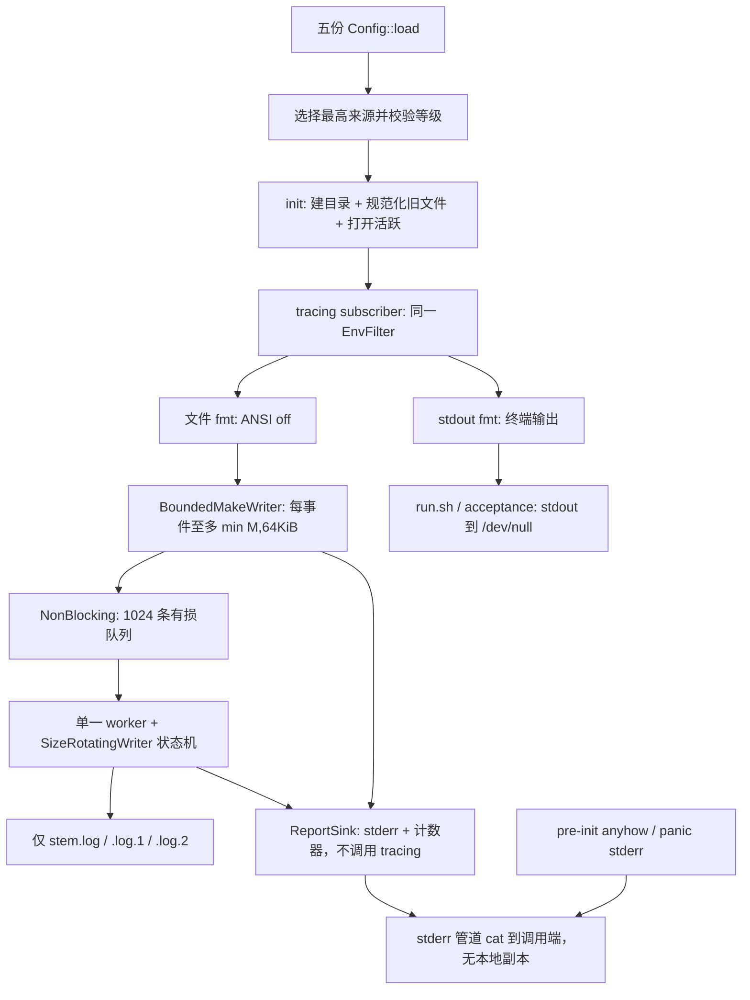

# 架构设计：子系统日志本地文件 rotate（addlog）

> 工序：F-AA，第 1 轮架构返工 + GATE1 复审 PASS 后的映射核对最小同步；分支基线 develop。
> 输入：`01-requirements.md`、`01-requirements-review.md`、`03-test-cases.md`（v1）、`02-architecture-review.md`（GATE2 REWORK，全文 §9 G2-1～8）。BRD：`velox-mono/docs/brd/001-addlog.md`。
> 状态：架构返工已定案；SA 已按 §9.2 完成四处限域修订（FR-4/AC-9、AC-3、FR-5），GATE1 定向复审 PASS（2026-11-26，见 `01-requirements-review.md` §R0），**需求已冻结**。本文件已在冻结基线上完成映射核对最小同步（逐项核对 FR-4/AC-9、AC-3、FR-5 与 §1 映射表，仅同步状态标注，无架构决策变更）。后续：TA 按 §6.3 回填 v1 用例（含 TC-13/TC-14→AC-9 映射），再次 GATE2 评审；未闭合前不交 DA 实施。
> 本工序只修改本文件；以下源码、脚本、ADR、规范与测试均是给 DA/TA 的实施清单，不是本轮已实现或已验证的功能。

## 1. 需求引用（FR/AC 编号映射）

| FR / NFR | 实现路径与约束 |
| --- | --- |
| FR-1 进程自身落盘 | D1，共享 `velox-log` 库，五个 main 统一初始化；tracing fmt 文本保留，文件禁 ANSI（§4.1/4.5）。超长事件例外按 §4.2 截断。 |
| FR-2 大小轮转与保留 | D2/D3，串行 writer 写前检查；活跃和两个归档各 ≤ M，只有三个本地日志文件；超长记录、旧超限文件和失败路径均受硬边界约束（§4.2/4.3）。 |
| FR-3 目录及命名 | D4/D5，默认 cwd/logs，文件/env 可覆盖，自动建目录；包名.log 和 .log.1/.log.2 固定；同包多实例分目录（§4.5/4.7）。 |
| FR-4 等级 | D6，`RUST_LOG > VELOX_*__LOG__LEVEL > 文件 > warn`，先选来源、只校验生效字符串；新渠道严格语法、空串拒绝；RUST_LOG 兼容语法（§4.4）。**FR-4/AC-9 已按 §9.2 由 SA 修订并冻结（GATE1 复审 PASS），与 §4.4 逐项一致**。 |
| FR-5 一致性和默认值 | 共享配置与解析；五份 config/main/toml 同步，旧配置及未知字段兼容。**FR-5 已冻结为五份实名默认 toml（core 三份 + demo-provider.toml/demo-consumer.toml），与 §4.5 表一致**（§9.2）。 |
| FR-6 规范与脚本 | D7/D8，脚本不再创建日志副本；stderr 管道直达调用端；mono 规范、README、ADR-0002 同步（§4.7）。 |
| NFR-1 / AC-13 | `M=200×1024×1024` 字节，保留含活跃共 3；总逻辑长度 ≤ 3M = 600 MiB，不留事件容差，不放宽 AC-13（§4.2/5）。 |
| NFR-2/NFR-5 | 有界有损队列和独立文件写线程；队列满/IO 故障允许丢弃并外显；业务任务先结束、guard 后释放，guard 等待有界而非无条件排空（§4.3/4.6）。 |
| NFR-3 | 保留 RUST_LOG 和活跃文件路径；正常旧文件续写；披露 info→warn、非法生效等级 fail-fast、超长截断及超限旧文件收敛（§5）。 |
| NFR-4 | 轮转、删除、截断、IO 错误走独立 stderr 报告及内存计数，**不调用 tracing、不回流队列**（§4.3.4）。 |
| NFR-6/NFR-7 | 集中 workspace 依赖、Rust 纯实现；Linux/macOS，采用 Unix 文件标识，不承诺 Windows；实际锁图与 MSRV 另验（§4.8）。 |

| AC | v1 TC 与设计路径 |
| --- | --- |
| AC-1 | TC-01：真实 registry 裸进程，触发 TTL 剔除 WARN；普通启动 INFO 不能作默认落盘证据。 |
| AC-2 | TC-02：core 三进程 + 两个 demo，五个确定包名，分别触发真实 WARN；库夹具补齐各等级精确探针。 |
| AC-3 | TC-04：写前检查、精确阈值、超长事件和旧超限文件；**AC-3 已按 §9.2 冻结块/容差定义（R=min(M,64 KiB)、0 超限容差、旧超限文件启动前收敛），与 §4.2 一致**。 |
| AC-4 | TC-05 + TC-03：含活跃 ≤3，归档计数、正常重启续写、失败中途重启。 |
| AC-5 | TC-06：§6.2 独立测试进程夹具，真实 subscriber + NonBlocking + 同一 writer，小阈值并发 HTTP 活体；不能以 writer 单测替代。 |
| AC-6/AC-7 | TC-08/TC-09：完整初始化中的 mkdir 和 Config→resolve→init，不以 writer::new 代替 mkdir 路径。 |
| AC-8 | TC-11/TC-12：INFO/WARN/正常 `error!` 探针；文件写失败的 stderr ERROR 不等价于文件中的 ERROR。 |
| AC-9 | TC-13/TC-14：四级优先级及合法高层覆盖非法低层；**SA/GATE1 已完成，冻结 AC-9 覆盖三渠道并存、高合法覆盖低非法、空串回落（与 §4.4 一致）；TA 回填 v1 时将 TC-13/TC-14 一并映射 AC-9**（§6.3）。 |
| AC-10 | TC-15：生效的空 LOG__LEVEL、warnn、错误模块指令失败，含实际值及唯一来源；RUST_LOG 按兼容分支单独断言。 |
| AC-11 | TC-18，TC-03 补 E5：旧配置和未知字段可用，正常文件不清空。 |
| AC-12 | TC-19：五份 dir/level 默认值 + 共享 M/KEEP 常量及注入单测 + CI；没有生产轮转参数/单位字符串解析。 |
| AC-13 | TC-07：所有该进程本地日志文件 `metadata.len()` 求和，≤3M；脚本不能产生额外副本，物理块占用另报。 |
| AC-14 | TC-23 + TC-20：规范、脚本、五份配置/README 与实际一致；显式 info 下启动必含字段仍齐备。 |

TC-16/TC-17 覆盖 off/五包一致，TC-21/TC-22 覆盖脚本与链路，TC-24/TC-25 覆盖故障恢复及无反馈运维报告。所有引用按当前 v1 编号，未修改 03。

## 2. 现状分析（相关模块与既有模式）

- 根 workspace 目前只有五个二进制：velox-mesh、velox-config、velox-registry、demo-provider、demo-consumer。`velox-log` 尚不存在，拟新增为共享库，不是第六个运行时子系统。
- 五个 `main.rs` 都在 Config::load 后使用 tracing-subscriber fmt + EnvFilter；非法 RUST_LOG 静默回退 info。此 feature 将默认值改 warn，生效非法等级改 fail-fast，必须披露。
- 五份 config 都是 TOML + 手写 env 覆盖，serde(default)，不设 deny_unknown_fields。存量 env_override 会过滤空字符串。**只对新 LOG__LEVEL 改用保留“已设置为空”的读取，不改变存量 env 惯例**。
- `scripts/run.sh` 当前把 stdout/stderr 合并追加 `logs/<crate>.log`，`scripts/common.sh` 切到仓库根、仅管理 registry/config/mesh。`velox-demo/scripts/acceptance.sh` 同样合流追加，还起第二个 provider。改名 stderr.log 仍会保留无限增长副本，因此本版完全移除这种本地重定向。
- provider 中后台任务 spawn 未保存 JoinHandle，正常退出时不保证先于日志 guard 结束。DA 须在入口保存并收尾这些句柄；这是日志生命周期接入的一部分，不改领域算法。其他入口逐个核对相同问题。
- 实查 development.md：集中依赖、架构变化随 ADR、默认配置与测试规范均适用；§3.4 的 INFO 启动语义不改，增补默认 warn 静默、显式 info 排障的说明（已闭合 RQ-2）。
- 当前 Cargo.lock 有 tracing-subscriber 0.3.23，无 tracing-appender/time/file-rotate。`rust-toolchain.toml` 的实际 channel 是 `stable`，注释写 1.100.0，**不是精确工具链版本锁**；workspace 声明 rust-version=1.80，不据注释宣称完整依赖图已适配。
- 测试沿用源文件内嵌 tests；临时目录由标准库创建（§6），本设计不依赖没有声明的测试 Uuid。

## 3. 方案总览

推荐：共享 `velox-log` + 自研硬边界轮转 writer + tracing-appender 0.2.4 非阻塞层；双 fmt 保留终端 stdout，但仓库后台脚本丢弃 stdout。pre-init/panic/运维 stderr 经匿名管道直达脚本调用端，不落第二份本地文件。



| 决策 | 定案 |
| --- | --- |
| D1 | 新共享库 velox-log，五包以 workspace path dependency 引用。 |
| D2 | 自研 writer 负责硬边界、重启规范化、明确的分阶段失败恢复；appender 仅负责队列/写线程。 |
| D3 | M=200 MiB，KEEP=3，生产不开放轮转参数；仅库内部构造允许测试注入。 |
| D4/D5 | cwd/logs + dir/env 覆盖；文件名=包名.log，归档固定 .1/.2；同包多实例分目录。 |
| D6 | 四级优先级；LOG__LEVEL/文件严格语法，RUST_LOG 保留 EnvFilter 兼容语法；校验只作用于生效值。 |
| D7 | 后台脚本 stdout=/dev/null，stderr 用管道回显；不创建 stderr.log/nohup.out/诊断归档。 |
| D8 | 默认 warn 的 INFO 启动行静默；RUST_LOG=info 时版本、地址、配置路径、关键配置及日志有效配置全部可查。 |

## 4. 模块与接口设计

### 4.1 共享库、公共接口与接入清单

```text
velox-log/src/
  lib.rs       LogConfig、ResolvedLevel、公共常量、init、LogGuard
  filter.rs    来源选择、两种等级语法、准确错误上下文
  bounded.rs   按事件限长的 MakeWriter，单事件只提交一次队列
  rotate.rs    Write 实现、旧文件规范化、分阶段轮转/重开
  report.rs    不回流的 stderr 报告、限频、内存计数
  tests.rs     cfg(test)：单测、完整 dispatch、独立进程夹具及父驱动
```

公共接口草案（DA 按此实施，不另选初始化/注入机制）：

```rust
pub const MAX_FILE_BYTES: u64 = 200 * 1024 * 1024;
pub const KEEP_FILES: usize = 3;
pub const MAX_EVENT_BYTES: usize = 64 * 1024;
pub const QUEUE_EVENTS: usize = 1024;

// serde 经私有 RawLogConfig 转换，记录 level 是否在文件显式出现，见 §4.4。
#[derive(Debug, Clone, serde::Deserialize)]
#[serde(from = "RawLogConfig")]
pub struct LogConfig {
    pub dir: String,         // 默认 logs
    pub level: String,       // 默认 warn；保留文件原值，未被 env 覆盖
    file_level_present: bool,
}

#[derive(Debug, Clone)]
pub enum LevelSource { Default, File(PathBuf), Env(String) }
#[derive(Debug, Clone)]
pub struct ResolvedLevel {
    pub value: String,
    pub source: LevelSource,
    filter: tracing_subscriber::EnvFilter,
}
// Default = warn/Default，其余字段随构造一起形成，不把字符串与来源分开合并。
pub fn resolve_level(log: &LogConfig, path: Option<&Path>, prefix: &str)
    -> anyhow::Result<ResolvedLevel>;
pub fn init(crate_name: &str, log: &LogConfig, level: &ResolvedLevel)
    -> anyhow::Result<LogGuard>;

// 私有测试/生产共用装配，不安装全局 subscriber：
fn build_dispatch(options: BuildOptions) -> anyhow::Result<(tracing::Dispatch, LogGuard)>;
// BuildOptions 含 dir/stem/已解析 filter/RotationLimits/队列容量/ReportSink/文件操作适配器。
// 生产入口只用固定 Limits；私有测试可注入值和 FaultFs，不暴露配置、启动参数或环境变量。
```

每份 Config 增加 `pub log: LogConfig` 和 `#[serde(skip)] pub log_level: ResolvedLevel`；load 末尾用当前真实 config_path 和前缀调用 resolve_level，之后 init 使用解析结果，不再读取环境。LogConfig/ResolvedLevel 都实现 Default，保持顶层 derive Default。5 个 main 使用具名 `_log_guard`，不得 `let _ = init(...)`。

| 包名（固定，不重开 RQ-5） | env 前缀 | 开发默认文件 |
| --- | --- | --- |
| velox-mesh | VELOX_MESH | velox-mesh/config/velox-mesh.toml |
| velox-config | VELOX_CONFIG | velox-config/config/velox-config.toml |
| velox-registry | VELOX_REGISTRY | velox-registry/config/velox-registry.toml |
| demo-provider | VELOX_PROVIDER | velox-demo/provider/config/demo-provider.toml |
| demo-consumer | VELOX_CONSUMER | velox-demo/consumer/config/demo-consumer.toml |

活跃名一律 `env!("CARGO_PKG_NAME") + ".log"`。Config 的 dir 覆盖仍采用非空 env 惯例；log_level 的规则单独见下文。五份 toml 的 `[log]` 只含 `dir="logs"`、`level="warn"` 和覆盖说明，没有 max_bytes/keep/unit 等生产选项。

### 4.2 字节上界、超长事件与启动规范化（G2-1/G2-2）

#### 4.2.1 硬不变量

设 M=单文件字节上限，K=3。初始化成功后，在单进程独占其 stem 文件集、无外部写入的前提下：

1. 只持有 `stem.log`、`stem.log.1`、`stem.log.2`；轮转只 rename/remove，不生成临时文件或旁路诊断文件，任何阶段文件数都 ≤3。
2. 每个文件逻辑长度都 ≤M，任一写入不允许越过 M；总和始终 ≤3M。短写、失败、重试也保持该条件。
3. 生产 M=209715200；K=3，总逻辑字节 ≤629145600（600 MiB）。五进程共 3000 MiB，约 2.93 GiB；第二 provider 是另一个进程，另计预算，不能算作五进程之一。
4. 目录覆盖不改变容量；stdout/pre-init stderr 不在本地另存，新增诊断文件不能以“不属于日志”规避计数。用户自行接入系统 journal/容器采集时，其外部保留策略由部署管理，仓库脚本不向这些渠道再创建本地文件。

AC-13 不改、不放宽。验收用文件逻辑字节求和；`du` 分配块包括文件系统块对齐、目录项等额外开销，只作独立观测，不能等同字节断言。

#### 4.2.2 事件限长与精确轮转

- 内部 `RotationLimits { max_bytes, keep_files }` 要求 `max_bytes >=32`、`keep_files=3`。只供测试传小阈值，生产固定常量。
- 文件 fmt 使用 `BoundedMakeWriter` 包裹 NonBlocking。每次 `make_writer` 创建独立事件缓冲，容量 `R=min(M,65536)` 字节；多次 write/write_all 只向该缓冲追加，超出部分直接计数丢弃，返回输入已消费，**不会创建第二个无限缓冲或第二条队列记录**。
- 事件 writer drop 时只提交一次：若完整事件 ≤R，原样提交；否则保留 UTF-8 完整前缀，在 R 内预留 ASCII 后缀 ` [truncated]\n`，最终总长度 ≤R。前缀截断时剔除残缺 UTF-8 字节；超长内容不另存任何文件。格式化仍用原 tracing fmt；截断只影响极端事件，作为运维损失明确披露。
- 不假设 fmt 一定只调用一次 write；事件缓冲跨多次调用聚合。fmt 自身可能生成较大临时格式化字符串，本 feature 约束落盘/排队字节，不声称业务任意 Debug 实现或 tracing 内部格式化内存也有硬上限。
- writer 在后台收到一条完整 record 后，先确保 Ready；若 `record_len > M-written`，先完成一次轮转，再整条写入。相等时填满但不立即建第四文件；下一条非空记录轮转。空记录无操作。检查用减法，禁止 `written+len` 溢出。
- SizeRotatingWriter 再次防御单次输入 >R：执行同样前缀+标记规则（保护直接 Write 测试/未来调用）；不拆到多个文件、不允许一条任意大记录撑破单文件。生产正常链路已在入队前限长。
- 外层 `Write::write` 执行完整 record 的内部短写循环后返回原输入 len；截断属于主动消费策略。override `write_all` 调用同一 record 路径，禁止 worker 对截断残部或部分失败记录自动再次提交。

单条记录可达 64 KiB，但**触发允许越界的容差为 0 字节**。因为整条记录在写入前迁至空文件，正常不足 M 时提前轮转的未用空间严格小于本条记录长度，最多 R−1 字节。冻结 AC-3 正是按此区分“提前量”（整块提前轮转未用空间，至多 R−1）与“超限量”（0 字节），两侧一致。

#### 4.2.3 已有超限文件、额外旧文件及重启

init 在安装 subscriber/启动 worker/对外监听之前完成：create_dir_all → 扫描本 stem 文件 → 清理/规范化 → append 打开活跃 → 校验 len≤M → build dispatch。

- 长度 ≤M 的 `.log/.1/.2` 原样保留；正常活跃 append，读取实际 metadata.len，不清空历史（TC-03/E5）。
- 某个既有文件长度 >M：以可写句柄 `set_len(M)`，保留前 M 字节，删除超限尾部；报告 WARN，含原长度/新长度/路径。不用复制或临时文件，避免收敛期间额外增加容量。历史文件末行可能被截断，明确披露。
- 活跃规范化后若 len=M，不在构造阶段滚动；**首条非空记录写入前**按正常链轮转，之后写新活跃。归档也必须先收敛，否则只处理活跃不能证明 3M。
- 发现属于本 stem 的精确数字后缀 `.log.N`（N≥3），删除；发现前版设计可能遗留的精确 `<stem>.stderr.log`，删除并 WARN，不作为第 4 份保留。不得匹配/删除其他包的文件或任意 glob。
- 文件为目录、无法遍历/截短/删除/append/取 metadata，均 fail-fast，错误含路径和阶段。**规范化无法完成就不能声称初始化成功或上界成立**；进程不接业务。失败前已有的超限历史文件不可能靠失败的 IO 魔法收敛，明确作为初始化失败处理。
- 重启只据文件名和长度恢复，不持久化状态机。轮转半途崩溃后可能缺一个归档序号或活跃；允许空洞，已有归档保留，创建活跃，不补做“猜测性轮转”。旧日志是尽力保留，不提供归档链跨崩溃事务保证。

多实例必须分目录；不协调外部 logrotate、外部 append、符号链接替换或并发文件篡改。运行期额外提供下一事件前的身份检查以识别常见 unlink/replace（§4.3），不把它宣传为跨进程一致性。

### 4.3 Writer 并发、IO 故障状态机、运维报告（G2-4/G2-5）

#### 4.3.1 数据结构与锁纪律

```rust
struct SizeRotatingWriter<F: FileOps> {
    fs: F,
    paths: LogPaths,
    limits: RotationLimits,
    current: Option<F::Handle>,
    written: Option<u64>,  // None=未知/无活跃，不能用旧值或假定 0
    phase: Phase,
    report: Arc<dyn ReportSink>,
}
enum Phase { Ready, RemoveOldest, MoveOne, MoveActive, OpenFresh, Reopen }
```

一个 NonBlocking worker 独占 writer，不需要轮转 mutex，不在 tokio worker 上执行文件操作。BoundedMakeWriter 只做事件内存缓冲、try_send 与计数；其报告 sink 若终端堵塞会影响诊断可用性，正常每事件不直接发 stderr，见限频及线程责任。保留 stdout 是既有行为，本设计新增文件 IO 全部移出数据面，不声称 stdout 本身也异步。

`current` 与 `written` 的更新全部在同一 worker 内完成。

内部 FileOps 的确定接口：`metadata_path`、`metadata_handle`（含 len/dev/ino/nlink）、`open_append_create`、`set_len`、`remove`、`rename`、`write(handle, bytes)->usize`、`flush(handle)`；StdFs 适配标准库，FaultFs 仅 cfg(test)，支持每种操作的第 N 次失败、前若干次短写、WriteZero、Interrupted、flush 失败。故障开关在共享测试控制器中，所有真实状态变更仍落临时目录。

`Ready` 不变量是 `current=Some`、`written=Some(实际长度≤M)`。其余 phase 都是 `current=None`、`written=None`；严禁旧计数透过 reopen。IO 错误统一调用报告入口，返回 io::Error 给 worker；不能指望 appender 自行修复 writer。

#### 4.3.2 正常轮转及分阶段失败表

记录需轮转时，先 drop current、清空 written、置 RemoveOldest。只完成有限的一条链，不做递归：

`RemoveOldest: 删除 .2 → MoveOne: .1→.2 → MoveActive: 活跃→.1 → OpenFresh: 打开活跃并读取长度 → Ready`。

每次仅在该步成功后推进 phase；NotFound 对删除/rename 源视为已完成，容许历史空洞。正常独占目录中目的位置已由前一步腾空，不额外反复删除目的文件，不从链头重来。

| 操作/失败 | current / written / 归档状态 | 下一条记录的确定动作 |
| --- | --- | --- |
| remove .2 失败（非 NotFound） | None/None，phase=RemoveOldest；原链不动 | 重试删除同一个 .2；成功后才继续 .1→.2。当前记录丢弃。 |
| .1→.2 rename 失败 | None/None，phase=MoveOne；.2 已删，.1 仍原位 | 仅重试 MoveOne，不再删除或推进已成功步骤。 |
| 活跃→.1 rename 失败 | None/None，phase=MoveActive；.1 已到 .2，活跃仍在 | 仅重试 MoveActive；不能把 .2 再向前移或清掉。 |
| 活跃→.1 已成功，新活跃 open 失败 | None/None，phase=OpenFresh；旧活跃已是 .1 | 下一条只 open 活跃；不再次移动 .1/.2。metadata 取成功后才 Ready，绝不沿用旧 written。 |
| open 成功但 metadata 失败 | 立即 drop 新句柄；None/None，仍 OpenFresh/Reopen | 下一条重新 open + metadata；如果先前已建空活跃，append 打开它，不新增归档。 |
| 正常写出 n>0 但 n<len（短写） | Ready；written 立刻加 n | 在同一 record 内继续剩余字节；全程不轮转。剩余长度已预检可容纳。 |
| write 返回 Interrupted | 计数不变 | 同一记录最多重试3次该次 write；超过次数按写失败转Reopen、报告ERROR并丢未写尾部，避免持续Interrupted忙循环。不重放已成功前缀。 |
| write 返回 0（非空）或其他错误 | 已写前缀保留；drop current、written=None、phase=Reopen | 报 ERROR 并丢弃当前记录未写尾部；下一条 open+metadata 后继续。不得把同一记录从头重放。 |
| worker 的 flush 失败 | 已写字节不回滚；drop current、written=None、phase=Reopen | 报 ERROR，下一条记录 reopen；不重写已提交记录。flush 本身不推进轮转链、不产生事件或忙重试。 |
| metadata/path检查失败（非缺失） | drop current，written=None，phase=Reopen；归档不动 | 报ERROR并丢本条；下条重新open+metadata，禁止带未知长度写入。 |
| Ready 前检测活跃路径缺失、nlink=0 或 path/handle 的 dev/ino 不同 | 关闭旧 fd，None/None，phase=Reopen；现有归档不动 | 同一条记录尝试 reopen 新路径，成功后再写；失败则本条丢弃，下条仍 Reopen。不往已经 unlink 的不可见 inode 持续写。 |
| Reopen 时发现路径长度 >M | None/None | 先 set_len(M) 并 WARN，成功才 Ready；后续写前正常轮转。失败停留 Reopen，丢本条。 |

基于 Linux/macOS 本地文件系统：remove/rename 成功提交一步，错误不视为已提交，失败注入也在操作执行前返回错误；成功后下一步失败由 phase 记忆。没有 WAL/事务回滚。remove .2 成功后后续失败会提前失去最旧一份，这是允许的保留淘汰；不覆盖其余未迁移内容。磁盘/文件系统故障允许当前事件尾部、后续恢复前事件及队列溢出丢失，但**不能放任文件越界、持续反馈或进程退出**。

运行期不设定时重开/重放队列，**后续每条非空写入触发一次有界的恢复链尝试**；故障持续时丢弃该条，不忙等。业务日志停止后没有恢复写入循环。读取 stat/open 的真实调用可能因内核/文件系统阻塞，普通 Write API 无法承诺 IO 本身的墙钟上限；它只阻塞专用 worker，guard 不无限 join（§4.6）。

Ready 每条记录写前比较路径与 fd 标识，同时更新长度；外部 unlink 单靠旧 fd.write 不会报错，因此须显式检测。检查之后的并发外部删除仍超出独占文件集契约；不得用 chmod 已开 fd 作为确定失败探针。

#### 4.3.3 短写、返回值与 flush 约束

内部只用 std::fs::File，不再套另一个 BufWriter。循环 write 必须按实际 n 更新 written；外层 write/write_all 只有全部写完才成功。遇错误返回 Err 时 worker 丢当前消息，不在日志库里无限保留/重放。已落 prefix 可能不是完整日志行；下条记录正常继续，测试接受故障损失，不接受重复整条、错误计数或超界。

flush 在 Ready 时调用当前句柄的 flush；在其余 phase 时无新数据可刷，文件操作返回 Ok，不主动执行 rename/open。两种情况下都必须在返回前执行 worker 侧报告采样/限频排出；用保存的 Result 返回，不能用早期 `?` 跳过错误报告及 closing 汇总。File::flush 不等于 fsync/掉电耐久，本 feature 不增加每记录 sync_all。已有字节和归档位置不因 flush 失败“回滚”。worker 取到 Shutdown 后发生 flush 错误时可能无法发完成握手，已由 guard 的有界等待兜底，不能据此许诺故障时不丢日志。

#### 4.3.4 无反馈报告通道（替换原轮转 tracing::warn）

- `ReportSink::record(ReportEvent)` 接收类型化事件：RotateCompleted、OldestRemoved、Truncated、LegacyNormalized、IoFailed{stage,kind,path}、QueueDropped。生产实现维护固定数量原子累计计数，不存事件列表；测试实现可记录有限事件供断言。
- **任何 writer/截断/队列内部报告都不得调用 tracing，不得发回 NonBlocking，不得写本地诊断文件。** 因果图仅“业务事件→文件 writer→stderr”，没有“stderr→subscriber”边，业务停止后不再生成新队列消息，故小阈值也不会自激轮转。
- worker 内可直接写限长 stderr 行：轮转/删除/截断/规范化为 WARN，IO 为 ERROR。固定 `component=velox-log`、stage、stem、累计计数；路径/错误文本各截断以使整行 ≤1024 字节。使用 `writeln!(stderr.lock(), ...)` 并忽略 stderr 写失败，不能用会因 stderr 失败 panic 的 eprintln!。
- 报告按类别限频 60s，首次由报告执行线程立即输出；被抑制次数累加，下次允许输出时带 counts，未被输出的每次轮转/删除仍有内存计数可查。只有启动线程（接客前）与文件 worker 可以执行 stderr IO；业务线程和 LogGuard::drop 只更新原子计数，不同步写 stderr。正常关停由 guard 标记 closing/待汇总计数，worker 的 write/flush 采样并输出最终汇总；worker 卡住时允许报告不可达，不为报告新增无限等待。限频/时间源可内部注入，不用等待 60 秒测用例。
- 业务线程的限长缓冲仅更新 truncation 计数。队列满用 `NonBlocking::error_counter().dropped_lines()` 采样，更新 ERROR 级 QueueDropped。共享 Stats 通过 OnceLock 保存 finish 后取得的 ErrorCounter（Rust 1.80 可用），worker 在每次 write/flush 读取；完成前的极短启动窗口允许留到下一次采样。LogGuard 只做最后一次采样和原子 closing 标记，由 worker 负责输出，不在业务写入或 guard drop 内同步报告。若 worker 卡死且进程被 kill，不能保证报告可达，披露为尽力诊断。
- pre-init Config/目录/文件初始化错误由 main 的 anyhow→stderr 明确输出，不受过滤器影响。panic stderr 同样保留；运行期内部 ERROR 不是用于 AC-8 的正常业务 error! 探针。

### 4.4 等级语法、来源与覆盖（G2-3）

#### 4.4.1 来源选择先于值校验

读取环境用 `var_os`/可注入 EnvInputs，区分 unset、已设置为空、非 UTF-8；先选最高优先候选，再转换/校验，不对较低层逐个校验：

1. `RUST_LOG` 已设置且原始值不等于空串 `""`：选 RUST_LOG。
2. 否则，`VELOX_<前缀>__LOG__LEVEL` **只要已设置就选中，包括空串**。
3. 否则，文件显式提供 `[log].level`：选 File(本次 Config::load 的真实路径)。
4. 否则：选 Default，值 warn。

`RUST_LOG=""` 视为未设置（保留既有设计约定），但空 LOG__LEVEL 和空文件 level 非法。RUST_LOG 仅空白且不为空串是非法值；选中变量非 UTF-8也报错并标变量名。较低候选非法字符串/非 UTF-8不影响合法高层；TOML 本身语法错误或 level 类型错误仍是文件反序列化错误，**不属于可被高层覆盖的等级字符串校验**。

为准确判定文件来源，RawLogConfig 采用 `dir: Option<String>, level: Option<String>`；转 LogConfig 时用默认值填缺省，并记录 `file_level_present=level.is_some()`。空文件 level 仍保留 Some("")，不能变成 Default。不设置 deny_unknown_fields。各 Config 的 skip log_level 字段不参与 TOML 反序列化，load 末尾赋值：

```rust
cfg.log_level = velox_log::resolve_level(&cfg.log, path.map(Path::new), "VELOX_REGISTRY")?;
```

DIR env 由原非空 env_override 覆盖 cfg.log.dir；level 不再用该 helper、不改写原文件值。测试使用私有 `resolve_from(log,path,prefix,EnvInputs)`，无需在并行单测里修改真实环境。

#### 4.4.2 新渠道语法（文件 level / LOG__LEVEL）

- 允许小写裸等级 `trace|debug|info|warn|error|off`。
- 允许逗号分隔指令，每项为裸等级或显式 `target=level`。target 非空，字符仅 ASCII 字母/数字/下划线/连字符/冒号，至少含一个字母或下划线；可用 `velox_registry::registry=debug,warn`。每个等级必须是上述六种；项两边允许 ASCII 空白，空项/尾逗号拒绝。
- 不接受裸 target（因此 warnn、velox_registry 都非法）、空值、数字等级、未知等级、span/field 匹配语法。需要 EnvFilter 完整语法时用 RUST_LOG。先按上述规则验证，再 `EnvFilter::try_new` 严格解析；任何一步失败均 fail-fast。
- 例：`warnn`、`""`、`svc=warnn`、`warn,,svc=info` 均拒绝；`warn,velox_mesh::proxy=debug`、`off` 合法。

#### 4.4.3 RUST_LOG 兼容语法

非空 RUST_LOG 使用 tracing-subscriber 0.3.23 `EnvFilter::try_new` 的完整、严格解析语法，支持 target、模块、span/field 指令；不自行裁剪到新渠道子集。**裸 `RUST_LOG=warnn` 在 EnvFilter 中是合法 target 指令，须接受，不能把它误测成非法等级**。明确错误如 `RUST_LOG=velox_mesh=warnn` 则启动失败，禁止 try_new 错误后静默回退。

来源和值随解析结果一起存入 ResolvedLevel。错误示例：`invalid log level value="" source=env:VELOX_REGISTRY__LOG__LEVEL: empty level`；文件错误为 `source=file:/abs/path/config.toml key=log.level value="warnn"`。相对文件路径在 load 时用 cwd.join 成绝对上下文，不笼统写“文件或 env”。成功的 INFO 配置行也记录真实 source/value，包含 RUST_LOG 指令，不只写最终最低等级。

最低优先合法性例表（须进 TC-14/TC-15）：

| 输入 | 结果 |
| --- | --- |
| 文件 warnn，LOG__LEVEL=info，无 RUST_LOG | 成功，来源为具体 LOG__LEVEL 变量，忽略文件非法字符串。 |
| 文件 warnn，LOG__LEVEL 空串，RUST_LOG=debug | 成功，来源 RUST_LOG，两个较低非法字符串都不校验。 |
| 文件 warn，LOG__LEVEL 空串，RUST_LOG 空串 | 失败，值为空，来源 LOG__LEVEL。 |
| 文件 level 缺省，无两个 env | warn/Default，而非“来自某个存在但未配置 level 的文件”。 |
| LOG__LEVEL=warnn，RUST_LOG 未设 | fail-fast，来源 LOG__LEVEL。 |
| 仅 RUST_LOG=warnn | 接受合法 target 指令，来源 RUST_LOG。 |
| RUST_LOG=svc=warnn，低层均合法 | 失败，来源 RUST_LOG，不回退。 |

### 4.5 初始化、subscriber 与五个入口

init 仅做固定流程：确认已解析等级 → create_dir_all → 按 §4.2.3 规范化 → 打开 writer → build NonBlocking → 双 fmt 构造 Dispatch → `tracing::dispatcher::set_global_default`。安装失败返回 Err，不静默沿用其他 subscriber。五个 async run 以 `spawn_blocking` 执行这段启动初始化（移入克隆的 LogConfig/ResolvedLevel，返回 LogGuard），且 await 成功后才启动业务；避免把启动目录/文件同步 IO 放在 tokio worker。测试同步调用相同 init/build_dispatch，路径不变。

- 文件 fmt：ANSI off + BoundedMakeWriter + 已解析 filter。
- stdout fmt：保留原 stdout + 同一个 filter 的 clone；裸启动可看终端，off 时两 sink 均无业务日志；内部 stderr 错误不受 off 隐藏。
- NonBlockingBuilder 显式 `.buffered_lines_limit(1024).lossy(true).thread_name("velox-log")`。入队记录各 ≤64 KiB，队列 payload ≤64 MiB，另有 worker 与并发格式化开销；不沿用上游 128000 条默认容量，不用阻塞入队。
- 正常事件内容/时间戳/结构化字段由现有 fmt 负责；不加日志格式重构。对内部截断和 IO 错误已单独披露。
- init 成功后 INFO 记录日志有效配置：source/value、解析后的绝对 dir、M、KEEP、事件 cap、队列容量。所有启动 INFO 还须含版本、监听地址、配置文件路径和各子系统关键配置；不能用这条日志配置记录替代缺失的启动字段。
- main 保存 config_path，调用 `init(env!("CARGO_PKG_NAME"), &cfg.log, &cfg.log_level)`。本期不做 level/dir 热更新、stdout 生产开关、轮转参数生产配置。

### 4.6 LogGuard、任务退出与有界等待（G2-5）

LogGuard 包含 appender WorkerGuard、ReportSink、队列 ErrorCounter；不得把 WorkerGuard 的 drop 描述成“run 返回所有日志已写完”。0.2.4 源码是发送 Shutdown 最多等 100ms，发送成功后等待完成握手最多 1000ms，不无限 join，内核/调度和诊断输出不构成实时保证。

五个入口的顺序契约：

1. 日志 guard 创建后，启动业务/HTTP/后台任务；保存所有常驻任务 JoinHandle。
2. 正常退出或初始化后的运行错误都进入同一 cleanup：发已有 shutdown 信号、停止接客、等待在途请求及后台生产者结束，写最后生命周期日志。
3. 没有任务继续产生日志后，释放 LogGuard（仍在 runtime 退出前）；这是**尽力**排空已入队记录。外层 main 再结束 runtime。不得先让 guard drop 再 await producer，也不得在此期间 std::process::exit。
4. 正常可写、队列未溢出、worker 在握手期限内完成时，可断言末条已落盘；队列满、IO 故障、worker 卡住、超过握手期限、kill -9 时允许丢失，不承诺 WARN/ERROR 绝对不丢。
5. provider/consumer 等缺 JoinHandle 的入口须保存句柄并在 cleanup await；serve 返回 Err 也先通知/等待再传播 Err。此处只调整入口收尾次序，不改变注册/刷新业务流程。异常 panic 用 RAII 尽力；业务任务自身无法终止的全进程退出时限不是日志 guard 能保证的。
6. LogGuard drop 仅采样队列计数、设置 closing 标记，再 drop WorkerGuard，不加 stderr 写入、无界 join 或重试；最终汇总由 worker 尽力执行。appender 超时自身可能往 stdout 写提示；脚本 stdout=/dev/null，裸进程下 stdout 堵塞也可能影响该上游诊断，因此承诺是握手等待有界，并非任意外部 IO/调度条件下整个 drop 的实时上限。worker 未响应时允许最后报告缺失，不能宣称全量落盘。精确 appender timeout 以锁定源码为准，升级需复审。

测试必须包含 worker 被确定阻塞、stdout/stderr持续排水条件下 guard 在2秒测试预算内返回的分支（给上游1.1秒握手留调度余量），不能要求该分支末条不丢。测试结束前释放 FaultFs 阻塞门，并 drop 局部 dispatch/发送者使通道断开，让后台线程终止，避免测试进程泄漏。

### 4.7 脚本、诊断流与规范改动（G2-1）

两个后台启动点使用 Bash 已支持的进程替换（无新增可执行 crate、无 Python 守护程序）：

```bash
# run.sh；cmd 已含绝对二进制与可选配置路径
nohup "${cmd[@]}" </dev/null >/dev/null 2> >(trap '' HUP; exec cat >&2) &
# acceptance.sh，同样保持 env VAR=VAL 透传
nohup env "$@" "$BUILD_BIN/$bin" "$cfg" </dev/null >/dev/null 2> >(trap '' HUP; exec cat >&2) &
```

- stdout 直接 /dev/null，持续常规日志只有进程内一份受管文件。stderr 是匿名管道，cat 将其送到脚本调用者原 stderr；nohup 看到 stdout=/dev/null、stderr=管道，不会另造 nohup.out。管道是内核有界缓冲，不是可增长磁盘文件；cat 固定缓冲搬运，不积攒完整行/全量输出。cat 随进程关闭 stderr 收到 EOF 退出。
- pre-init Config/日志初始化 fail-fast、panic、轮转和 IO 报告始终可在调用端 stderr 看见。健康检查失败分支说明“启动错误已输出到 stderr”，再 tail 存在的进程内 `.log`；不 tail 不存在的 `.stderr.log`。初始化前失败没有本地日志是明确契约，**可查渠道是本次启动 stderr，而不是持久化第四文件**。
- 终端断开/调用端不接收 stderr 时，管道可能关闭或终端写失败；报告忽略错误，业务不退出。需要持久诊断的 daemon 部署可接系统 journal（部署自身管理轮转），仓库脚本不另建无界文件。不要把 `2>&1` 接回本地日志或 tee 到诊断文件。
- 若未来要求“启动后永远可回看 pre-init 错误”，需新需求在同一 3M 预算内重新分配容量；本期不新增这个契约，也不以未预算副本实现。
- `run.sh` 只启动 core 三个服务；`logs` 子命令仍读 `<crate>.log`，follow 改用 `tail -F` 跟随换名后的活跃路径。失败消息/README 不再提示第四个文件。
- acceptance 的第二 provider 增加 `VELOX_PROVIDER__LOG__DIR="$VELOX_LOG_DIR/demo-provider-2"`，其中文件名仍是 demo-provider.log；pid 仍使用运行名。不得让脚本按运行名再写一份 demo-provider-2.log。
- 脚本升级/重复启动不会生成 stderr.log；历史该运行名的 stderr.log 由 §4.2.3 管理范围清理，第二实例原脚本的 `$VELOX_LOG_DIR/demo-provider-2.log` 和早期设计的 `$VELOX_LOG_DIR/demo-provider-2.stderr.log`，在确认该运行名已停止、启动新进程之前由 acceptance 清理这两个精确旧文件，不能把旧运行名副本无限遗留。只清理本 feature 的确定旧副本，不删除其他包日志。

DA 文档清单：scripts/run.sh、scripts/README.md、velox-demo/scripts/acceptance.sh；五个 crate/velox-demo README；五份默认 toml；mono development.md §2/§3.4、subsystems.md 各关键配置；新增 `velox-mono/docs/adr/0002-log-rotation.md`。development §3.4 明示默认 warn 静默 INFO、排障 RUST_LOG=info，仍要求显式 info 下启动字段完整。compose/历史 feature 工件不改。

### 4.8 Workspace 依赖、锁定和 ADR（G2-7）

实施时根 Cargo.toml 必须完整包含：

```toml
[workspace]
members = ["velox-mesh", "velox-config", "velox-registry",
           "velox-demo/provider", "velox-demo/consumer", "velox-log"]

[workspace.dependencies]
# 保留其他现有依赖
velox-log = { path = "velox-log" }
tracing-subscriber = { version = "0.3", features = ["env-filter", "registry"] }
tracing-appender = { version = "=0.2.4", default-features = false }
```

五个运行时成员 Cargo.toml 各加 `velox-log.workspace = true`。新 velox-log 的 dependencies 仅 `tracing`、`tracing-subscriber`、`tracing-appender`、`serde`、`anyhow`（全部 workspace=true）。库无 tokio/axum 运行时依赖。测试用标准库临时目录、TCP、进程、线程，无 uuid/tempfile 新 dev-dep；不会声称“用了 Uuid 但无需声明”。

新增直接外部依赖只有 appender；新共享 path crate 不等于新增外部包。**新增传递依赖并非零**：0.2.4 manifest 的常规依赖是 crossbeam-channel ^0.5.6、time ^0.3.2（无 default features、formatting/parsing）、thiserror 2、tracing-subscriber ^0.3.18；parking_lot ^0.12.1 是 optional，本方案不启用。crossbeam-utils、time-core、time-macros、deranged/num-conv 等取决于实际锁图和 feature，须在 ADR 列实际解析结果，不能漏 time。

锁定步骤给 DA：

1. 新增共享库与 appender 精确版本后生成 Cargo.lock；`cargo update -p time --precise 0.3.36` 固定本 feature 新引入 time 的兼容基线，检查 time-core=0.1.2、time-macros=0.2.18（若 feature 激活）。提交 lock，不用宽范围 time 最新版推断兼容。
2. 本轮已静态读取 time 0.3.36/time-core 0.1.2/time-macros 0.2.18 manifest，均声明 MSRV 1.67；appender 0.2.4 声明 1.63。**这只证明这些包的声明，不证明整个 workspace 在 Rust 1.80 已构建成功**。
3. 本项目是提交 Cargo.lock 的二进制 workspace；time 采用 lock 约束，不为未使用 API 添加伪直接依赖，不修改别的根依赖版本。CI/build 用 --locked；若更新导致 time 越过已验版本，应还原/重新锁定并评审，不借此修改 rust-version。
4. DA 用 `cargo tree -p velox-log --locked` 和实际 manifest 的 rust-version 清点新增子图；纯 Rust/禁 native-tls 的约束同样核对。现有依赖也可能已超 workspace 声明，须区分原有问题与本 feature 新图，不能宣称原有全图已验证。
5. 执行当前 stable 的四门槛，再在已安装/CI 可用的 Rust 1.80.0 上 `cargo +1.80.0 check -p velox-log --all-targets --locked` 检查库新增图。若不通过，记录具体依赖链并在实施关口解决，不能以 appender 顶层 MSRV代替构建；未执行时如实标记未验证。该命令不是本轮已执行项。

ADR-0002 必须记录 D1～D8、下面具体备选对比、事件截断和历史收敛代价、状态机/部分失败损失、stderr 无文件方案、lossy/guard 有界语义、实际 lock 版本/features/MSRV 验证结果。ADR 随实施落地，本轮不提前修改代码或制造 ADR 文件。

## 5. 数据模型与迁移

配置只新增 `[log].dir`/`level`，ResolvedLevel/来源元信息不序列化到配置。无数据库、无业务 API、无生产轮转参数迁移。未知字段兼容依赖 serde 不使用 deny_unknown_fields，serde(default) 只负责缺省值，二者不可混淆。

文件模型只有三个路径，M 为严格逻辑字节上限；正常历史 append/归档保留，异常超限文件初始化时截掉尾部，旧第四副本删除。首次升级清理必须在服务接客之前完成且可报告；失败则启动失败。多次启动在已规范化文件上幂等，不重新截正常文件、不平白推进归档。

须在 README/PR 明示的行为变化：

- info 默认改 warn，启动 INFO 静默；显式 info 时保留完整启动字段。
- 新 level 渠道严格拒绝裸 target/空值；RUST_LOG 保留兼容语法，生效解析失败从回退改为 fail-fast。高优先级合法字符串可覆盖较低非法等级字符串。
- 超长事件只留有界前缀和截断标记；超过上限的旧文件尾部会在初始化收敛时丢失。
- 文件日志由进程轮转，脚本不另存 stdout/stderr；pre-init/panic 在启动 stderr 查。正常裸进程仍保留 stdout。
- lossy 队列/IO 故障/关停期限内未完成允许尽力丢失，不承诺持久化或关键日志绝对不丢。运行期错误不退出业务。

## 6. 测试策略建议（测试接口与 v1 回填合同）

### 6.1 同一实现的分层测试接口（G2-6）

1. `SizeRotatingWriter::new` 私有构造注入 limits/FileOps/ReportSink，目录须已经存在。用于字节边界、归档链、分阶段故障、短写计数；不拿它验证 init 的 mkdir。
2. `build_dispatch(BuildOptions)` 是 init 复用的内部装配，可生成局部 Dispatch，不安装全局 subscriber。完整过滤/限长/队列/worker 用 `tracing::dispatcher::with_default(&dispatch, || ...)` 注入各级事件；每个生产线程显式 clone Dispatch，不能误以为默认 subscriber 跨线程自动继承。测试结束先停止生产者、释放 dispatch，再 drop guard 并等待可观测完成。
3. 真正的全局 init 只在独立测试子进程及实际五个二进制里调用，每个进程一次。不能再写“单测一律不准 init，因此完整路径不测”；应写“同一测试进程不重复安装全局 subscriber，改局部 Dispatch 或隔离子进程”。
4. TempDir 小工具用 temp_dir + 进程 pid + AtomicU64 计数创建独占目录，create_dir AlreadyExists 则重新取序号；RAII drop 尽力清理。无需 UUID/dev-dep，不在共享 cwd 修改环境或留本地无界 stdout 捕获文件。
5. FaultFs 精确注入 remove/两类 rename/open/metadata/write/flush 失败。TestReportSink 计数有界；测试时间源、worker 阻塞门与完成计数可注入。用屏障和 ack 协调，不依赖 chmod 已打开句柄或 unlink“应该使 write 失败”的错误假设。

### 6.2 TC-06 活体夹具定案（不可用纯 writer 单测替代）

使用 **velox-log 单元测试可执行文件自身作为独立进程**，不新增第六个产品二进制、不新增生产 feature/配置/env。落点 `velox-log/src/tests.rs`：

- 固定测试 `tests::fixture_child` 只有在 cfg(test) 且带内部 `VELOX_LOG_FIXTURE=1` 时启用服务；普通 cargo test 运行到它直接返回。
- 父测试 `tests::live_rotation_concurrent` 用 `current_exe()` 启动自身，参数 `--exact tests::fixture_child --nocapture --test-threads=1`，传临时目录和测试 limits。这些 env 读取只存在 cfg(test)，五个产品二进制不编入任何测试后门。
- 子进程走同一 prepare/build_dispatch/安装全局 subscriber/LogGuard 路径，测试 M=1024、K=3、队列=1024；标准库 TcpListener 绑定 127.0.0.1:0，stdout 发送唯一 `FIXTURE_READY <port>`，父端持续 drain stdout/stderr 到有限环形缓冲（各 64 KiB），不重定向到磁盘全量副本。
- 真实 HTTP 最小夹具：`GET /healthz`→200；`POST /emit?producer=N&seq=S`→在 handler 发一条正常 WARN，返回200；`POST /stop`→向子进程主控制循环发停止信号，由主循环停止接客、join 所有 request producer（handler不join自身），最后 `warn!("fixture_final")`，释放 guard。另有只读 `GET /stats` 返回已提交/已写记录数、轮转数、队列丢弃数供持久写入ack；还提供仅夹具的 `/gate`、`/fault` 命令给队列/IO 测试，不是产品路由。
- 父端 8 个并发客户端，每个至少64次请求，反复请求健康接口；写前/轮转后以指定 marker 事件确认两时间窗都可读，并保证最终 marker 尚在最近三份中。要求已发生 ≥4 次真实轮转，最终无丢队列（普通 TC-06 负载需按 ack 节流）；队列溢出另设专项，不混淆正常并发断言。
- stop 后子进程正常退出、marker 能 grep、全部相关文件数≤3且各≤M。parent 有超时与 kill+wait 清理，防止孤儿进程。该测试**在 cargo test --workspace 中默认执行**，不是可选手工路径；200 MiB 真值另做常量检查/可选抽查，不替代此活体覆盖。

子进程测试可验证全 subscriber 链、真实 OS 文件及进程生命周期；五个真实服务的 HTTP 行为另外由 TC-01/TC-02/TC-21/TC-22 覆盖，不声称标准库 health 夹具就是 mesh 的业务服务。

### 6.3 逐项 v1 TC 回填要求（交 TA）

| TC | 确定路径与必须补充的断言 |
| --- | --- |
| TC-01 | 裸 registry，默认 warn，以短 TTL 的未续约注册触发真实 WARN，不用启动/注册 INFO 证明默认内容。 |
| TC-02/TC-17 | 五包名已定；run.sh 仅三 core，另启 demo 两个；无 Q3/Q9 待定标记。 |
| TC-03 | 正常历史续写；补 M/M+1 旧活跃、超限 .1/.2、部分 rename 后重启，普通文件不清空，异常收敛按 §4.2。 |
| TC-04/TC-05 | 直接内部 writer 小阈值 + 完整 dispatch 路径；覆盖 M−1、M、M+1、record>M、连续超长事件；无 max+单行容差，任时文件≤3且各≤M。 |
| TC-06 | 固定 §6.2 活体子进程，不留“实现不可注入再降级”双轨选择。 |
| TC-07 | 遍历该进程所有受管文件求 metadata.len 总和≤3M；包括检查没有 stderr.log/nohup.out/第二份运行名日志。du 单独记录分配块不作等价判定。 |
| TC-08/TC-09/TC-10 | 完整 init 测 mkdir/目录覆盖/路径被普通文件占用 fail-fast；非 root 权限探针仅补充，不代替确定性失败。 |
| TC-11/TC-12 | 局部 dispatch 发 info/warn/error 正常事件；ERROR 用正常 error!，stderr IO 报告不能作文件 ERROR。真实默认 WARN 用业务事件交叉验证。 |
| TC-13/TC-14 | SA/GATE1 已完成，冻结 AC-9 同时映射 TC-13/TC-14；加入合法高层覆盖非法低层、RUST_LOG 空串回落、具体来源。 |
| TC-15 | 新 LOG 空串/warnn/非法模块 fail-fast；文件来源须精确到路径；RUST_LOG 裸 target 接受、非法显式指令拒绝；不混同两套语法。 |
| TC-16/TC-18 | off 文件/stdout 无事件，stderr 初始化错误仍可见；无 log 节/未知字段走默认 warn。 |
| TC-19 | 五 config 默认只测 dir/level；共享常量=209715200/3、内部注入构造单独测，无生产轮转单位/数字解析项。 |
| TC-20 | 默认 warn 启动 INFO 静默（RQ-2 已闭合）；显式 info 必有版本/监听地址/真实配置路径/关键业务配置和有效日志配置，不能只查后者。 |
| TC-21/TC-22 | 连续大量输出、stop/restart、init 失败后检查所有相关文件，无完整 stdout 副本；stderr 管道可见 fail-fast；core+demo 全链通过，第二 provider 分目录，无脚本运行名日志。 |
| TC-23 | 文档/ADR/真实默认 toml 名对齐；FR-5 已冻结为实名五份 toml，按冻结文本回填。 |
| TC-24 | FaultFs 逐阶段确定失败，含部分成功后下一步失败、恢复只续当前 phase、write n后Err/WriteZero/flush失败、unlink身份检查、worker阻塞guard期限、队列满丢失计数。 |
| TC-25 | 真实 dispatch+队列，M小于轮转报告文本长度，业务停止后事件/轮转计数静止；报告在独立 sink/stderr，可见 WARN/ERROR且限频。不能只用无 subscriber 的 writer 单测证明无反馈。 |

队列专项：先 gate 阻塞 worker，容量降至2，提交足够事件使 error_counter>0；释放 gate 后下一次 worker flush/guard 汇总可见 QueueDropped；检查业务生产者未被队列反压。静止专项：生产者 stop、队列排空 ack 后记录 event/rotate/file长度计数，连续两个短观测窗不变（测试时钟可快进）；没有自动轮转事件回写。不靠“60秒内告警不多”掩盖反馈。

所有失败阶段均断言 count/size 上界、phase/current/written 和归档内容；多次 remove/rename 重试不能导致重复移位。IO 错误报告必须 ERROR，不因某个 `?` 提前返回遗漏。

### 6.4 命令、验证边界

实施后门槛：

```bash
scripts/test.sh
cargo test -p velox-log
cargo test --workspace --locked
cargo fmt --all --check
cargo clippy --workspace --all-targets -- -D warnings
cargo build --workspace --locked
bash velox-demo/scripts/acceptance.sh
```

scripts/test.sh 保持 fmt+clippy+build+test 全绿要求；lock 相关检查补 --locked，TC-06 随默认单测执行。TA 执行时记录目录/阈值/完整 TC 与结果，不将本设计的静态论证算作测试 PASS。本轮仅文档与源码/依赖取证，未运行尚不存在 velox-log 的构建、测试或轮转。

## 7. 备选方案与取舍

### 7.1 推荐 A：共享库 + 自研 writer + 官方非阻塞层

共享解决五份一致性；appender 复用队列/后台线程/有界 guard；自研只负责本项目的硬字节容量、截断、旧文件清理、失败 phase 和报告通道。原文“150行算法简单所以风险低”撤回：这是一项 M～L 的故障敏感实现，必须落实 §6 全状态测试，不能靠行数替代证据。

### 7.2 B：file-rotate 0.7.6（已核对具体 API/源码）

可构造：`FileRotate::new(path, AppendCount::new(2), ContentLimit::Bytes(M), Compression::None, #[cfg(unix)] None)`。其中 AppendCount(2) **不含活跃**，得到 .log/.1/.2，命名/计数可以满足；不能再以“语义也许不匹配”作为不选理由。

| API/源码行为 | 对本需求影响 |
| --- | --- |
| ContentLimit::Bytes(M) | 精确按字节拆写，单次缓冲可跨多个文件；硬上界基本成立，但可能拆断一条 tracing 记录，仍须外层限长或明确拆分。 |
| ContentLimit::BytesSurpassed(M) | 写前只检查 count>M，整 buffer 仍写入，不能满足本期无容差 AC-13，不选此变体。 |
| AppendCount::new(2) | 两份归档+活跃，与固定 .1/.2兼容。 |
| new()->Self | create_dir_all(...).expect，初始 open 使用 .ok 存 Option；需要外围适配才能返回完整 init fail-fast 上下文。 |
| rotate()/write() | 先移位再 handle_old_files，有中间文件数/错误状态责任；Bytes 分支 file.write_all 部分失败后的 count 与内容需额外适配/修补，不能自动满足本设计的恢复契约。 |
| 运行中 file=None | 文档/实现允许数据送 void，不自动提供本需求的分阶段 ERROR及明确重开状态。 |
| Cargo manifest | 即使用 Compression::None，0.7.6 仍声明 chrono(clock) 和 flate2；新增图比只用 appender 大，仍须纯 Rust/MSRV 检查。 |

因此继续自研，不是认为 file-rotate 无法大小轮转，而是：为了项目确定的错误/诊断/历史收敛契约，仍需外层 state/补丁和同等故障测试；本期将责任集中在受控 writer，避免同时维护第三方错误语义适配。若 DA 发现自研状态测试不能闭合，应退架构评审，不自行切库或放宽上界。

### 7.3 C/D 与子决策

- 复制五份 logging.rs：省 path crate，但错误状态、过滤语法、限长实现维护五套，漏改风险更高，否决。
- 官方 RollingFileAppender：只支持时间轮转，不能实现 M 硬限制；仅 NonBlocking 复用。
- flexi_logger 整栈替换：需要重新适配 tracing 格式/结构化字段和日志门面，没有必要；这不表示所有第三方 writer 都会丢字段。
- stdout 再存 stderr.log：即使名字变了仍是完整无界副本，否决。对 stderr 分配第四文件/单独轮转会改变三文件预算，否决。本期选管道回显，持久诊断需部署 journal。
- 轮转 tracing::warn! 或“每转只报一条”：小阈值可自激，否决；独立 ReportSink 是无回边证明。
- 阻塞队列换不丢：可能阻塞 tokio 数据面，否决；选容量1024有损并报告。guard 无限 join 同理否决。
- 双 fmt vs Tee：保留双层，便于 stdout ANSI/file no ANSI 和独立 writer；正常默认 warn 频率低，额外格式化开销交链路回归验证，不引入未来 stdout 配置项。

只读取证来源（本轮成功读取，非解析/构建证明）：

- `https://static.crates.io/crates/file-rotate/file-rotate-0.7.6.crate` 中 Cargo.toml、src/lib.rs、src/suffix.rs。
- `https://github.com/tokio-rs/tracing/blob/tracing-appender-0.2.4/tracing-appender/Cargo.toml`、src/non_blocking.rs、src/worker.rs；核对了默认队列、lossy、worker忽略写错继续、guard 100ms/1000ms。
- `https://static.crates.io/crates/time/time-0.3.36.crate`、time-core-0.1.2.crate、time-macros-0.2.18.crate 的 Cargo.toml。

## 8. 风险与工作量评估

| 风险 | 评估与确定措施 |
| --- | --- |
| 容量与超长事件冲突 | 高；已选硬边界和截断，历史超限先规范化；代价是丢超长尾部，必须 SA/用例准确对齐。 |
| rename/open/短写/flush 的部分失败 | 高；phase 只在成功后推进，未知计数必须重读，FaultFs 全路径测试；不提供日志归档事务性。 |
| 告警反馈 | 原设计高风险已定案消除回边；需真实 subscriber+队列静止测试，不靠限频单独证明。 |
| stdout/stderr 无限副本 | 脚本不再留副本，stderr 管道诊断；调用端关闭时诊断可能不可达，业务仍继续。 |
| 队列满、guard 超时 | 有损/有界是明确取舍；正常不满队列测试和故障损失测试分开，不能写绝对不丢声明。 |
| 外部 unlink/并发写/多实例 | 每记录身份检查补常见恢复；外部竞争不提供一致性，实例分目录、第二 provider 必改。 |
| 依赖/MSRV | appender声明不足以证明完整图；time锁基线、实际cargo tree与1.80检查列入DA；本轮未构建不宣称通过。 |
| 五入口收尾/测试隔离 | 保存并等待producer、统一cleanup、局部Dispatch/子进程防全局冲突。 |

总工作量 **M～L（约 6～8 人日，含故障测试）**：共享过滤/缓冲/报告 1d；writer/恢复+FaultFs 2d；全 subscriber/队列/活体夹具 1～1.5d；五包接入/收尾/脚本 1～1.5d；依赖/规范/ADR/全链回归 1～2d。不能沿用原150行/低风险估计。

DA 实施步骤固定：① 等 SA/GATE1/TA/GATE2 链闭合 → ② workspace库/依赖锁图与ADR草稿 → ③ filter+来源单测 → ④ 事件限长+writer状态机/FaultFs → ⑤局部Dispatch/全队列与独立活体测试 → ⑥五包配置/入口任务收尾/开发toml → ⑦两脚本stdout/stderr分流与第二实例目录 → ⑧规范/README/ADR最终证据 → ⑨四门槛+MSRV新增图检查+acceptance及TA执行。不得在实现时另选上述语义。

## 9. 对待确认问题的处置与限域移交

### 9.1 G2-1～8 逐条处置合同

| 编号 | AA 本轮处置与实施验收点 | 下游 |
| --- | --- | --- |
| G2-1 | §4.2/4.7：只有三个受管文件；脚本stdout丢弃、stderr匿名管道到调用端，无stderr.log/nohup.out；初始化错误本次启动stderr可查；清理精确旧副本。 | TA补TC-07/TC-21/TC-22全相关文件及持续输出，DA改两启动点。 |
| G2-2 | §4.2：记录cap=min(M,64KiB)，超长截前缀+标记，0字节超限容差；旧活跃/归档init先set_len(M)，失败不接客；AC-13完全不改。 | SA仅AC-3，TA补TC-03/TC-04/TC-07。 |
| G2-3 | §4.4：新level严格语法/空串与warnn拒绝；RUST_LOG完整兼容，空RUST_LOG回落；最高候选先选再校验、来源和值绑定。 | SA限FR-4/AC-9，TA补TC-13/TC-14/TC-15。 |
| G2-4 | §4.3.4：报告只到stderr+固定计数，无tracing/队列回边；首次/限频/关停汇总；小阈值业务停止后静止。 | TA补TC-25完整subscriber+queue测试，DA不得恢复轮转tracing::warn。 |
| G2-5 | §4.3/4.6：remove/rename/open/metadata/短写/flush逐步状态表，未知written=None，按phase重试、当前事件允许部分丢弃；guard限时，producer先结束。 | TA TC-24逐故障点和guard，DA按表实现。 |
| G2-6 | §6：私有build_dispatch、FaultFs、cfg(test)自执行子进程固定；TC-06默认必跑；正常error!探针、逻辑字节口径，所有v1 TC映射纠正。 | TA按§6.3回填v1正文/矩阵/OP-RQ，不自行发明双轨。 |
| G2-7 | §4.8/7：file-rotate0.7.6具体API与错误行为实证；appender/time锁定边界、path dep完整、无需Uuid/dev依赖；未宣称MSRV验证。 | DA补真实Cargo.lock/tree/MSRV结果与ADR-0002，TA核TC-19/TC-23。 |
| G2-8 | §9.2给SA精确建议文本；本轮不改01/03，不声称GATE1已复审。 | SA限域修订→GATE1复审→TA同步→GATE2复审；未闭合前不交DA实施。 |

### 9.2 交 SA 的精确建议文本（仅四处）

**允许改动仅 FR-4、AC-9、AC-3、FR-5。其他 FR/AC（尤其 AC-13）不改，不加生产轮转参数，不重开 RQ-1/RQ-2/RQ-5。以下为当时交 SA 的建议文本存档；SA 已按此完成四处修订，GATE1 定向复审 PASS（2026-11-26），四处内容已冻结，以当前 `01-requirements.md` 为准。**

**FR-4 建议替换等级渠道/语法/优先级段：**

> 默认等级 warn。生效来源优先级固定为非空 RUST_LOG > 已设置的 VELOX_<CRATE>__LOG__LEVEL > 文件显式 [log].level > 内置 warn。RUST_LOG 空串视作未设置；新 LOG__LEVEL 或文件 level 空串为非法。先选择最高优先来源，只校验该生效等级字符串，合法高优先级可覆盖较低非法等级字符串；TOML 本身语法或类型错误仍须报错。文件及新环境变量允许 trace/debug/info/warn/error/off，或逗号分隔的裸等级与显式 target=level 指令；不接受裸 target 和未知等级。RUST_LOG 保留 tracing EnvFilter 的完整兼容语法（裸词可能为合法 target），生效解析错误 fail-fast，不回退。错误含实际值与准确文件路径/变量名。调级须重启。

**AC-9 建议替换：**

> Given 分别设置文件 [log].level=info、LOG__LEVEL=info 或非空 RUST_LOG=info，When 启动并输出不同等级事件，Then INFO 及以上可见；Given 三渠道同时设置不同等级，Then 严格按 RUST_LOG > LOG__LEVEL > 文件 > warn 生效，低优先级值不生效。Given 合法高优先级值与非法低优先级等级字符串并存，Then 启动成功且行为及记录来源为高优先级；Given 生效候选为非法新 LOG__LEVEL（含空串）或文件等级，Then 按 AC-10 fail-fast，RUST_LOG 空串则回落到下一来源。

**AC-3 建议替换：**

> Given 单文件上限 M、每条格式化日志块处理后长度不超过 R=min(M,64KiB)，When 当前文件剩余空间不足以容纳下一块，Then 先归档再向新活跃文件写入；相等时可恰好填满，下一非空块触发轮转。任何文件逻辑长度始终≤M，超限容差为0；按整块提前轮转的未用空间小于该块长度。超过R的单事件仅保留UTF-8完整前缀与上限内截断标记，不另存尾部。已有超限活跃或归档须在启动初始化成功前收敛到≤M并告警，无法收敛则启动失败。AC-13的总字节上界不变。

**FR-5 仅将默认文件名一句改为：**

> 各子系统 config 目录下的开发默认 toml 补充 [log] 节并注明覆盖方式；core 三份为 velox-mesh.toml、velox-config.toml、velox-registry.toml，demo 两份为 demo-provider.toml、demo-consumer.toml。

RQ-6 指的正是此文件名，不得误当脚本重定向。SA 已仅针对上述范围修订并经 GATE1 定向复审 PASS（越限核对确认其余 FR/AC 逐字未动）；AA 已在本文件完成冻结后映射核对（结论：FR-4/AC-9、AC-3、FR-5 及 §1 映射表与冻结文本一致，仅同步状态标注），TA 随后回填对应映射，不扩改其余需求。

### 9.3 已闭合问题及 OP/RQ 去向

- RQ-1 内部小阈值注入保留，生产轮转无配置；RQ-2 默认warn/显式info排障保留；RQ-5 五包名与.1/.2保留，不再标待定。
- RQ-3 → SA FR-4/AC-9 + TA TC-14；RQ-4 → 本设计硬边界已定，SA仅AC-3 + TA TC-04/TC-07；RQ-6 → SA仅FR-5实际demo文件名。
- OP-1/OP-2/OP-4/OP-5/OP-7/OP-10 技术定案保留；OP-3/OP-8按§4.4与SA链闭合；OP-6按§4.7取代原副本方案；OP-9按具体依赖与故障测试方案定案。TA回填状态不等于实现已通过。
- 原 Q1/Q2/Q3/Q4/Q8/Q9 默认方案采纳；Q5优先级采纳且补严格等级契约；Q6保留裸进程stdout但脚本不保存；Q7脚本入范围且移除无界副本。所有技术决定在本文落位，无待DA临场选择事项。
- 01 §7 Q5 行仍保留“待确认/建议默认方案”措辞：QA 复审记为 P3 编辑备注（01-requirements-review.md RQ-A-1），冻结需求不改动；优先级链已由冻结 FR-4“固定为”定案，本设计与下游一律按 FR-4/AC-9 固定链执行，不依赖 Q5 行措辞。
