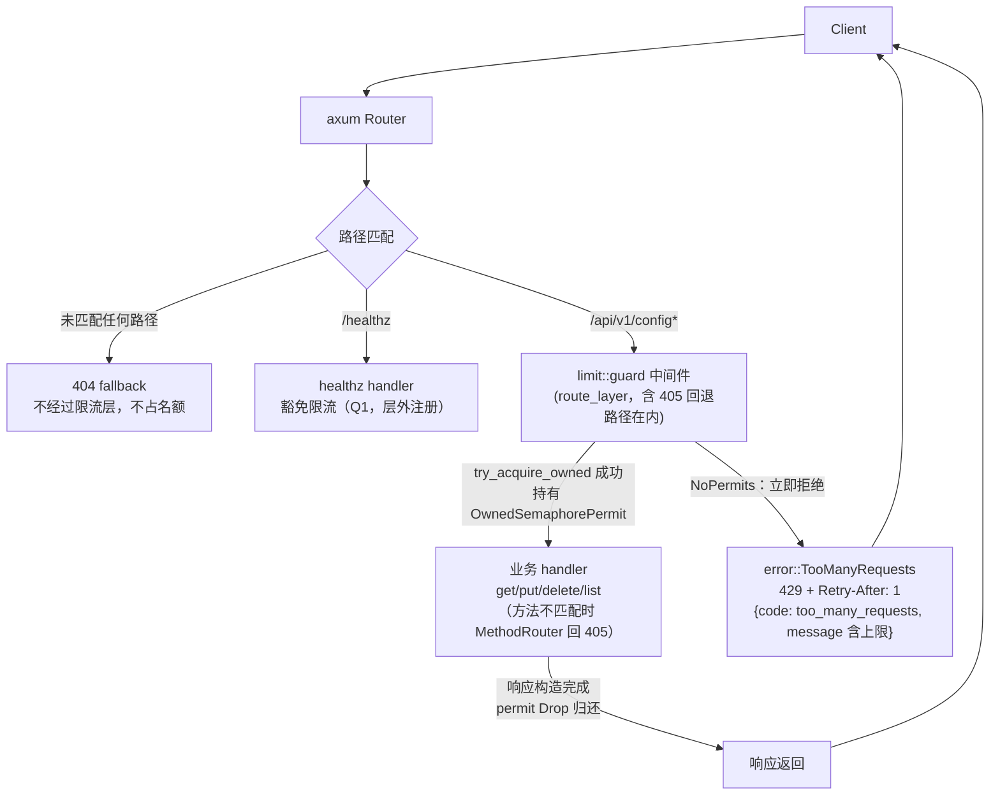

# 架构设计：velox-config 单实例最大并发请求限流

> feature slug: `instance-concurrency-limit`
> 工序状态：**F-AA 首个正式架构定稿（2026-11-26），待 GATE2 评审**。
> 需求基线：`01-requirements.md` 冻结版（GATE1 复审 PASS，2026-11-26 11:08，Q1～Q6 决议固化，见 `01-requirements-review.md`）；本稿按冻结 AC 全文重校，取代旧稿（旧稿基于 GATE1 前的需求旧版，含 FR-1～FR-7 计数错误、Q6 失实、空 env 措辞粗化、405 语义失实四处偏差，已在对应节修正）。
> 代码基线：develop @ 28c9114；实现 `90268ca`、单测 `dff2006` 已在库。设计遵循冻结需求的硬约束：**保留既有实现与验证资产，仅修真实缺口，不机械重写**。
> 锁定依赖（Cargo.lock，本稿只读核对）：tokio 1.54.1、tower 0.5.3、axum 0.8.9。

## 1. 需求引用（FR/AC 编号映射）

冻结需求共 FR-1～FR-6、NFR-1～NFR-4、AC-1～AC-7（旧稿页首"FR-1~FR-7"计数错误，予以纠正）。

| 需求 | 本方案落点 |
|---|---|
| FR-1 进程级全局并发上限（默认 10） | 全局共享一个 `tokio::sync::Semaphore`（名额 = 上限值），全部业务路由经同一限流层（已在 `limit.rs`/`api.rs` 实现，保留） |
| FR-2 口径 = in-flight，覆盖 `/api/v1/config*`；healthz 豁免（Q1） | `route_layer` 仅挂业务路由；permit 持有至响应构造完成（`limit.rs:35-55` 已实现，保留）；404/405 边界语义见 4.4 节定论 |
| FR-3 超限立即 429 + 统一错误体 | `try_acquire_owned` 非阻塞失败 → `error::TooManyRequests`（429 + `Retry-After: 1` + code/message，`error.rs:21-38` 已实现，保留） |
| FR-4 配置归属 `[server]`，env 覆盖优先 | `ServerConfig.max_concurrent_requests` + `VELOX_CONFIG__SERVER__MAX_CONCURRENT_REQUESTS`（`config.rs:23`、`:67-73` 已实现，保留） |
| FR-5 有效 env > 文件 > 默认 10；空 env 不覆盖文件 | `#[serde(default = "default_max_concurrent_requests")]` + `env_override` 空串过滤（`config.rs:14-16`、`:95-97` 已实现且语义与冻结 G1-3 一致，保留） |
| FR-6 非法值 fail fast，合法域 1..=U 无损比较 | **本设计唯一行为修改点**：`config.rs:79-87` `validate()` 补技术上界与 u128 无损比较；`config.rs:90-92` 访问器补不变式说明（见 4.1 节） |
| NFR-1 低开销、不阻塞 worker | `try_acquire` 为 O(1) 原子操作；信号量构造在启动期（监听前），请求路径无阻塞等待（已满足，无改动） |
| NFR-2 可观测性 | 启动 `info!` 含上限字段（`main.rs:46-52` 已有）；每拒一条 `warn!` 含上限与路径（`limit.rs:44-48` 已有）；日志默认 warn 裁决的观察论证见 4.5 节（本 feature 不改日志初始化） |
| NFR-3 不超卖 | 名额唯一来源是信号量 permit；`OwnedSemaphorePermit` Drop 即归还，无手工计数泄漏路径（已满足） |
| NFR-4 兼容性 | 存量 TOML 缺键自动取 10；行为收紧的发布说明义务见第 5 节 |
| AC-1～AC-4（上限/共享/429 格式/无副作用） | `limit.rs` 既有 4 个集成单测已覆盖主路径；TA 按 `03-test-cases.md` TC-01～07/16/18 补强断言（第 6 节给接口合同） |
| AC-5/AC-6（配置优先级 7 情况/fail fast 与 1..=U） | `config.rs` 既有 7 个单测覆盖部分情况；需按 TC-08/09/10/11/12 补情况 5/6/7、组合分支与 U 边界（4.1 节 + 第 6 节） |
| AC-7（日志观察前提） | 默认 warn 与显式 info 的核验条件论证见 4.5 节；TA 按 TC-13/14/15 执行，本 feature 不改日志代码 |

## 2. 现状分析（相关模块与既有模式）

### 2.1 已实现资产（只读核对 develop @ 28c9114，全部保留）

- **`config.rs`**：`Config::load(Option<&str>)` = TOML 文件（可选）→ env 覆盖（`env_override` 过滤空串，`:95-97`）→ `validate()`（`:79-87`）→ 返回。字段 `i64` + 显式默认函数 10（`:12-16`、`:23-24`）；env 解析失败报错含 env 全名与原始值（`:67-73`）；模块内 7 个单测（ENV_LOCK 串行 + uuid 临时文件）。
- **`limit.rs`**：`ConcurrencyLimit`（`Arc<Semaphore>` + `max` 缓存，Clone 共享，`:13-30`）；`guard` 中间件 `try_acquire_owned` 非阻塞取名额，失败即 `warn!(limit, path)` + 429（`:35-55`）；模块内 5 个集成单测（门闩 handler + `tower::ServiceExt::oneshot`，mpsc started / watch release）。
- **`api.rs`**：`limit_routes<S>`（`route_layer` 仅包业务路由，`:19-24`）；`router(store, max)` 生产装配，`/healthz` 注册在层外（`:27-41`）；装配冒烟测试 `smoke_router_assembly`。
- **`error.rs`**：`TooManyRequests{limit}` → 429 + `Retry-After: 1` + `{code:"too_many_requests", message 含上限}`（`:21-38`），与 `AppError(StoreError)` 通道独立。
- **`main.rs`**：`Config::load` 先于限流器构造/监听（`:28` → `:39` → `:45`）；启动 INFO 含 `max_concurrent_requests` 字段（`:46-52`）；日志过滤器缺省 `info`（`:30-35`）——**默认 warn 改造归 addlog feature，本 feature 不动此处**。
- **依赖**：`uuid`/`tower` 已为 `[dev-dependencies]`（`Cargo.toml:21-23`）；运行时依赖 tokio/axum/anyhow/tracing 均已在列，**本设计零新增依赖**。

### 2.2 真实缺口（本设计要修的全部范围）

| # | 缺口 | 证据 | 修复 |
|---|---|---|---|
| G-1 | `validate()` 仅校验下界 `< 1`，未保护信号量技术容量上界 U；值 > U 时会走到 `Semaphore::new` 的 `assert` panic（tokio `batch_semaphore.rs:147-152`），违反 FR-6"不以未捕获 panic 代替合规 fail-fast" | `config.rs:79-87` | 4.1 节：补 1..=U 上界检查，u128 无损比较 |
| G-2 | 访问器 `as usize` 为有损转换路径（32 位平台上 i64::MAX 会截断），缺不变式说明 | `config.rs:89-92` | 4.1 节：不变式文档 + debug_assert（转换安全性由 G-1 修复后成立） |
| G-3 | `api.rs:16-18` doc comment 声称"404/**405** 不执行中间件"，其中 405 半句失实（见 2.3 节证据），误导 TA 对 TC-17 的预期 | `api.rs:16-18` | 4.4 节：仅修正注释文字，行为不变 |

除此之外（含 addlog 默认 warn、Store、handler、429 错误体、README 主体说明）均不在本 feature 修改范围。

### 2.3 关键依赖契约（本稿只读核对源码，供 DA/TA 引用）

1. **tokio 1.54.1**：`tokio::sync::Semaphore::MAX_PERMITS` 是**公开常量** `usize::MAX >> 3`（`semaphore.rs:479`）；`Semaphore::new(permits)` 超界 `assert!` panic（`semaphore.rs:483-485`、`batch_semaphore.rs:147-152`）。64 位平台 U = 2305843009213693951（2^61−1），32 位 = 536870911（2^29−1）；两者均 < i64::MAX（9223372036854775807），故 `i64::MAX` 输入在任何当前支持平台都超 U，须按 FR-6 普通配置错误处理。
2. **axum 0.8.9 `Router::route_layer` 语义（修正旧稿失实）**：`route_layer` 对**每个已注册路径的 endpoint** 加层；endpoint 为 `MethodRouter` 时走 `MethodRouter::layer`——层包住**整个 MethodRouter 服务，含其 405 回退**（`path_router.rs:311-341` → `mod.rs:757-775` → `method_routing.rs:967`）。axum 官方测试实证：`Router::new().route("/foo", get(...)).route_layer(ValidateRequestHeaderLayer)` 下，POST /foo（方法不匹配）返回层的 401 而非 405，且源码注释明言 Router 层面无法先判方法（`routing/tests/mod.rs:489-513`）。**定论**：
   - 404（路径未命中）→ router 级 fallback，**不经过**限流层，不占名额（官方测试 `/not-found` → 404 佐证）；
   - 405（路径命中、方法不匹配）→ **先经过**限流层：饱和时被 guard 以 429 拒绝（不产生 405），未饱和时短暂占用名额 → MethodRouter 返回 405 → permit 立即归还。无存储访问，不超卖，与 FR-2"覆盖业务路由 `/api/v1/config*`"口径一致。
   - 该定论同时意味着既有测试 `shared_counter_across_routes_methods`（`limit.rs:149-176`，饱和时 GET /b 断言 429，/b 仅注册 PUT）**行为成立、无需修改**——GATE1 复审 §H8 与 TC-17 指出的静态分歧即源于旧稿失实表述，本轮以源码证据闭合：测试预期 429 正确，TC-17 按此定论核验未饱和 405（405）与饱和 405（429）两条路径即可。
3. **tower 0.5.3**：`ConcurrencyLimitLayer` 在 `poll_ready` 经 `poll_acquire` 等待名额（`limit/concurrency/service.rs:56-78`），`type Error = S::Error` 不产生 429——"满额立即拒绝"不能由它直接满足，**不切换**（与冻结需求 §8 提示一致）。

### 2.4 测试基建先例

无 `tests/` 目录；`store.rs`/`config.rs`/`limit.rs`/`api.rs` 均为模块内 `#[cfg(test)]` + `#[tokio::test]`。进程内 HTTP 测试用 `tower::ServiceExt::oneshot`（不监听端口）；env 相关测试共用 `static ENV_LOCK`；临时文件用 uuid 命名。`03-test-cases.md`（同波 TA 定稿中）沿用同一套基建，本文第 6 节给出与其 TC 编号对齐的接口合同。

## 3. 方案总览

**推荐方案一句话**：保留 `90268ca` 的"自研轻量中间件 + 共享 `Arc<Semaphore>` + `try_acquire_owned`"整体架构与全部装配/错误/日志资产，唯一行为级修改是把 `config.rs` 的校验从"仅下界"补齐为冻结 FR-6 的"1..=U 无损比较"，其余改动仅为注释/文档/测试。



配置加载链路（启动时一次，无热更新；与冻结 FR-4/FR-5/G1-3 逐条对齐）：

```
启动参数 → Config::load(path)
  ├─ Some(p): read_to_string + toml::from_str
  │     ├─ 键缺失          → default_max_concurrent_requests() = 10            (FR-5)
  │     ├─ 0 / -1          → 反序列化成功，validate() 报错退出（含字段名+原值）   (FR-6/Q4)
  │     ├─ 域内但 >U       → 反序列化成功，validate() 报错退出（含字段名+原值+U）(FR-6/Q6)
  │     ├─ 超 i64 解析域   → toml 反序列化错误（报错带源码片段，含键名与原始值）  (FR-6)
  │     └─ 1.5 / "abc"     → toml 类型错误，启动失败（报错含键名与原值）         (FR-6)
  └─ None: Config::default() = 10                                            (FR-5)
  → env VELOX_CONFIG__SERVER__MAX_CONCURRENT_REQUESTS
        ├─ 未设置 / 空串    → 不覆盖：文件有值保留文件值（文件5+空env=5），
        │                     无文件/缺键保持默认 10（G1-3，非"回落 10"）        (FR-5)
        ├─ "abc" / "1.5"   → parse::<i64> 失败 → 报错含 env 全名与原始值         (FR-6)
        ├─ 超 i64 解析域   → parse::<i64> 失败 → 报错含 env 全名与原始值，
        │                     不进入任何转换/构造链                              (FR-6)
        └─ 合法整数        → 覆盖文件值后统一走 validate()（0/-1/>U 均被拒；
                             文件值被覆盖后不再单独校验——TC-09 组合语义）        (FR-4)
  → validate()：1..=U 无损比较（u128），失败即启动失败（stderr 普通可读错误，非 0 退出）
  → main.rs: api::router(store, cfg.max_concurrent_requests())，启动 INFO 带上限字段
```

选型理由（备选方案与弃选理由详见第 7 节）：`try_acquire` 精确匹配"超限即拒、不排队"（FR-3）；permit RAII 保证任何返回路径（含 handler 出错、future 取消）都释放名额（NFR-3/AC-4）；429 响应体/`Retry-After`/`warn` 日志在同一处代码定制。该架构已在 `90268ca` 落地并经 `dff2006` 单测，本设计不推翻。

## 4. 模块与接口设计

新依赖：无（运行时与 dev-dependencies 均不加）。改动面：`config.rs` 唯一行为修改；`api.rs` 仅注释修正；示例 toml/README 文字对齐；测试补充。`limit.rs`/`error.rs`/`main.rs`/`store.rs`/handlers 零改动。

### 4.1 `src/config.rs`：合法域 1..=U 无损校验（G-1/G-2，唯一行为修改点）

新增常量（置于 `DEFAULT_MAX_CONCURRENT_REQUESTS` 附近）：

```rust
/// 并发上限合法域上界 U = min(i64::MAX, usize::MAX, Semaphore::MAX_PERMITS)（冻结 FR-6/Q6）。
/// 以 u128 无损计算：i64::MAX、usize::MAX、MAX_PERMITS 均可无损表入 u128（const 可求值）。
/// 64 位平台 U = 2305843009213693951，32 位 = 536870911，均 < i64::MAX
/// （tokio 1.54.1 semaphore.rs:479 公开常量 MAX_PERMITS = usize::MAX >> 3）。
const MAX_CONCURRENT_REQUESTS_CAP: u128 = (i64::MAX as u128)
    .min(usize::MAX as u128)
    .min(tokio::sync::Semaphore::MAX_PERMITS as u128);
```

替换 `validate()`（`config.rs:78-87`，签名不变）：

```rust
/// FR-6/Q4/Q6 fail fast：合法域为整数 1..=U；`load` 返回即保证合法，main 无需二次校验。
/// 比较在 u128 无损域中进行——**不得先 `as usize` 再校验**（32 位平台上 i64::MAX
/// 会被截断成小值而漏判；这正是本轮修复的真实缺口）。
fn validate(&self) -> anyhow::Result<()> {
    let v = self.server.max_concurrent_requests;
    if v < 1 {
        anyhow::bail!("非法配置 server.max_concurrent_requests：{v}（要求 ≥1 的整数）");
    }
    if v as u128 > MAX_CONCURRENT_REQUESTS_CAP {
        anyhow::bail!(
            "非法配置 server.max_concurrent_requests：{v}（超过本平台信号量技术上界 U={MAX_CONCURRENT_REQUESTS_CAP}）"
        );
    }
    Ok(())
}
```

替换访问器（`config.rs:89-92`，签名不变）：

```rust
/// 信号量容量。不变式：`load()` 已 validate 保证 1..=U，且 U ≤ usize::MAX
/// （U 的定义含 min(usize::MAX)），故 `as usize` 无损；debug_assert 固化该不变式，
/// 正式约束由 validate 承担，运行时零开销。
pub fn max_concurrent_requests(&self) -> usize {
    debug_assert!(self.server.max_concurrent_requests >= 1);
    debug_assert!((self.server.max_concurrent_requests as u128) <= MAX_CONCURRENT_REQUESTS_CAP);
    self.server.max_concurrent_requests as usize
}
```

**保持不动的部分与理由**（DA 不要顺手改）：

- 字段类型保持 `i64` + 显式默认函数（`config.rs:12-25`）：`-1` 须通过 serde 反序列化后由 `validate()` 统一拒绝，保证 AC-6"错误含字段名与实际值"（改用 `usize`/`u32` 会让负数在 serde 层以类型错误失败，报错文案不受控；`1.5`/`"abc"` 仍被 serde 拒绝，toml 0.8 报错带源码片段含键名与原值）。裸 `#[serde(default)]` 陷阱注释已写在该字段上，保留。
- env 覆盖块（`config.rs:67-73`）：parse 失败报错已含 env 全名与原始值，覆盖了 FR-6"超 i64 解析域的输入带原值明确报错、不进入转换链"（`parse::<i64>` 失败即返回，不会走到构造链）；错误文案"（要求 ≥1 的整数）"无需追加 U——FR-6 仅要求**技术超界错误**含 U，解析域错误只要求字段名+原值。
- `env_override` 空串过滤（`config.rs:95-97`）：即冻结 G1-3"空 env 不覆盖文件"的实现，语义正确，保留（既有测试名 `env_empty_falls_back` 只测无文件分支，期望 10 正确，不改名；文件 5 + 空 env = 5 的新分支由测试补充覆盖，见 6.2 节）。
- 加载顺序 文件 → env 覆盖 → validate 最终值：天然满足 TC-09 组合语义——文件非法值 + 非空合法 env = 选中 env 值并通过校验（文件值被覆盖、不触发校验，与 `addr` 语义一致）；文件合法 + 非空非法 env = 按 env 报错，不回落文件值。

**合法域行为汇总**（AC-6 判定表，DA 按此实现/TA 按此断言）：

| 输入 | 路径 | 结果 |
|---|---|---|
| `1` / `1000` / `100000` / `U` | 文件或 env | 加载成功，容量与配置一致地构造（`available_permits == 配置值`） |
| `0` / 负数 | 文件或 env | validate 下界分支：普通错误，含 `server.max_concurrent_requests`（或 env 场景的字段名/全名）与原值 |
| `1.5` / `"abc"`（env 为 `abc`） | 文件或 env | serde/parse 拒绝：普通错误，含键名（或 env 全名）与原值 |
| `U+1`、`i64::MAX`（均在 i64 解析域内） | 文件或 env | validate 上界分支：普通错误，含字段名、原值与 `U=<数值>`；真实进程非 0 退出，构造/监听前终止，无 panic |
| 超 i64 解析域整数（如 30 位数字） | env：parse 失败报错含 env 全名+原值；文件：toml 反序列化错误含键名+原值（源码片段） | 均不进入转换/构造链 |

### 4.2 `src/limit.rs`：保留原样（契约声明）

`ConcurrencyLimit::new(max: usize)` 直接 `Semaphore::new(max)`——超界 panic 的技术风险已由 4.1 节在配置层消除：生产唯一构造链 `Config::load → validate（1..=U）→ main → router → ConcurrencyLimit::new`，`U ≤ Semaphore::MAX_PERMITS` 是 U 定义的一部分，故构造必安全且容量一致（FR-6"合法值转换后须能安全构造容量一致的限流器"由该链保证）。**不为它添加运行时检查或改签名**（避免机械重写；`debug_assert` 亦不加——不变式已在 config 侧用 debug_assert 固化，两层重复无收益）。

`guard` 中间件语义不变：permit 持有窗口 = `next.run()` 返回即响应对象构造完成。velox-config 全部响应为小体积 JSON（构造即完整），与 FR-2"响应生成完成即处理结束"一致；未来若引入流式/长连接端点，持有窗口需重估（记入第 8 节风险，非本 feature 范围）。

### 4.3 `src/error.rs`：保留原样

`TooManyRequests{limit}` 已满足冻结 AC-3 全部断言：429、`application/json`、`code = "too_many_requests"`（固定）、message 含上限数值、`Retry-After: 1`（固定值，仅重试提示）。零改动。

### 4.4 `src/api.rs`：装配保留，仅修正 doc comment（G-3）

`limit_routes<S>` / `router(store, max_concurrent_requests)` / healthz 层外注册 / handlers 全部不动（`from_fn_with_state` 的限流 state 与路由 state 相互独立，handlers 零改动的设计已成立）。唯一修改是把 `api.rs:16-18` 的失实注释替换为与 2.3 节源码证据一致的表述：

```rust
/// 仅给业务路由挂限流层。`Router::route_layer` 语义（axum 0.8.9 源码实证，
/// 见 routing/tests/mod.rs:489-513 与 path_router.rs:311-341）：
/// - 路径未命中（404）不执行本层中间件，不占名额；
/// - 路径命中但方法不匹配（405）会先经过本层（层包住整个 MethodRouter，含其 405 回退）：
///   饱和时被限流层以 429 拒绝（不产生 405），未饱和时短暂占用名额后由 MethodRouter
///   返回 405 并立即归还——不超卖、无存储访问，与 FR-2"覆盖业务路由"口径一致。
/// healthz 豁免（Q1）由结构保证：它注册在该层之外，业务池饱和时探针不受影响，
/// 且不为探针放宽业务上限（单一信号量，无第二名额池）。
```

这是文档修正而非行为改动：现有测试对 404（`unmatched_route_bypasses_limit` → 404）与饱和 405（`shared_counter_across_routes_methods` 的 GET /b → 429）的断言均与该定论一致，无测试需改。

### 4.5 `src/main.rs`：本 feature 零改动；默认 warn 下的日志观察论证（NFR-2/AC-7，供 DA/TA 使用）

`Config::load` 先于限流器构造与监听（保证 fail-fast 时机）、启动 INFO 含 `max_concurrent_requests`、`shutdown_signal` 优雅关停——均已满足。日志初始化 `main.rs:30-35` 的缺省等级改造**归 addlog feature**，本 feature 不动（冻结 R5.4）。

**默认 warn 下如何验证/观察限流行为（论证）**：

1. **target 约定**：tracing 事件默认 target = 调用点模块路径。启动 INFO 行产生于 `main.rs`（crate 根）→ target `velox_config`；每拒 WARN 产生于 `limit.rs` → target `velox_config::limit`。
2. **启动 INFO 的合规性**：NFR-2 只要求 INFO 事件**存在**（`main.rs:46-52` 已满足），不要求默认可见。addlog 交付后进程缺省 warn（过滤器语义：仅 ≥WARN 事件通过），INFO 启动行静默属**过滤预期**而非功能缺失——AC-5/AC-7 明文"INFO 行缺失不表示配置失效"。
3. **默认 warn 下上限的三条证明途径**（不依赖 INFO）：
   a. **配置解析结果**：`Config::load` 返回值即生效上限（fail-fast 契约保证 load 与生效一致）；
   b. **受控饱和行为**：以 N 个受控在途请求占满、第 N+1 个业务请求收到 429、释放后可再受理（AC-5/TC-08/TC-13 的主体判据）；
   c. **每拒 WARN 可见**：默认 warn 且未屏蔽 target 时，`velox_config::limit` 的 WARN 事件恰好逐条可见（AC-7）。
4. **显式 info 核验前提**：日志作上限证据时须显式开启且允许对应 target，如隔离环境 `RUST_LOG=info`（两者同时可见）或精确 `RUST_LOG=velox_config=info,velox_config::limit=warn`；遵循 addlog 的 `RUST_LOG > LOG__LEVEL > 文件 > warn` 优先级，用文件/env 调级时必须隔离残留的高优先级 `RUST_LOG`。显式 `error`/`off` 或 target 过滤掉 WARN 时 WARN 不可见属过滤预期，**每拒一条 WARN 的事件生成义务不变**（TA 应在捕获层核验事件生成，而非仅凭 subscriber 可见性——TC-14 口径）。
5. **配置/初始化错误不经日志**：`validate()` 的错误经 `main -> anyhow::Result` 走 stderr，不受任何 INFO/WARN 过滤器影响（FR-6），无需为 fail-fast 可见性调整日志等级。

### 4.6 配置示例与 README（文字对齐，DA 实现时顺带完成）

- `velox-config/config/velox-config.toml:5`：注释由"≥1"改为"合法域 1..=U（U=min(i64::MAX, usize::MAX, Semaphore::MAX_PERMITS)，随平台）"。
- `velox-config/README.md`（§配置 :47-49 一带）：补三点——合法技术域 1..=U 与超界报错含上界；空 env 不覆盖文件（文件有值保留文件值）；配置启动时加载一次、修改需重启生效；日志核验前提（默认 warn 下以饱和行为证明，显式 info 方可见启动行）。发布说明义务（NFR-4/Q5：默认 10 收紧声明 + 调优指引）保留。README:44 配置表与 :44-49 说明行主体已正确，不重写。注意评审 P3 RQ-B-2：需求 §8 引 `README.md:40` 实为配置表行，说明内容在 :44-49，后续文档同步时顺带校正锚点。

## 5. 数据模型与迁移

- **存储结构不变**：限流状态是进程内 `Semaphore`（内存态），不落盘、不进 TOML 以外的存储；无数据迁移。
- **配置迁移**：存量配置文件缺键 → serde 显式默认函数取 10，文件无需修改即可启动（FR-5）；本次修复对合法域内的存量配置零影响（1..=U 内一切值照常生效）。
- **行为迁移（NFR-4，非代码）**：默认 10 对存量部署是收紧，需在发布说明标注：变更内容、`VELOX_CONFIG__SERVER__MAX_CONCURRENT_REQUESTS` 调整方法、429/`too_many_requests`/`Retry-After: 1` 调用方可见行为、按峰值 in-flight 观测调大的指引、`/healthz` 不受限流影响。
- **接口迁移**：无（`api::router(store, max)` 签名在 `90268ca` 已就位；workspace 内无其他 crate 以 crate 依赖方式引用 velox-config，均走 HTTP，无传导）。

## 6. 测试策略建议（给 TA 的接口合同，与 `03-test-cases.md` 对齐，不改该文件）

沿用既有两条先例：模块内 `#[cfg(test)]`（ENV_LOCK 串行 env 用例、uuid 临时文件）+ `tower::ServiceExt::oneshot` 进程内 HTTP（门闩 handler：先发 started 再等 watch 放行，`tokio::spawn` 驱动 oneshot）。以下签名即生产代码现状（TA 可直接依赖，本设计不改这些签名）：

| 契约 | 签名 | TA 使用点 |
|---|---|---|
| 配置加载 | `Config::load(path: Option<&str>) -> anyhow::Result<Config>` | TC-08/09/10/11/12 |
| 容量访问 | `Config::max_concurrent_requests(&self) -> usize` | TC-08/11/12 |
| 限流器 | `ConcurrencyLimit::new(max: usize)`；`.max() -> usize`；Clone 共享同一 `Arc<Semaphore>` | TC-11/12/16 |
| 装配 | `api::limit_routes<S>(limit, routes) -> Router<S>`（pub(crate)）；`api::router(store: Arc<Store>, max: usize) -> Router` | TC-01～07/17/18 |
| 429 响应 | `error::TooManyRequests { limit: usize }` + `IntoResponse` | TC-03/15 |
| 信号量容量核对 | 构造后 `available_permits()` 等于配置值（经 `ConcurrencyLimit` 间接触达：饱和 N 后第 N+1 个 429 即容量证明；或直接 `Semaphore::new(v)` 对照） | TC-11/12（U 只核对构造/容量，不发起 U 个请求） |

### 6.1 `config.rs` 单测增量（既有 7 个测试全部保留）

| 用例（建议名） | 场景 → 断言 | 对应 TC |
|---|---|---|
| `file_value_kept_without_env` / `file_value_kept_with_empty_env` | 文件 5 + 无 env → 5；文件 5 + 空 env → 5（**空 env 不覆盖文件**，不得断言回落 10） | TC-08 情况 5/6 |
| `empty_env_without_file_defaults_to_10` | 无文件/缺键 + 空 env → 10（既有 `env_empty_falls_back` 已覆盖无文件分支，可保留原名） | TC-08 情况 7 |
| `illegal_file_with_valid_env_selects_env` | 文件 0 + env 3 → 加载成功且生效 3（文件值被覆盖不触发校验）；文件 5 + env 0 → 按 env 报错、不回落 5 | TC-09 |
| `over_technical_cap_fails_with_bound` | 文件/env 分别 `U+1`、`i64::MAX` → `Err`，消息含字段名（或 env 全名）、原始值与 `U=` 上界文本；**断言在 load 层完成，不构造限流器** | TC-10/12 |
| `parse_domain_overflow_keeps_raw_value` | env `"99999999999999999999999"` → `Err` 含 env 全名与原值（不进转换链）；文件同值 → toml 错误含键名与原值 | TC-10 |
| `valid_capacity_boundary_u` | `U` 本身：load 成功 → `max_concurrent_requests() == U`（usize 值相等），可安全构造容量一致限流器 | TC-11/12 |

注意：`U+1`、`i64::MAX` 用例在**修复前会失败**（现行代码会走到 `Semaphore::new` panic 或静默接受），按冻结 AC-6 期望书写、执行期如实记录失败，不降低期望；涉及构造的边界用例按 TC-12 可用隔离子进程防 panic 波及测试进程。

### 6.2 `limit.rs`/`api.rs` 集成测试增量（既有 6 个测试全部保留）

- 既有门闩手法（started 信号先行、饱和后再发探针）已满足 AC-1/2/3/4 主证据，TC-16（barrier 竞态 peak≤2）、TC-06/07（4xx/5xx/取消释放）按该手法补充。
- **TC-17 按本设计定论书写预期**：未饱和 GET /b（/b 仅注册 PUT）→ **405**（短暂占名额后归还）；饱和 GET /b → **429**（限流层先拒，无 405）；未匹配路径 → **404**（不经限流层）。既有 `shared_counter_across_routes_methods`（饱和 GET /b → 429）与本定论一致，无需修改；405 的 AC-2 证明不得使用未命中方法探针（用命中的 DELETE/列表或同路径 GET/PUT）。
- TC-18 生产装配：真实 `router(store, N)` + Json 提取窗口暂停（部分 body 占名额）验证业务 429、healthz 200。

### 6.3 日志与 e2e（TC-13/14/15/19，留给 TA）

- 日志断言不做单测 subscriber 假设；按 4.5 节 target 约定与 G1-1 前提执行：INFO 证据须显式 info + 允许 target；默认 warn 场景以配置解析 + 饱和行为 + 每拒 WARN 证明；addlog 未合并前"默认 warn 进程级行为"记「无法验证/依赖未就绪」。
- TC-15/19（真实二进制、部分 body 占名额、SIGINT 优雅关停）沿用 `03-test-cases.md` §2.3 夹具 E 手法；`bash velox-demo/scripts/acceptance.sh`（无参数）仅作协作回归，不替代本 feature 专项 e2e。

## 7. 备选方案与取舍

| 方案 | 描述 | 优点 | 弃选/备选理由 |
|---|---|---|---|
| **A（推荐，已实现）**：tokio `Semaphore` + `try_acquire_owned` + `from_fn_with_state` 自研 guard，`route_layer` 挂业务路由 | 见第 3/4 节 | `try_acquire` 精确匹配"超限即拒"；permit RAII 不超卖；429/Retry-After/日志一处定制；零新依赖 | ✅ 采用并保留——已在 `90268ca` 落地、`dff2006` 验证，本轮仅修配置校验缺口 |
| B：`tower::limit::ConcurrencyLimitLayer`（tower 0.5 已是 dev-dep） | 现成层 + `HandleErrorLayer` 把 `BoxError` 映射 429 | 复用现成组件 | ❌ 技术上不可行：`poll_ready` 经 `poll_acquire` **等待**名额（tower-0.5.3 `limit/concurrency/service.rs:56-78`），满额时请求悬挂而非 429，`Error = S::Error` 不产生 429——直接违反 FR-3"不排队、立即拒绝"（冻结需求 §8 已纠正并明示不切换） |
| C：`AtomicUsize` 计数 + 自定义 Drop guard | 不依赖 Semaphore | 无额外收益 | ❌ 需手写 guard 保证错误/panic/取消路径释放，`fetch_add`/`fetch_sub` 边界易错；`Semaphore` + `OwnedSemaphorePermit` 已提供等价且经并发验证的 RAII |
| D：字段改用 `usize`/`u32` + serde deny negatives | 在反序列化层挡非法值 | 少一个 validate 分支 | ❌ 负数会在 serde 层以类型错误失败，报错文案不受控，难稳定满足 AC-6"错误含字段名与实际值"；env 侧 `"-1".parse::<usize>()` 的 `ParseIntError` 文案同样不含字段上下文；`i64` + 统一 validate 是受控报错的最小方案（维持现状） |
| U 上界比较实现：`usize::try_from(v)` + 与 `MAX_PERMITS` 比较 | 先 try_from 再比较 | 亦无损 | ❌ 备选：32 位平台 `i64::MAX` try_from 失败，错误分支需另行区分"超 usize"与"超 MAX_PERMITS"，报错文案拆成两种；u128 常量 `min(i64::MAX, usize::MAX, MAX_PERMITS)` 是冻结公式的直接转写，单一常量同时用于比较与错误信息，代码更短 |

## 8. 风险与工作量评估

| 风险 | 等级 | 缓解 |
|---|---|---|
| serde 默认值陷阱（裸 `#[serde(default)]` → i64 默认 0） | 中 | 设计保持显式默认函数 + 字段注释；既有单测 `default_when_key_missing` 已固化 |
| env 类测试并行互扰（`set_var` 进程级） | 低 | 既有 `ENV_LOCK` 串行化；新增用例沿用；测试结束恢复 env 原值 |
| TC-12 类用例在修复前失败 / 构造 panic 波及测试进程 | 低 | 按冻结 AC 期望书写、如实记录；子进程隔离（TA 按 TC-12 档位执行） |
| permit 持有窗口 = 响应对象构造完成；未来流式/长连接端点需重估口径 | 低 | 当前全为小 JSON 响应，口径精确成立；4.2 节已注明演进注意点 |
| 405 语义与旧文档表述的偏差（本轮已修正） | 低 | 源码证据定论（2.3/4.4 节）；api.rs 注释同步修正；TC-17 实跑留痕；无 AC 冲突、无测试需改 |
| addlog 未合并前"默认 warn 进程级行为"无法验证 | 低 | 非本 feature 缺口：TC-13/14 按既有约定记「无法验证/依赖未就绪」，不降低期望 |
| 默认 10 收紧引发存量调用方 429（NFR-4） | 中 | 非代码风险：发布说明 + 调优指引（第 5 节）；README 已有主体说明 |
| 极大合法值（如域内 100000）构造的信号量内存占用 | 低 | `Semaphore` 名额按需分配（无预分配数组）；域内值构造即安全（U 内 assert 通过） |

**工作量：S（小）**。行为修改仅 `config.rs`（常量 + validate 上界分支 + 访问器不变式说明，净增约 15 行）；`api.rs` 注释替换（约 10 行）；示例 toml/README 文字对齐（各 1～3 行）；测试补充约 100～150 行（config 增量为主）。预计 0.5 人日内含测试。下游命令与 README 一致性核对：`cargo build/test --workspace`、`cargo fmt --all --check`、`cargo clippy --workspace --all-targets -- -D warnings`、`bash velox-demo/scripts/acceptance.sh`（均与 `velox-config/README.md` 及 demo README 现有记载一致，本工序未运行）。

## 9. 对待确认问题的处置

Q1～Q6 已由 GATE1 关口裁决**冻结**（非开放问题），本设计逐项落实：

| # | 冻结决议 | 本设计落点 |
|---|---|---|
| Q1 | `/healthz` **豁免**：不占业务名额，饱和时仍 200；不为探针放宽上限 | 4.4 节：healthz 注册在 `limit_routes` 之外，单一信号量结构保证；既有测试 `exempt_route_stays_available` |
| Q2 | 归属 **`[server].max_concurrent_requests`**，env 全名 `VELOX_CONFIG__SERVER__MAX_CONCURRENT_REQUESTS`，优先级 env > 文件 > 默认 | 4.1 节保持既有字段/env 块不动 |
| Q3 | `code = "too_many_requests"` + 固定 `Retry-After: 1`，message 含上限；重试提示不代表服务端排队 | 4.3 节 `error.rs` 保留；既有测试 `reject_body_shape` |
| Q4 | 非法值 **fail fast**（含技术超界）：配置阶段普通可读错误、真实非 0 退出、构造/监听前终止、不以 panic 代替；空 env 是不覆盖而非非法 | 4.1 节 validate；4.5 节 stderr 通道论证；3 节链路图 |
| Q5 | 接受默认 10 的行为收紧，发布说明 + 调优指引义务 | 第 5 节迁移；4.6 节 README 对齐 |
| Q6 | **不设额外业务封顶**，合法域整数 1..=U（`U = min(i64::MAX, usize::MAX, Semaphore::MAX_PERMITS)`），超界错误含字段名/原值/U，不截断/不静默默认 | 4.1 节 `MAX_CONCURRENT_REQUESTS_CAP` + validate 上界分支（**修正旧稿**"`Semaphore::new` 无上限校验、仅 ≥1 下限"的失实处置——该说法与 tokio 源码契约及冻结 Q6 冲突） |

旧稿遗留差异的闭合记录（供 GATE2 对照）：①页首 FR 计数 FR-1~FR-7 → FR-1~FR-6（本稿第 1 节）；②Q6 行失实 → 本节 Q6 行；③"空 env 回落默认"措辞 → 3 节链路与 4.1 节改为冻结 G1-3"不覆盖文件"；④404/405 route_layer 语义失实（旧稿 :234/:356 称 405 不执行中间件且"已在 axum 0.8.9 实测"）→ 2.3/4.4 节以源码证据定论。本设计无新增开放问题，DA 拿到后不需要再做架构决策。
