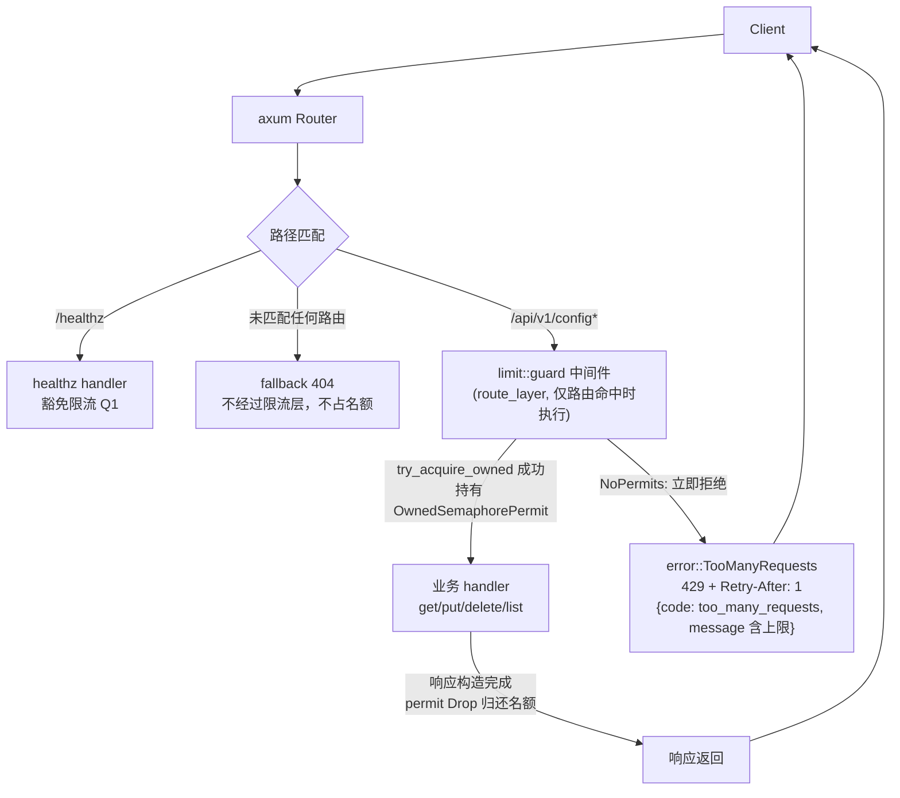

# 架构设计：velox-config 单实例最大并发请求限流

> feature slug: `instance-concurrency-limit`
> 上游文档：`01-requirements.md`（FR-1~FR-7、NFR-1~4、AC-1~AC-7、Q1~Q6）
> 状态：待评审。所有待确认问题（Q1~Q6）按需求文档建议的默认方案处置，见第 9 节。
> 实施前验证：第 4 节关键签名与第 6.2 节测试手法已在临时工程（axum 0.8.9 + tokio 1 + tower 0.5 + toml 0.8）上编译并跑通行为用例（429/Retry-After/豁免/名额归还、serde 默认值与 fail fast），未改动仓库任何代码。

## 1. 需求引用（FR/AC 编号映射）

| 需求 | 本方案落点 |
|---|---|
| FR-1 进程级全局并发上限（默认 10） | 全局共享一个 `tokio::sync::Semaphore`（名额 = 上限值），所有业务路由经同一限流层 |
| FR-2 口径 = in-flight 请求数，覆盖 `/api/v1/config*` | 中间件在 handler 前获取名额、响应构造完成即 RAII 归还；`route_layer` 仅挂在业务路由 |
| FR-3 超限立即 429 + 统一错误体 | `Semaphore::try_acquire_owned` 非阻塞失败 → `error::TooManyRequests`（429 + `Retry-After: 1`） |
| FR-4 配置归属 `[server]`，env 覆盖优先 | `ServerConfig.max_concurrent_requests` + `VELOX_CONFIG__SERVER__MAX_CONCURRENT_REQUESTS` |
| FR-5 未配置默认 10 | `#[serde(default = "default_max_concurrent_requests")]`（显式 fn，陷阱见 4.1） |
| FR-6 非法值启动失败 | `Config::load()` 末尾 `validate()`，错误信息含字段名与实际值 |
| NFR-1 低开销、不阻塞 worker | `try_acquire` 为 O(1) 原子操作，无排队、无阻塞等待 |
| NFR-2 可观测性 | 启动 `info!` 增加上限字段；拒绝路径 `warn!`（含上限与路径） |
| NFR-3 不超卖 | 名额唯一来源是信号量 permit；`OwnedSemaphorePermit` Drop 即归还，无手工计数泄漏路径 |
| NFR-4 兼容性 | 存量 TOML 缺键自动取 10；行为收紧写入发布说明（第 5 节迁移） |
| AC-1~AC-4（上限/共享/429/无副作用） | 中间件语义单测（`oneshot` + 可暂停 handler，第 6 节） |
| AC-5/AC-6（配置链路/fail fast） | `config.rs` 单测 |
| AC-7（日志） | 单测不做日志断言（记录于第 6 节），留给 TA e2e 验证 |

## 2. 现状分析（相关模块与既有模式）

- **`velox-config/src/api.rs`**：`pub fn router(store: Arc<Store>) -> Router`，路由 `/healthz` + `/api/v1/config*`，state 为 `Arc<Store>`，handler 全部为快速路径（内存读写 + 锁外异步落盘）。
- **`velox-config/src/config.rs`**：`Config::load(Option<&str>)` = TOML 文件（可选）→ 环境变量覆盖（`env_override` 过滤空值）→ 返回。`ServerConfig` 现只有 `addr`。容器级 `#[serde(default)]`。
- **`velox-config/src/error.rs`**：`AppError(StoreError)` → `IntoResponse`，统一错误体 `{code, message}`；限流拒绝发生在 handler 之前，不经过 `StoreError`，需独立响应类型。
- **`velox-config/src/main.rs`**：装配 + 启动日志（`version/addr/data_dir`）+ `axum::serve` + 优雅关停。
- **测试基建**：无 `tests/` 目录；`store.rs` 用模块内 `#[cfg(test)]` + `#[tokio::test]`。**workspace 先例**：`velox-registry/src/api.rs` 用 `tower::ServiceExt::oneshot` 对 `Router` 做进程内 HTTP 测试（不监听端口），tower 0.5 已在 `[workspace.dependencies]`（util feature）。
- **依赖现状**：velox-config 未直接依赖 tower；tokio/axum 已在列。

## 3. 方案总览

**推荐方案**：自研轻量中间件 `limit::guard`（tokio `Semaphore::try_acquire_owned` + `axum::middleware::from_fn_with_state`），通过 `Router::route_layer` 只挂业务路由。**不新增任何运行时依赖**（tokio 信号量 + axum middleware 即可）；仅 `[dev-dependencies]` 增加 `tower.workspace = true` 用于 `oneshot` 测试（有 velox-registry 先例）。



配置加载链路（无热更新，启动时一次）：

```
CLI 参数 → Config::load(path)
  ├─ Some(p): read_to_string + toml::from_str
  │     ├─ 键缺失     → default_max_concurrent_requests() = 10        (FR-5.2)
  │     ├─ 0 / -1     → 反序列化成功，validate() 报错退出              (FR-6)
  │     └─ 1.5/"abc"  → serde 类型错误，启动失败（报错含键名与值）     (FR-6)
  └─ None: Config::default() = 10                                     (FR-5.1)
  → env VELOX_CONFIG__SERVER__MAX_CONCURRENT_REQUESTS
        ├─ 未设置/空串 → 不覆盖（空串回落默认，保持现有语义）           (FR-5.3)
        ├─ "abc"/"1.5" → parse::<i64> 失败 → 启动失败，报错含原始值     (FR-6)
        └─ "3"/"-1"    → 覆盖后走 validate()（-1 被拒）
  → validate()：max_concurrent_requests ≥ 1，否则 bail（含字段名与实际值）
  → main.rs: api::router(store, cfg.max_concurrent_requests())，启动日志带上限字段
```

选型理由（vs 备选方案详见第 7 节）：`try_acquire` 天然满足"超限即拒、不排队"（FR-3），permit RAII 保证任何返回路径（含 handler 出错）都释放名额（NFR-3/AC-4），429 响应体/`Retry-After`/`warn` 日志在同一处代码定制，无需错误类型转换胶水。

## 4. 模块与接口设计

新模块 `velox-config/src/limit.rs`（`main.rs` 加 `mod limit;`），其余为既有文件小改。**无新增运行时依赖**；`[dev-dependencies]` 增加 `tower.workspace = true`（仅测试用 `ServiceExt::oneshot`，版本由 workspace 统一管理）。

### 4.1 `src/config.rs`：配置字段与校验

```rust
const DEFAULT_MAX_CONCURRENT_REQUESTS: i64 = 10;

fn default_max_concurrent_requests() -> i64 {
    DEFAULT_MAX_CONCURRENT_REQUESTS
}

#[derive(Debug, Clone, Deserialize)]
pub struct ServerConfig {
    pub addr: String,
    /// 单实例最大并发处理请求数，≥1；未配置取 10
    #[serde(default = "default_max_concurrent_requests")]
    pub max_concurrent_requests: i64,
}

impl Default for ServerConfig {
    fn default() -> Self {
        Self {
            addr: "0.0.0.0:8200".to_string(),
            max_concurrent_requests: DEFAULT_MAX_CONCURRENT_REQUESTS,
        }
    }
}

impl Config {
    pub fn load(path: Option<&str>) -> anyhow::Result<Self> {
        // ……现有 TOML/默认值逻辑不变……
        if let Some(v) = env_override("VELOX_CONFIG__SERVER__MAX_CONCURRENT_REQUESTS") {
            cfg.server.max_concurrent_requests = v.parse().map_err(|_| {
                anyhow::anyhow!(
                    "非法配置 VELOX_CONFIG__SERVER__MAX_CONCURRENT_REQUESTS：'{v}'（要求 ≥1 的整数）"
                )
            })?;
        }
        cfg.validate()?;
        Ok(cfg)
    }

    /// FR-6 fail fast：load 返回即保证合法，main 无需二次校验
    fn validate(&self) -> anyhow::Result<()> {
        if self.server.max_concurrent_requests < 1 {
            anyhow::bail!(
                "非法配置 server.max_concurrent_requests：{}（要求 ≥1 的整数）",
                self.server.max_concurrent_requests
            );
        }
        Ok(())
    }

    /// 已由 validate 保证 ≥1，转换为信号量容量
    pub fn max_concurrent_requests(&self) -> usize {
        self.server.max_concurrent_requests as usize
    }
}
```

**关键决策与陷阱**：

- **字段类型用 `i64` 而非 `u32`/`usize`**：`-1` 能通过 serde 反序列化、由 `validate()` 统一拒绝，保证 AC-6 要求的"错误信息含字段名与实际值"（u32 会在 serde 层以类型错误失败，报错文案不受控）。`1.5`/`"abc"` 仍被 serde 拒绝，toml 0.8 的报错带源码片段（含键名）与原值，满足 AC-6；DA 实现后用单测固化该文案行为。
- **必须用 `#[serde(default = "default_max_concurrent_requests")]`，不能裸 `#[serde(default)]`**：裸写会对字段类型取 `Default`（i64 → 0，非法）。这是本设计最容易踩的坑，配套单测 `default_when_key_missing` 固化（第 6 节）。
- 校验放在 `load()` 末尾（而非 main）：`addr` 的非法值在 main 里因 `SocketAddr::parse` 自然失败，而上限值没有天然的解析步骤，放 `load()` 可保持"load 返回即可用"语义。

### 4.2 新模块 `src/limit.rs`：限流核心

```rust
//! 实例级并发上限：超限立即 429，不排队（自保护手段，非业务限流）。

use std::sync::Arc;

use axum::extract::{Request, State};
use axum::middleware::Next;
use axum::response::Response;
use tokio::sync::Semaphore;

use crate::error::TooManyRequests;

/// 全局并发名额持有者；Clone 共享同一信号量（`from_fn_with_state` 的 state）。
#[derive(Clone)]
pub struct ConcurrencyLimit {
    semaphore: Arc<Semaphore>,
    max: usize,
}

impl ConcurrencyLimit {
    pub fn new(max: usize) -> Self {
        Self {
            semaphore: Arc::new(Semaphore::new(max)),
            max,
        }
    }

    pub fn max(&self) -> usize {
        self.max
    }
}

/// axum 中间件：`try_acquire_owned` 非阻塞取名额，失败立即 429（NFR-1、FR-3）。
/// 名额由 `OwnedSemaphorePermit` RAII 释放：`next.run()` 返回（响应构造完成，
/// 含 handler 出错路径）即归还，无手工增减计数，天然满足 NFR-3 不超卖与 AC-4。
pub(crate) async fn guard(
    State(limit): State<ConcurrencyLimit>,
    req: Request,
    next: Next,
) -> Response {
    match limit.semaphore.clone().try_acquire_owned() {
        Ok(_permit) => next.run(req).await, // _permit 在响应构造完成后 Drop → 归还名额
        Err(_) => {
            // NFR-2 / AC-7：每次拒绝一条 warn，含上限与路径
            tracing::warn!(
                limit = limit.max(),
                path = %req.uri().path(),
                "request rejected: instance concurrency limit reached"
            );
            TooManyRequests {
                limit: limit.max(),
            }
            .into_response()
        }
    }
}
```

口径说明（对应 FR-2）：permit 从 handler 执行前持有到 `next.run()` 返回、即**响应对象构造完成**为止。velox-config 全部响应为小体积 JSON（构造即完整），与需求"响应生成完成即处理结束"一致。若未来引入流式响应，需重新评估持有窗口（记入第 8 节风险）。

### 4.3 `src/error.rs`：限流拒绝响应类型

限流发生在 handler 之前，不经过 `StoreError`/`AppError`，故新增独立响应类型，继续把"错误 → HTTP 响应"的构造收敛在 error.rs（与现有文件职责一致）：

```rust
/// 限流拒绝：由 limit::guard 在 handler 之前直接产生（Q3 默认方案：Retry-After: 1）
#[derive(Debug, Clone, Copy)]
pub struct TooManyRequests {
    pub limit: usize,
}

impl IntoResponse for TooManyRequests {
    fn into_response(self) -> Response {
        (
            StatusCode::TOO_MANY_REQUESTS,
            [(axum::http::header::RETRY_AFTER, "1")],
            Json(json!({
                "code": "too_many_requests",
                "message": format!("并发请求已达上限 {}，请稍后重试", self.limit), // message 含上限（AC-3）
            })),
        )
            .into_response()
    }
}
```

### 4.4 `src/api.rs`：挂载方式与签名变更

```rust
use crate::limit::{self, ConcurrencyLimit};
use axum::middleware;

/// 仅给业务路由挂限流层。`route_layer` 语义：路由未命中（404/405）不执行中间件（已在 axum 0.8.9 实测），
/// 不占名额——与 FR-2"覆盖业务路由"口径一致。healthz 豁免（Q1）由结构保证：
/// 它注册在该层之外。
pub(crate) fn limit_routes<S>(limit: ConcurrencyLimit, routes: Router<S>) -> Router<S>
where
    S: Clone + Send + Sync + 'static,
{
    routes.route_layer(middleware::from_fn_with_state(limit, limit::guard))
}

/// 签名变更：新增上限参数。仅 main.rs 调用，无外部消费者，非破坏性。
pub fn router(store: Arc<Store>, max_concurrent_requests: usize) -> Router {
    let limit = ConcurrencyLimit::new(max_concurrent_requests);
    limit_routes(
        limit,
        Router::new()
            .route(
                "/api/v1/config/{namespace}/{key}",
                get(get_item).put(put_item).delete(delete_item),
            )
            .route("/api/v1/config/{namespace}", get(list_namespace))
            .route("/api/v1/config", get(list_namespaces)),
    )
    .route("/healthz", get(healthz)) // 豁免限流（Q1 默认方案）
    .with_state(store)
}
```

要点：`from_fn_with_state` 的 state（`ConcurrencyLimit`）与路由 state（`Arc<Store>`）相互独立，**handlers 零改动**；泛型 `limit_routes<S>` 使测试可以用任意 state 类型的 router 复用同一挂载代码路径。

### 4.5 `src/main.rs`：装配与启动日志

```rust
let app = api::router(store, cfg.max_concurrent_requests());
// ……
info!(
    version = env!("CARGO_PKG_VERSION"),
    addr = %addr,
    data_dir = %cfg.storage.data_dir,
    max_concurrent_requests = cfg.max_concurrent_requests(), // NFR-2 / AC-5、AC-7
    "velox-config started"
);
```

### 4.6 其他改动面

- `velox-config/config/velox-config.toml`：`[server]` 节增加 `max_concurrent_requests = 10`（带注释"单实例最大并发处理请求数，≥1"）。
- `velox-config/Cargo.toml`：`[dev-dependencies]` 增加 `tower.workspace = true`。
- `velox-config/README.md`（如含配置说明）：补充字段说明与调优指引（配合 NFR-4/Q5 发布说明义务）。

## 5. 数据模型与迁移

- **存储结构不变**：限流状态是进程内 `Semaphore`（内存态），不落盘、不进 TOML 以外的任何存储，无数据迁移。
- **配置迁移**：存量配置文件缺键 → serde 默认 10，文件无需修改即可启动（FR-5.2）；升级即生效。
- **行为迁移（NFR-4，非代码）**：默认 10 对存量部署是收紧，需在 CHANGELOG/发布说明标注：变更内容、`VELOX_CONFIG__SERVER__MAX_CONCURRENT_REQUESTS` 调整方法、"429 = too_many_requests + Retry-After" 调用方可见行为、容量评估指引（按峰值 in-flight 观测调大）。
- **接口迁移**：`api::router` 签名新增 `max_concurrent_requests` 参数，仅影响 main.rs 与其单测（workspace 内无其他 crate 以 crate 依赖方式引用 velox-config，均走 HTTP）。

## 6. 测试策略建议（不需要真实网络）

沿用既有两条先例：`store.rs` 式模块内单测 + velox-registry 式 `tower::ServiceExt::oneshot` 进程内 HTTP 测试（tokio::test 驱动，不监听端口）。

### 6.1 `config.rs` 单测（AC-5/AC-6，纯逻辑）

```rust
#[cfg(test)]
mod tests {
    // 环境变量为进程级全局：所有触碰 env 的测试共享一把锁，避免并行互扰
    static ENV_LOCK: std::sync::Mutex<()> = std::sync::Mutex::new(());
    // 借用 dev-dep uuid 生成临时 toml 文件路径（现有 store.rs 同款手法）
}
```

| 用例 | 断言 |
|---|---|
| `default_when_no_file` | `Config::load(None)` → 上限 10（FR-5.1） |
| `default_when_key_missing` | toml 只有 `[server].addr` → 10（FR-5.2，**固化 serde 默认 fn 陷阱**） |
| `env_overrides_file` | 文件 5 + env 3 → 3；仅 env 3 → 3（AC-5.3/4） |
| `env_empty_falls_back` | env `""` → 10（保持 `env_override` 过滤语义） |
| `invalid_zero_negative_fail_fast` | toml `0`/`-1`、env `-1` → `Err` 且消息含 `max_concurrent_requests` 与实际值 |
| `invalid_float_string_fail` | toml `1.5`/`"abc"`、env `abc`/`1.5` → `Err`（FR-6） |
| `valid_extremes` | `1`、`100000`（Q6 不封顶）→ 加载成功并生效 |

### 6.2 `limit.rs` 单测：中间件语义（AC-1~AC-4、AC-2、Q1 豁免）

核心手法：**测试专用 router + 可暂停 handler**（`tokio::sync::watch`/`Notify` 门闩），用同一生产代码路径 `limit_routes(limit, …)` 挂载，`oneshot` 并发发起：

| 用例 | 场景 | 断言 |
|---|---|---|
| `third_rejected_while_two_in_flight` | limit=2，两个请求被门闩按住，第 3 个到达 | 429；门闩放行后前两个 200；再发第 4 个 200（AC-1 + AC-4：被拒者从未占名额） |

**时序要点（已实证）**：门闩 handler 必须先发一个 `started` 信号（`watch::channel`），测试**等待该信号后再发超限请求**——否则被暂停请求可能尚未轮询到限流层、名额尚未占用，断言 429 会变成时序未定的 flaky 测试。onshot 请求用 `tokio::spawn` 驱动以在单线程 runtime 中交错执行。
| `shared_counter_across_routes_methods` | limit=2，按住 GET `/a` 与 PUT `/b` 两个不同路由 | 第 3 个（任意路由/方法）429（AC-2 全局共享） |
| `reject_body_shape` | 处于饱和状态 | 429 + `Content-Type: application/json` + `code == "too_many_requests"` + message 含上限数值 + `Retry-After: 1`（AC-3） |
| `exempt_route_stays_available` | limit=1 按住 1 个业务请求；豁免路由（层外注册）到达 | 豁免路由 200（结构性验证 Q1） |

### 6.3 `api.rs` 冒烟测试（生产装配）

真实 `router(store, 2)` + `oneshot`：正常 GET/PUT 200；`/healthz` 200；未匹配路径 404 且不经过限流层（404 响应正常返回）。生产 router 的 handler 是快速路径，无法确定性维持 in-flight，精确边界归 6.2 的中间件单测覆盖（同一代码路径）。

### 6.4 留给 TA（e2e / 可选）

- AC-1/AC-2 全链路：真实端口 + 客户端注入延迟压测（进程内手段已覆盖语义，e2e 属加分验证）。
- AC-7 日志：启动 `info` 含上限字段、每次 429 产生 `warn`（单测不做 tracing 捕获，避免为此引入测试订阅者基建；如 TA 需要，可用自定义 `Layer` 写入 Vec，无新依赖）。
- 优雅关停（第 5 节边界）：Ctrl-C 后在途请求完成、限流不阻碍关停——现有 `with_graceful_shutdown` 行为天然满足，建议 e2e 顺带验证。

## 7. 备选方案与取舍

| 方案 | 描述 | 优点 | 缺点 | 结论 |
|---|---|---|---|---|
| **A（推荐）**：tokio `Semaphore` + `try_acquire_owned` + `from_fn_with_state` 自研 guard | 见第 3/4 节 | `try_acquire` 精确匹配"超限即拒"；permit RAII 不超卖；429/Retry-After/日志一处定制；**零新依赖** | ~40 行自研代码（语义简单，风险低） | ✅ 采用 |
| B：`tower::limit::ConcurrencyLimitLayer`（workspace 已有 tower 0.5） | 现成层 + 错误转换（`HandleErrorLayer`/`map_err` 把 `BoxError` 映射为 429） | 复用现成组件 | 错误类型是泛型 `BoxError`，转换胶水易把"关停/上游错误"误映射为 429；`Retry-After`、warn 日志、message 含上限仍需再包一层；净代码量不占优 | 备选，若团队偏好现成组件可切换，外部行为一致 |
| C：`AtomicUsize` 计数 + 自定义 Drop guard | 最小依赖（不用 Semaphore） | 无 | 需手写 guard 保证错误/panic 路径释放，`fetch_add`/`fetch_sub` 边界易错；Semaphore 已提供等价 RAII | ❌ 放弃 |

A 与 B 的外部行为可做到完全一致，差异仅在实现维护成本；A 的自研面足够小（单个 match + 一个结构体），且错误路径显式可控，故推荐 A。

## 8. 风险与工作量评估

| 风险 | 等级 | 缓解 |
|---|---|---|
| serde 默认值陷阱（裸 `#[serde(default)]` → 0） | 中 | 设计已显式指定 `default = fn`；单测 `default_when_key_missing` 固化 |
| env 类测试并行互扰（`std::env::set_var` 进程级） | 低 | `static ENV_LOCK: Mutex<()>` 串行化（第 6.1 节） |
| permit 持有窗口 = 响应对象构造完成；未来若加流式/长连接端点，口径需重估 | 低 | 当前全为小 JSON 响应，口径精确成立；已在 4.2 节注明演进注意点 |
| 404/405 不占名额（`route_layer` 语义）与需求字面口径的偏差 | 低 | 有意为之并写入文档：FR-2 口径即"业务路由"，未匹配请求无处理成本；如上游要求全路径计数，改为 `Router::layer`（一行切换） |
| 429 warn 日志在重试风暴下刷屏 | 低 | AC-7 明确要求每拒必记；运维可用 `RUST_LOG` 过滤；不做采样（避免与需求冲突） |
| 默认 10 收紧引发存量调用方 429（NFR-4） | 中 | 非代码风险：发布说明 + 调优指引（第 5 节），指标是调用方 429 率 |

**工作量：S（小）**。改动 6 个文件 + 新增 1 个模块：config.rs（+~35 行）、limit.rs 新建（~60 行含实现）、error.rs（+~20 行）、api.rs（~15 行改动）、main.rs（~3 行）、示例 toml（+1 行）、dev-dep（+1 行）；测试约 150~200 行。预计 0.5~1 人日含测试。

## 9. 对待确认问题的处置

全部采纳需求文档建议的默认方案：

| # | 处置 | 落点 |
|---|---|---|
| Q1 | **`/healthz` 豁免**：注册在 `limit_routes` 之外，由结构保证而非运行时判断 | 4.4 节 + 测试 `exempt_route_stays_available` |
| Q2 | **归属 `[server].max_concurrent_requests`**，不为单项新建 `[limits]` 节 | 4.1 节 |
| Q3 | **`code = "too_many_requests"`，附带 `Retry-After: 1`** | 4.3 节 `TooManyRequests` |
| Q4 | **非法值启动失败（fail fast）**，`Config::load` 末尾 `validate()`，消息含字段名与实际值 | 4.1 节 |
| Q5 | **接受默认 10 的行为收紧**，发布说明标注 + 调优指引（文档义务，非代码） | 第 5 节迁移 |
| Q6 | **不封顶**：`Semaphore::new(usize)` 无上限校验，仅 `≥1` 下限；`validate` 只查下界 | 4.1 节 |

> 注：若上游对 Q1 改为"不豁免"，实现上的切换点唯一——把 `/healthz` 移入 `limit_routes` 包裹的路由集即可（一行），不影响其余设计。
