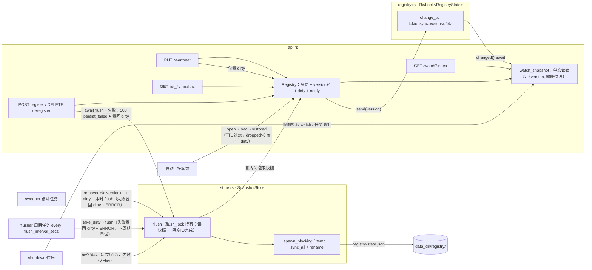

# 架构设计：velox-registry v0.2「状态持久化 + watch 推送」（registry 侧）

> feature slug: `registry-persistence-watch`
> 工序：F-AA 第 2 轮架构返工（GATE2 REWORK 返工波次）；分支基线 `develop @ 28c9114`。
> 输入：`01-requirements.md`（SA 定向修订 FR-2/AC-1/AC-2/Q2/Q6 后版本，SHA-256 `7285db59…996`）；`01-requirements-review.md`（定向 GATE1 PASS：G2-4/G2-5 需求归属闭合，其余未关闭）；`02-architecture-review.md`（GATE2 REWORK，§8 G2-1…8 与 §9 非阻塞项为本文唯一返工依据）；`03-test-cases.md`（TA v1 定稿，其中「待 AA 对齐」条目已与本文对齐；其引用的架构旧稿 SHA-256 `e51c5bb1…` 即本文替换版本）。行文参考：`docs/specs/addlog/02-architecture.md`。
> 状态：**返工定稿，待 GATE2 复审**。本文不推翻 GATE1 的范围与总体方向；复审通过前不进入实施，文中代码均为给 DA 的实施清单，非已实现功能。
> 日期：2026-11-26
> 范围红线：仅改 `velox-registry/` 及文档；`velox-mesh` / `velox-config` / `velox-demo` 零改动（含脚本）；watch 仅 registry 侧 HTTP+JSON 长轮询；单机落盘，无分布式一致性。
> 返工落实对照：G2-1/2/3/5/6、§9 非阻塞项、G2-4 同步逐条的落实章节号见 §10，供复审对照。

## 1. 需求引用（FR/AC 编号映射）

| FR | 本文档落位 |
|----|-----------|
| FR-1 结构变更即时写穿落盘（全量快照、绝对时间戳） | §4.2 `SnapshotStore`、§4.3 Registry 挂接、§5 文件格式（隔离子目录布局，G2-5） |
| FR-2 心跳：内存即时 + 脏标记周期刷盘；恢复窗口语义 | §4.3 `dirty` 标记与失败置回、§4.4 刷盘任务、§5.1（写入时机与失败重试，G2-1）；恢复窗口按 SA 修订版 FR-2，§4.5/§5.1 已删除「恢复硬保证」措辞（G2-4 同步） |
| FR-3 重启恢复、`instance_id` 不变、接客前完成 | §4.4 装配时序（main.rs 步骤 3 在 bind 之前） |
| FR-4 恢复按绝对时间 TTL 判定、超时不恢复（严格 `age > ttl`） | §4.3 `Registry::restored`、§5.2 恢复流程 |
| FR-5 `[persistence]` 配置节（含禁用时的校验边界，G2-3） | §4.5 config.rs |
| FR-6 恢复失败降级：损坏跳过不阻断 | §4.2 `LoadOutcome::Corrupted`、§5.2 |
| FR-7 落盘失败：内存优先 + ERROR；结构变更 5xx；失败自动重试 | §4.6 error.rs（500 `persist_failed`）、§4.3/§4.4（失败置 dirty 重试，G2-1） |
| FR-8 watch 端点（长轮询 + 全局版本号；缺省 index 分支，G2-2） | §4.3 版本号、§4.7 api.rs watch handler |
| FR-9 变更触发范围 | §4.3 版本递增规则表 |
| FR-10 timeout 校验（含解析失败统一映射，G2-2） | §4.7 参数解析与校验、§4.6 `invalid_parameter` |
| FR-11 v0.1 兼容 | §4.6（AppError 保持 Registry 变体语义）、§4.7（既有路由与错误行为不动）、§6.3 回归测试（断言保留、setup 适配 AppState） |

| AC | 覆盖手段（§6 测试策略） |
|----|------------------------|
| AC-1/AC-2 重启恢复 + 同 id 心跳（前提：恢复时落盘心跳 age ≤ 本次 TTL，FR-2 恢复窗口） | `tests/persistence.rs::restart_recovers_instances`（窗口前提显式构造） |
| AC-3 刷盘周期 + 心跳不等待落盘 + 失败后自动重试 | `tests/persistence.rs::heartbeat_flush_is_periodic` + 设计保证（§4.3 心跳路径无 flush await）+ 失败置 dirty 下周期重试（§4.4，G2-1） |
| AC-4 超 TTL 不恢复 | `Registry::restored` 单测 + 集成（固定 epoch 注入，严格 `age > ttl` 边界） |
| AC-5 默认值/关闭/非法值（含禁用态校验边界与部分节默认，G2-3） | `tests/config.rs` + `tests/persistence.rs::disabled_persists_nothing` |
| AC-6 损坏跳过（含 format_version 不识别） | `tests/persistence.rs::corrupted_snapshot_skipped` |
| AC-7 落盘失败内存优先 | `tests/persistence.rs::readonly_dir_register_semantics`（先正常 open 再注入写失败；500 `persist_failed`） |
| AC-8 watch 唤醒 ≤1s（严格）/ 旧 index 与缺省 index 立即返回 | `tests/watch.rs`（含缺省 index 分支，G2-2） |
| AC-9 关停唤醒挂起 watch | `tests/watch.rs::shutdown_wakes_watchers` |
| AC-10 剔除触发（批次 +1）/ 查询不触发 | `tests/watch.rs`（含一次 sweep 多实例整体 +1） |
| AC-11 timeout 非法 400 / 默认精确 30 | `tests/watch.rs` + 参数解析单测（含 `QueryRejection` → 400 映射，G2-2） |
| AC-12 v0.1 回归 + mesh 零改动 | 既有 `api.rs` 单测断言保留（setup 适配 AppState）+ `tests/compat.rs` + demo 只读回归（零脚本修改） |
| AC-13 性能 ≤2× 真 v0.1 基线（`28c9114`） | 验收期性能专项（§6.4，G2-6：非常规 CI 门槛，但验收不可省略；`enabled=false` 仅辅助对照） |
| AC-14 原子写 | 代码审查点 + open 清 tmp 测试 + **独立崩溃注入子用例**（§6.4，TC-18b 式实跑） |

## 2. 现状分析（相关模块与既有模式）

### 2.1 velox-registry v0.1（develop @ dff2006）

| 文件 | 现状 | 与本 feature 的关系 |
|------|------|--------------------|
| `src/registry.rs` | `RwLock<HashMap<String, HashMap<Uuid, Instance>>>`；`Instance.last_heartbeat: Instant`；register/heartbeat/deregister/sweep_expired/list_* 全部锁内纯内存 | 本期改造核心：状态加版本号、挂接落盘与变更广播 |
| `src/api.rs` | 6 条 v0.1 路由；handler 薄（协议转换）；`tower::ServiceExt::oneshot` 单测 | 新增 watch 路由；v0.1 路由与断言不动（setup 适配 AppState） |
| `src/config.rs` | TOML + env 覆盖（`VELOX_REGISTRY__<SECTION>__<FIELD>`）+ `serde(default)`；无集中 validate（env 解析失败即 fail fast） | 新增 `[persistence]` 节；引入集中 `validate()`（参照 velox-config） |
| `src/error.rs` | `AppError(RegistryError)` → 404 `service_not_found`/`instance_not_found`，统一 `{"code","message"}` | 扩展变体：落盘失败、非法参数 |
| `src/main.rs` | 装配：config → tracing → Registry → shutdown watch 通道 → sweeper（select 优雅退出）→ bind → serve | 插入启动恢复、刷盘任务、关停最终落盘 |
| `tests/` | **不存在**（NFR-6 要求新建） | 新建集成测试目录；当前为 bin crate、模块在 main 中私有，需 lib 入口（§4.1，G2-7 配套） |

### 2.2 可复用的 velox-config 既有模式（`velox-config/src/store.rs`）

- **并发纪律**（QA-4/G2-1 采纳）：`std::sync::RwLock` 锁内纯内存；`tokio::sync::Mutex`（flush_lock）串行化落盘；**快照必须在 flush_lock 锁内读取，且锁持续持有到阻塞 IO 完成才释放**（G2-1 明确覆盖范围），保证并发写不把文件回退到旧快照；真实文件写入走 `spawn_blocking`。
- **恢复时序**（FR-3 采纳）：启动期一次性同步 IO，发生在 HTTP 接客之前；损坏文件整文件跳过 + WARN，不阻断启动。
- **写穿失败语义**（FR-7/Q3 采纳）：内存已更新但落盘失败返回 Err（由 HTTP 层映射 5xx）。
- **QA-1 修正**：velox-config 现状为 `std::fs::write` 直接覆盖，**没有** temp+rename 原子写。本期复用的是上述「并发纪律 / 恢复时序 / 损坏跳过」模式；**原子写（NFR-5）为本期新增**，不在 velox-config 中补（范围外），仅 registry 实现。
- **边界警示（G2-5）**：velox-config `Store::open` 会**非递归扫描 data_dir 顶层全部 `.json`**，stem 须为合法 namespace（字母数字/`-`/`_`），内容按 `BTreeMap<String, Value>` 解析——registry 快照不得落在该扫描范围内（§4.2 隔离布局）。

### 2.3 依赖盘点（NFR-6：预期零新增）

- 长轮询挂起：`tokio::sync::watch`（已在用，main.rs shutdown / mesh discovery 同款）；`tokio::time::timeout/sleep_until`。
- 原子写：`std::fs` temp + `rename`（无新依赖）。
- 序列化：serde/serde_json；UUID：uuid（`serde` feature 已开）。
- 结论：本设计无需新增任何 crate，全部取自 `[workspace.dependencies]`。NFR-6 原文为「**预期**无需新增依赖」——零新增是本设计的选择性结论，不是架构红线：若实施中确需新依赖，须重新评审取舍，而非默认引入或绝对禁止（评审措辞纠正）。

## 3. 方案总览

推荐方案一句话：**「全量快照单文件 + 写穿/脏刷双通道落盘 + 锁内版本号 + tokio watch 长轮询」**——持久化与变更感知共用同一把领域锁保证一致性，落盘沿用 velox-config 串行纪律（锁覆盖完整 IO）并新增原子替换；快照存于 data_dir 下 registry 专属子目录，与 velox-config 的 namespace 扫描隔离。

### 3.1 数据流



### 3.2 关键不变量

1. **版本号与状态原子可读**：`version` 与实例表同处一把 `RwLock`（`RegistryState`），watch 一次读锁同时取得 `(version, 快照)`，杜绝「版本新、快照旧」错配（B-11）。
2. **文件不回退**（QA-4/G2-1）：所有落盘经 `SnapshotStore::flush` 串行（tokio Mutex），快照在该锁内读取，**且 flush_lock 自读快照起持续持有至阻塞 IO 完成才释放**；内存修改先于落盘被写锁串行化提交，后执行的 flush 读到的状态永不早于先执行的 flush。
3. **领域锁内无 IO、无 await**（NFR-1）：领域锁临界区只做内存操作（含快照克隆）；flush_lock 是异步锁、允许跨 await 持有——这正是不变量 2 覆盖范围的实现方式；文件 IO 在阻塞线程池执行。
4. **注册成功 ⇒ 已落盘**（Q3/QA-6）：register/deregister 在响应前 await flush，失败返回 500；心跳永不因落盘报错。
5. **失败必重试**（G2-1）：任何路径 flush 失败 → `mark_dirty()`，由周期 flusher 持续重试直至成功或进程退出（关停最终落盘除外，进程退出无重试目标）。**成功 flush 不清除任何 dirty**——快照之后的新修改只由其自身置位的 dirty 表达；纪律：先 `take_dirty`、再在锁内取快照（顺序颠倒会清掉并发新修改，见 §4.3）。

## 4. 模块与接口设计

### 4.1 模块划分（全部在 `velox-registry/src/`）

| 模块 | 职责 | 改动性质 |
|------|------|---------|
| `registry.rs` | 领域模型：实例表 + **版本号** + **脏标记**（含失败置回）+ **变更广播通道**；快照 DTO 转换（Instant↔epoch）；恢复 TTL 过滤 | 修改 |
| `store.rs`（新建） | 快照文件 IO：隔离子目录路径常量、原子写、启动恢复读取、flush 串行化（锁覆盖完整 IO）；**持有文件格式 DTO**（`RegistrySnapshot`/`PersistedInstance`） | 新建 |
| `api.rs` | 路由；watch 长轮询 handler（缺省 index 分支 + QueryRejection 映射）；`AppState`（registry + 可选 store + shutdown rx） | 修改 |
| `config.rs` | `[persistence]` 配置节 + env 覆盖 + 集中 validate（含禁用态边界） | 修改 |
| `error.rs` | `AppError` 扩展（persist/invalid_param），保持既有映射 | 修改 |
| `main.rs` | 装配：恢复 → sweeper（含剔除后 flush）→ flusher → bind → serve → 关停最终落盘 | 修改 |
| `lib.rs`（新建） | **测试入口（G2-7 配套，TA §2.1 等待项）**：`pub mod` 导出 registry/store/api/config/error，main.rs 变薄壳调用 `velox_registry::run()`；使 `tests/` 集成测试可直接 import，无需 pub 修饰 main 私有模块 | 新建 |

> 不新建 `watch.rs`：变更通道仅是 Registry 的一个字段 + api 里的一个 handler，无独立状态，拆模块无收益。

### 4.2 `store.rs`（新建）——快照文件 IO

```rust
/// 文件格式 DTO（本模块持有文件契约；format_version 预留演进，解析不识别即按损坏跳过）
#[derive(Serialize, Deserialize)]
pub struct RegistrySnapshot {
    pub format_version: u32,                       // 恒为 1
    pub saved_at_epoch: u64,                       // 信息性字段，恢复逻辑不依赖
    pub services: BTreeMap<String, Vec<PersistedInstance>>,   // 服务名排序；实例按 (address, port, id) 排序
}
#[derive(Serialize, Deserialize)]
pub struct PersistedInstance {
    pub id: Uuid,
    pub address: String,
    pub port: u16,
    pub metadata: HashMap<String, String>,         // 遍历顺序不保证字节稳定（§9 非阻塞纠正：只承诺内容可恢复）
    pub last_heartbeat_epoch: u64,                 // 绝对时间戳（FR-1）
}

pub enum LoadOutcome {
    Restored(RegistrySnapshot),   // 合法快照
    Corrupted(String),            // JSON 非法 / 字段缺失 / format_version != 1（FR-6：整文件跳过）
    Missing,                      // 首次启动或 enabled=false（INFO 即可）
}

pub struct SnapshotStore { data_dir: PathBuf, dir: PathBuf, flush_lock: tokio::sync::Mutex<()> }
// dir = data_dir.join("registry")（隔离子目录，G2-5）

impl SnapshotStore {
    /// create_dir_all(`<data_dir>/registry/`)：data_dir 与子目录一并递归创建
    ///   （失败 → Err 含路径，B-3/TC-15 fail fast；父路径组件为普通文件同样失败）；
    /// 尽力清理残留 `<dir>/registry-state.json.tmp`（清理发生在 open，先于任何写入；
    ///   恢复只依赖旧正式文件，TC-18a）
    pub fn open(data_dir: impl Into<PathBuf>) -> anyhow::Result<Self>;

    /// 同步读取，仅启动期调用（不在请求路径）
    pub fn load(&self) -> LoadOutcome;

    /// 串行化落盘（G2-1 纪律）：获取 flush_lock → 锁内调用 snapshot_of（纯内存闭包，
    ///   短暂取领域读锁完成克隆后即释放领域锁）→ **持锁 await** spawn_blocking
    ///   （写 `{file}.tmp` → `sync_all()` → `rename`）→ IO 完成后才释放 flush_lock。
    ///   覆盖范围 = 「读快照 + 完整阻塞 IO」，不是「读快照后即释放」（QA-4/G2-1）。
    pub async fn flush<F>(&self, snapshot_of: F) -> Result<(), StoreError>
    where F: FnOnce() -> RegistrySnapshot;
}

pub enum StoreError { Io(std::io::Error), Json(serde_json::Error) }   // thiserror
```

要点定案：

- **隔离布局（G2-5 定案，对齐 TA F-PATH/TC-37b）**：快照文件为 `{data_dir}/registry/registry-state.json`，tmp 为同子目录 `registry-state.json.tmp`。`data_dir` 配置默认仍为 `./data`（FR-5/AC-5 默认值**不变**；子目录是 registry 内部布局，不是新的配置项）。依据：velox-config `Store::open` 非递归扫描 data_dir 顶层 `*.json`、`registry-state` 是合法 namespace、快照顶层 JSON 对象可被其 `BTreeMap<String, Value>` 解析——若放顶层会被 config 装载为 namespace，后续对该 namespace 的 put/delete 会经 flush 覆盖同一路径、破坏快照。子目录避开该扫描，**config 代码零修改**。旧稿「与 config 共目录、文件名不同即无冲突」的依据作废（§9 Q6 已更正）；B-10「两个 registry 实例不得共 data_dir」约束保留——它属另一类部署关系，不得再被用作 registry 与 config 共用顶层目录安全的证明。两条部署约束（单实例独占；与 config 同 cwd 的隔离依据）均写入 README。
- **原子写 = temp + sync_all + rename**：temp 用固定名（flush_lock 已串行化单进程写入，固定名避免 tmp 堆积；open 时清理崩溃残留）。`sync_all()` 的保证范围：**temp 文件内容在 rename 前落盘**；未对父目录执行 fsync，极端掉电下目录项是否持久化**不作承诺**（§9 非阻塞纠正：表述收窄；本期接受、不扩为额外 AC，掉电强持久性不在承诺内）。fsync 频率按路径区分：心跳周期刷盘每 `flush_interval_secs` 至多一次；结构写穿（register/deregister/sweep）**每次变更各一次**，总量随注册 churn 变化，由 AC-13 专项验证（§9 纠正：不宣称「所有 IO 每 5s 一次」）。
- **损坏判定**（FR-6）：读文件失败、JSON 解析失败、必填字段缺失（serde 默认行为即报错）、`format_version != 1`（不识别版本）——统一返回 `Corrupted(reason)`，调用方 WARN 后按空注册表启动；**不做部分恢复**。
- 快照克隆（约数百 KB @ 1000 实例）在领域读锁内完成（与 velox-config `.cloned()` 同款）；克隆完成领域锁即释放，**flush_lock 仍持有直至写文件完成**（写文件在阻塞线程池）。

### 4.3 `registry.rs`（修改）——领域模型

```rust
struct RegistryState {
    version: u64,                                              // 全局变更版本号，从 0 起（FR-8：不持久化，重启归零）
    services: HashMap<String, HashMap<Uuid, Instance>>,        // v0.1 原样
}
struct Instance {
    address: String, port: u16,
    metadata: HashMap<String, String>,
    last_heartbeat: Instant,                                   // 内存保持 Instant（运行期 TTL 语义与 v0.1 逐字节一致）
}

pub struct RestoreStats { services: usize, instances: usize, dropped_expired: usize }

pub struct Registry {
    state: RwLock<RegistryState>,
    ttl: Duration,
    dirty: AtomicBool,                                         // true = 内存新于文件；置位方：任何 mutation、任一 flush 失败后的置回（G2-1）
    change_tx: tokio::sync::watch::Sender<u64>,                // watch::channel(0)；send 失败（无接收者）忽略
}

impl Registry {
    pub fn new(ttl: Duration) -> Self;
    /// 启动恢复：now_epoch 下按 `now_epoch - last_heartbeat_epoch > ttl_secs` 丢弃超时实例（FR-4，
    /// 严格大于：age == ttl 保留）。空/缺失服务条目不建。仅恢复期同步调用。
    /// **dropped_expired > 0 → mark_dirty（延迟清理，G2-4/§9 非阻塞纠正）**：被过滤实例仍在文件中，
    /// 由周期 flusher 在一个周期内把文件改写为过滤后状态；不做启动期额外同步写（FR-3 时序不变）。
    /// dropped_expired == 0 → 不置 dirty。启动后立即崩溃时，文件中的过期实例在下次启动被再次过滤，幂等无害。
    pub fn restored(ttl: Duration, snapshot: RegistrySnapshot, now_epoch: u64) -> (Self, RestoreStats);

    pub fn register(&self, service: &str, address: String, port: u16,
                    metadata: HashMap<String, String>) -> InstanceView;          // +version/dirty/notify
    pub fn heartbeat(&self, service: &str, id: Uuid) -> Result<(), RegistryError>; // 置 dirty；仅「复活」时 +version/notify
    pub fn deregister(&self, service: &str, id: Uuid) -> Result<(), RegistryError>; // +version/dirty/notify
    pub fn sweep_expired(&self) -> usize;                                        // removed>0 时整体 +version×1 / dirty / notify

    // v0.1 查询接口签名与语义不变（FR-11）
    pub fn list_services(&self) -> Vec<String>;
    pub fn list_instances(&self, service: &str, only_healthy: bool) -> Result<Vec<InstanceView>, RegistryError>;

    // watch 支撑
    pub fn version(&self) -> u64;
    pub fn subscribe(&self) -> tokio::sync::watch::Receiver<u64>;
    /// 单次读锁同时取 (version, 各服务健康实例列表)；服务名 BTreeMap 排序，实例按 (address, port) 排序，
    /// 无健康实例的服务不出现在 map 中
    pub fn watch_snapshot(&self) -> (u64, BTreeMap<String, Vec<InstanceView>>);
    /// 持久化全量快照（含未健康未剔除实例；恢复期由 FR-4 二次过滤）
    pub fn snapshot(&self) -> RegistrySnapshot;      // 内含 Instant→epoch 换算 + saved_at_epoch=now
    /// 原子取走脏标记；true 则调用方执行 flush（FR-2）。
    /// **纪律（G2-1/TC-05c）：必须先 take、再在 flush_lock 内取快照**——顺序颠倒时，
    /// 「取快照 → 并发 mutation 置 dirty → 成功 flush」会丢失该新修改的重试标记。
    pub fn take_dirty(&self) -> bool;
    /// flush 失败后原子置回（幂等，G2-1）。成功路径**不得**调用：成功不清除任何标记，
    /// 快照之后的新 dirty 只由其自身置位表达。失败置回后，即使无新 mutation，下个周期也会重试（TC-05b/TC-17）。
    pub fn mark_dirty(&self);
}
```

**版本号递增规则**（FR-9 + QA-2 + QA-3 定案，均在写锁内完成、与状态变更原子）：

| 事件 | version | 说明 |
|------|---------|------|
| 注册成功 | +1 | |
| 主动注销 | +1 | |
| sweep 一批移除 k≥1 个实例 | +1 | **批次整体 +1**（QA-2 定案；一次 sweep 移除多实例仍 +1，watch 本就全量快照 + 通道合并唤醒，客户端只关心「变了」） |
| 心跳使 unhealthy→healthy（「复活」） | +1 | QA-3 定案：写锁内一次 `elapsed > ttl` 判断，迟到心跳翻回健康时唤醒 watch，避免快照内容变化但客户端等满 timeout |
| 心跳（健康内续约） | 不 +1 | 内容无变化；仅置 dirty |
| 健康 healthy→unhealthy 翻转（TTL 到点、sweep 前） | 不 +1 | FR-9.4 定案：无离散事件可挂接；收敛延迟上限 = timeout_secs（超时响应本就携带当前快照），文档明示为已知取舍 |
| 查询（list/healthz/watch 自身） | 不 +1 | FR-9 |

**时间换算**（放在 registry.rs，DTO 只携带 u64）：

```rust
fn now_epoch() -> u64 { SystemTime::now().duration_since(UNIX_EPOCH).unwrap_or_default().as_secs() }
// 快照：now_epoch().saturating_sub(instant.elapsed().as_secs())
// 恢复：age = now_epoch.saturating_sub(epoch)；先按 age > ttl 丢弃（FR-4，严格大于）；
//       存活者 last_heartbeat = Instant::now().checked_sub(age)
//         .unwrap_or_else(|| Instant::now())   // age 超过进程运行时长的钳位兜底：
//         此时实例已通过 TTL 过滤，钳位只影响下次到期判定的秒级偏差，下次心跳即复位。
//       ⚠️ 实现必须用 checked_sub，禁止直接 `Instant::now() - Duration`（age 大时 panic）。
```

时钟回拨（B-9）为已知限制，不做专门防御，README 记录。

### 4.4 `main.rs`（修改）——装配时序（FR-3/NFR-2/B-8）

```
 1. Config::load(args)                      // 解析期拒绝 + validate 在 load 内完成，fail fast（AC-5/G2-3）
 2. tracing init（现状不动）
 3. 持久化初始化（接客之前，一次性同步 IO）：
      enabled=true  → SnapshotStore::open(data_dir)          // 递归建 <data_dir>/registry；不可建 → 启动失败含路径（B-3）
                    → store.load()                            // Corrupted → WARN（含路径+原因）按空表启动（FR-6）
                    → Registry::restored(...)                 // FR-4 TTL 过滤；dropped_expired>0 → 置 dirty（延迟清理）
                    → INFO：enabled/data_dir/flush_interval/恢复服务数/实例数/丢弃数/skipped
                      （NFR-4 + TC-39：skipped = 跳过的损坏文件数，单文件布局下取值 0 或 1）
      enabled=false → Registry::new(...)，store=None        // 与 v0.1 完全一致（FR-5）；跨项校验不适用（§4.5）
 4. 建 shutdown watch 通道（现状）
 5. sweeper 任务（现状 select 退出）+ 追加：removed>0 →
      version/notify/dirty 已在 sweep_expired 内 → 即时 store.flush
      （失败：registry.mark_dirty() + ERROR 日志；后台任务不外发，由周期任务重试，G2-1）
 6. flusher 任务（仅 enabled）：interval(flush_interval_secs)，select 退出；
      每 tick：registry.take_dirty() → true 才 store.flush(|| registry.snapshot())（G2-1 纪律）：
        Ok(())  → 无动作（不清除任何标记；快照之后的新 dirty 留给下个周期）
        Err(e)  → registry.mark_dirty() + error! 日志 → 下个周期自动重试，直至成功或进程退出；
                  不做退避——周期本身即重试节流（TC-05b：撤销故障后无新 mutation 也能追平）
 7. bind TcpListener（恢复完成后才接客，FR-3）
 8. axum::serve(...).with_graceful_shutdown(shutdown_signal)   // shutdown_tx.send(true) → 挂起 watch 全部唤醒（AC-9）
 9. serve 返回后：await sweeper/flusher 退出；最终落盘一次
      （B-8 尽力而为：store.flush，失败仅 ERROR 日志——进程即将退出，无重试目标；
       与 flusher 最后一 tick 经 flush_lock 串行，幂等无害）
```
### 4.5 `config.rs`（修改）——`[persistence]` 配置节（G2-3/G2-4）

```rust
#[derive(Debug, Clone, Deserialize)]
#[serde(default)]                       // 容器级：节内缺失字段从手写 Default 取值（部分节可解析，G2-3）
pub struct PersistenceConfig {
    pub enabled: bool,             // Default: true   （Q1 定案：默认开启）
    pub data_dir: String,          // Default: "./data"（Q6 定案；实际文件在其 registry/ 子目录，§4.2）
    pub flush_interval_secs: u64,  // Default: 5      （FR-2）
}

impl Default for PersistenceConfig {
    fn default() -> Self {
        Self { enabled: true, data_dir: "./data".to_string(), flush_interval_secs: 5 }
    }
}
```

- **容器级 `#[serde(default)]` + 手写 `Default`（G2-3/TC-12）**：`bool` 的逐字段 serde 默认只会给 `false`、`u64` 给 `0`，均不合语义；容器级缺省从 `Default::default()` 补齐，使 `[persistence]` 整节缺失、或节内只写部分字段（如仅 `enabled = false`、仅 `data_dir`）都能取其余默认值 true / ./data / 5。TOML 与 env 两途径均按此验证。
- env 覆盖：`VELOX_REGISTRY__PERSISTENCE__ENABLED`（仅接受 `true`/`false`，错误含实际值）、`...__DATA_DIR`、`...__FLUSH_INTERVAL_SECS`；env 优先于 TOML（既有机制）。
- 引入集中 `Config::validate()`（参照 velox-config，load 末尾调用），均为 fail fast、错误含配置项名与实际值（AC-5）：

  **解析期拒绝（反序列化失败即启动失败，无论 enabled）**：TOML 字段类型不符（如 `flush_interval_secs = -1`）、env 值解析失败（`ENABLED` 非 `true`/`false`、`FLUSH_INTERVAL_SECS` 负数/非数字）→ 拒绝，错误含实际值。

  validate() 规则：
  1. `persistence.flush_interval_secs == 0` → **拒绝（无论 enabled）**：0 对周期字段本身非法，与是否启用无关（G2-3 明确的禁用态仍拒绝项之一）；
  2. `persistence.data_dir` 为空 → **拒绝（无论 enabled）**：同理（禁用态仍拒绝项之二）；
  3. `enabled = true` 且 `persistence.flush_interval_secs >= registry.heartbeat_ttl_secs` → 拒绝。**语义（G2-4 同步）**：该校验**缩小正常刷盘路径的心跳新鲜度丢失窗口**（落盘心跳最大陈旧度 ≈ flush_interval），**不构成「健康实例恢复后必存活」的硬保证**——能否恢复取决于恢复时 `now − 已持久化 heartbeat ≤ 本次启动 TTL`（FR-2 恢复窗口）；即使真实最后心跳未超 TTL，落盘心跳偏旧也会按 FR-4 严格丢弃。默认 5 < 30 满足；
  4. `enabled = false` 时**不执行规则 3**（跨项校验仅适用启用态，G2-3）：`enabled=false + TTL1 + 默认 flush5` 合法可运行，行为与 v0.1 完全一致（FR-5/AC-5）。除规则 1/2 所列「字段本身非法」外，禁用态无其他拒绝项——不存在含糊的「全部跳过」。

- 同步更新 `config/velox-registry.toml`（带注释的 `[persistence]` 节）与 README 配置表（NFR-6）；README 同时写明两条部署约束（B-10 单实例独占 data_dir；与 velox-config 同 cwd 的隔离依据，§4.2）。

### 4.6 `error.rs`（修改）——错误变体（QA-6 定案）

```rust
pub enum AppError {
    Registry(RegistryError),   // 既有：404 service_not_found / instance_not_found，映射不变（FR-11）
    Persist(String),           // 500 + {"code":"persist_failed","message":"registry state persist failed"}
                               // message 不含内部路径/IO 细节；细节由调用点 error! 日志外显（FR-7/NFR-4）
    InvalidParam(String),      // 400 + {"code":"invalid_parameter", ...}
                               // 两个来源：范围校验（如 "timeout_secs=0（要求 1..=300）"）
                               // 与 Query 解析失败（如 "index=abc 无法解析为 u64"，G2-2）
}
```

映射表：

| 变体 | 状态码 | code | 触发点 |
|------|--------|------|--------|
| `Registry(InstanceNotFound)` | 404 | `instance_not_found` | 心跳/注销（v0.1 不变） |
| `Registry(ServiceNotFound)` | 404 | `service_not_found` | 列表/心跳/注销（v0.1 不变） |
| `Persist` | 500 | `persist_failed` | register/deregister 的 await flush 失败（Q3/QA-6；失败同时 `mark_dirty` 供周期重试，G2-1） |
| `InvalidParam` | 400 | `invalid_parameter` | watch 参数范围校验（FR-10）**及 `QueryRejection` 解析失败**（仅 watch 新端点捕获映射，G2-2；既有六端点错误行为不变） |

落盘失败时的 ERROR 日志在 **api handler / sweeper / flusher / 关停路径各自记录**（`error!(error = %e, path = …, "persist failed")`），错误细节不进 HTTP 响应。

### 4.7 `api.rs`（修改）——watch 端点与 AppState（G2-2/RQ-3 定案）

```rust
pub struct AppState {
    pub registry: Arc<Registry>,
    pub store: Option<Arc<SnapshotStore>>,          // enabled=false 时 None
    pub shutdown: tokio::sync::watch::Receiver<bool>, // 复用 main 的关停广播
}
pub fn router(state: Arc<AppState>) -> Router;      // 内部签名变化，外部 HTTP API 不变

// 新增路由（追加，不动既有 6 条）：
// GET /api/v1/registry/watch?index={u64}&timeout_secs={u64}
#[derive(Deserialize)] struct WatchQuery { index: Option<u64>, timeout_secs: Option<u64> }

// handler 签名（G2-2）：以 Result 接收，解析失败进入统一映射，仅作用于本端点
async fn watch(State(state): State<Arc<AppState>>,
               params: Result<Query<WatchQuery>, QueryRejection>) -> Result<Json<WatchResponse>, AppError>
```

watch handler 定案逻辑（FR-8/Q4/Q5/B-7/RQ-3）：

1. **参数解析（第一步，先于一切分支）**：`Query` 反序列化失败（非数字、负数、u64 溢出、空值等 `QueryRejection`，发生于业务校验之前）→ `AppError::InvalidParam`（400 `invalid_parameter`，message 含被拒参数名与原因摘要）。**仅 watch 新端点做此捕获**，既有端点错误行为不变（FR-11）。
2. **参数范围校验**：`timeout_secs` 缺省 30（常量 `WATCH_TIMEOUT_DEFAULT_SECS=30`）；`0` 或 `>300`（`WATCH_TIMEOUT_MAX_SECS=300`）→ `AppError::InvalidParam`（400，AC-11）。**先完整校验所有参数，再进入 index 分支**——缺省 index 的立即分支同样必须先通过校验（TC-22）。
3. `subscribe()` 先于 `watch_snapshot()`（订阅先于读，杜绝「读后变、通道漏通知」窗口）。
4. **index 分支（RQ-3 定案，保留 `Option<u64>` 区分缺省与显式 0）**：
   - `index` 缺省（None）→ **首次快照请求：立即返回**当前 `(version, services)`。覆盖三种版本场景：空表 version=0（返回空 map、index=0）、恢复有实例 version=0（返回恢复快照、index=0）、version>0；
   - `index = Some(i)`：`i != 当前 version` → **立即返回**当前 `(version, services)`（覆盖 index 过旧与 B-7 index 过大，后者以响应内新 index 纠正客户端）；`i == version` → 挂起（步骤 5）。
   - 显式 `index=0` 在 version=0 时按「相等」挂起，**不与缺省混同**；version>0 时立即返回。
5. `index == version` → `select!` 三路等待：
   - `rx.changed()`：`borrow_and_update()` 后新 version != index → 返回最新 `(version, services)`（长轮询唤醒，通道即时 notify，满足 AC-8 的 1s 内）；若版本未越过 index（理论不发生，防御性 continue）。
   - `shutdown.changed()`：优雅关停 → 立即返回当前快照（200），连接随服务关闭（AC-9「唤醒/断开」）。**必须**唤醒而非等超时：axum graceful shutdown 会等待在途连接完成，不唤醒则关停被挂起请求拖到 timeout_secs。
   - `sleep_until(deadline)`：超时 → 返回当前 `(version, services)`，HTTP 200（FR-8）。
6. 响应体：`{"index": u64, "services": { "<svc>": [ InstanceView... ] }}`，仅健康实例，复用 `InstanceView` 序列化（与列表端点同构，消费方零学习成本）；无健康实例的服务不出现在 map。
7. 无服务端订阅会话（B-6）：每次请求独立，断开即弃，客户端重携原 index 重入即可。

**心跳/注册/注销挂接**：`register`/`deregister` handler 在领域变更后 `state.persist_after_change().await`（`None → Ok(())`；`Some → store.flush(|| registry.snapshot())`）；失败 → `registry.mark_dirty()`（供周期任务重试，G2-1/TC-16）+ 记 ERROR + `AppError::Persist`。`heartbeat` handler 不 flush（registry.heartbeat 内部仅置 dirty），故心跳永不因落盘失败报错（FR-2/Q3）。

### 4.8 并发模型小结（NFR-1/QA-4/B-11/G2-1）

| 锁 | 保护对象 | 纪律 |
|----|---------|------|
| `std::sync::RwLock<RegistryState>` | version + 实例表 | 临界区纯内存（读快照的克隆也在锁内，数百 KB 量级可接受）；无 IO、无 await；**只包闭包内短暂克隆，不与 IO 共持**（G2-1） |
| `tokio::sync::watch::Sender<u64>` | 变更广播 | send 非阻塞，写锁内调用安全；无接收者时错误忽略 |
| `AtomicBool`（dirty） | 脏标记 | 仅两种操作：`take`（swap false，**仅由 flusher 在读快照之前调用**）与 `mark`（mutation 置位 / 失败置回，幂等）；**成功路径不清除**；多余一次 flush 无害（G2-1） |
| `tokio::sync::Mutex<()>`（SnapshotStore.flush_lock） | 落盘串行 | **自读快照闭包起持续持有，直到 spawn_blocking 写文件（含 rename）完成才释放**；结构写穿、sweep flush、周期 flush、关停 flush 四路共用（G2-1：覆盖范围=读快照+完整 IO，非「锁外写文件」） |

死锁评估（§9 非阻塞纠正：修正旧稿「四把锁互不嵌套」的不精确表述）：存在 **flush_lock → 领域读锁** 的短暂嵌套（闭包克隆快照），但**不存在「领域锁 → flush_lock」的等待边**——领域锁临界区不发起、不等待任何 flush（mutation 与 flush 在 handler/sweeper/flusher 中先后发生，不共持）；锁等待图无环。不为消除文字上的嵌套而把快照读取移出锁内（否则 QA-4 的旧写覆盖新写风险重现）。

## 5. 数据模型与迁移

### 5.1 落盘文件（`{data_dir}/registry/registry-state.json`）

```json
{
  "format_version": 1,
  "saved_at_epoch": 1737000000,
  "services": {
    "svc-a": [
      {
        "id": "0f8e…",
        "address": "172.17.0.2",
        "port": 9000,
        "metadata": { "version": "0.1.0" },
        "last_heartbeat_epoch": 1736999995
      }
    ]
  }
}
```

tmp 与快照同在 `registry/` 子目录；velox-config（同 cwd 部署）既不读取该子目录，其自身 namespace 文件也均在 data_dir 顶层（`{data_dir}/{namespace}.json`），互不装载、互不覆盖（TC-37b 验证）。

写入时机与失败语义汇总（FR-1/FR-2/Q2 定案 + G2-1 重试纪律）：

| 路径 | 时机 | 失败语义 |
|------|------|---------|
| register / deregister | 响应前 await flush（写穿） | 500 `persist_failed`（Q3）+ `mark_dirty` → 周期任务自动重试（G2-1/TC-16） |
| sweep 移除>0 | sweeper 任务即时 flush | ERROR + `mark_dirty` 重试（TC-17：撤销故障后无新 mutation 也追平，含全空表场景） |
| heartbeat | 仅置 dirty，由 flusher 每 `flush_interval_secs` 合并刷盘 | flusher 失败：ERROR + `mark_dirty`，下周期重试（TC-05b）。新鲜度代价按 FR-2：**无 IO 故障、无调度严重延迟、刷盘按期完成**时，崩溃丢最近一个刷盘周期内尚未落盘的心跳新鲜度；存在故障/严重延迟时不承诺一个周期的硬上界。`flush < ttl` 校验仅缩小该窗口，**不构成恢复硬保证**（G2-4 同步）——可恢复以恢复时 `now − 已持久化 heartbeat ≤ 本次 TTL` 为准 |
| 优雅关停 | 最终 flush 一次（尽力而为） | ERROR 日志；进程退出，不重试（B-8） |
| `enabled=false` | 全部不发生 | —（v0.1 等价） |

### 5.2 恢复流程（FR-3/FR-4/FR-6，全部在接客前）

```
open（递归建 <data_dir>/registry，fail fast / 清残留 tmp） → load
  ├─ Missing            → 空表启动（INFO；首次空启动不要求快照文件已写出，TC-11）
  ├─ Corrupted(reason)  → 空表启动（WARN：文件路径 + 原因；skipped=1 计入启动日志，TC-39）
  └─ Restored(snapshot) → 逐实例：age = now_epoch - last_heartbeat_epoch
                            age > ttl → 丢弃（WARN + dropped_expired 计数，FR-4/Q9；
                                        严格大于：age == ttl 保留，TC-08c 边界）
                            存活者 → checked_sub 换算回 Instant（钳位兜底）
                          → 构造 Registry（restored）
                          → dropped_expired > 0 → mark_dirty（延迟清理：文件中的已过滤实例
                             由周期 flusher 一个周期内改写；启动不做额外同步写）
                          → RestoreStats → INFO（NFR-4：服务数/实例数/丢弃数/skipped）
```

### 5.3 迁移与兼容

- v0.1 → v0.2：无存量落盘数据，首启 `Missing → 空表`，无迁移动作；`enabled=false` 可完全回到 v0.1 行为（逃生门）。
- v0.2 → v0.1 回滚：旧二进制忽略 data 目录（含 `registry/` 子目录，无害增量，Q1 风险已记录）。
- 与 velox-config 同 cwd 部署：registry 快照/ tmp 均在 `data_dir/registry/` 子目录，config 非递归扫描不触及；config 的 namespace 文件均在顶层，registry 也不读取（互不干扰，TC-37b）。
- 格式演进：`format_version` 预留；不识别 → 按损坏跳过；文件格式不对外承诺兼容（范围外 §6.8），无需升 API 版本。

## 6. 测试策略建议（供 DA/TA 参考）

> 时钟策略（对齐 TA F-TIME）：恢复过滤等纯逻辑用**固定 `now_epoch` 注入**（`restored` 已为参数）；tick 相位测试用屏障同步 + 真实短等待；不假定 tokio `test-util` 可用（`full` 不含该 feature，且暂停 Tokio 不推进领域 `std::time::Instant`）；若 DA 明确启用 dev `test-util`，仅用于异步 timer，不代替领域 TTL。

### 6.1 单元测试（模块内 `#[cfg(test)]`）

- `registry.rs`：版本递增规则全表（§4.3 四类事件；含**一次 sweep 移除多实例同批仅 +1**）、复活心跳 +1、查询不 +1；`restored` 的 TTL 过滤（固定 now_epoch：age=TTL 保留 / age=TTL+1 丢弃，严格边界）；dropped_expired>0 → dirty 置位；Instant↔epoch 换算往返与 `checked_sub` 钳位；dirty 状态机：take 先于快照的顺序约定、mark 幂等、**成功不清除**、失败置回后下轮可再 take。
- `store.rs`：save/load 往返；损坏 JSON / 缺字段 / `format_version=99` → `Corrupted`；残留 `.tmp` 在 open 清理；路径常量为 `<data_dir>/registry/`；并发 flush 文件不回退（QA-4：flush_lock 覆盖「读快照+完整 IO」，多任务竞争断言最终文件含最后状态）。
- `config.rs`：默认全值；**部分节**（仅 `enabled=false`、仅 `data_dir`）缺省字段取容器 Default（true/./data/5）；`flush=0` 拒绝（**含 enabled=false**）；跨项 `flush >= ttl` **仅 enabled=true** 拒绝（enabled=false + TTL1 + flush5 合法）；env ENABLED 非 true/false、FLUSH_INTERVAL_SECS 负数/非数字拒绝；TOML 类型错误拒绝（G2-3/TC-10/12）。
- `api.rs`：既有 v0.1 单测**断言原样保留**，setup 改为构造 AppState（构造签名适配不判 API 不兼容，AC-12）；timeout 解析：**缺省精确 `== 30`**（AC-11 默认值的必要精确证据）、0/301 → InvalidParam；`Query` 解析失败（abc/空值/溢出）→ 400 `invalid_parameter` 映射单测（G2-2）。

### 6.2 集成测试（新建 `velox-registry/tests/`，oneshot/router 级，不起真端口；经 `lib.rs` 入口 import）

| 文件 | 覆盖 |
|------|------|
| `tests/persistence.rs` | 重启往返（写→drop→同 store 重 open→字段一致，AC-1；**前提校验：恢复时落盘心跳 age ≤ 本次 TTL**，FR-2 恢复窗口）；恢复后同 id 心跳 200（AC-2，同一窗口前提）；超 TTL 丢弃 + 计数（AC-4，固定 epoch）；损坏夹具逐场景跳过 + healthz 200 + skipped 日志（AC-6，含 format_version=99）；`enabled=false` 不产生文件/不起 flusher/已有文件内容不变（AC-5）+ **enabled=false、TTL1 < 默认 flush5 的兼容分支**（G2-3）；只读/注入写失败（**先正常 open 成功后注入**）→ 500 `persist_failed`、内存可查、ERROR、进程不退（AC-7）+ **撤销注入后无新 mutation，下个周期自动重试成功**（G2-1/TC-05b/17，含全空表）+ 结构写穿失败同样置 dirty 重试；周期刷盘推进 + 心跳响应不等刷盘（AC-3，相位屏障 + 跨 epoch 秒）+ **快照之后的新 dirty 不被成功 flush 清掉**（TC-05c）；恢复 dropped_expired>0 的延迟清理（一个周期内文件改写） |
| `tests/watch.rs` | **缺省 index 立即返回 × {空表 v0、恢复有实例 v0、version>0}**（RQ-3/G2-2）；**显式 index=0 × v0 挂起、× v>0 立即**；显式相等仍挂起（反例保留）；index 落后立即返回（AC-8b）；挂起中被注册唤醒 **严格 <1s** 且 index+1 含新实例（AC-8a；超限样本记录实测/复跑或判无法验证，不以 2s 通过）；超时返回当前快照 200；timeout=0/301 → 400；解析失败（abc/负数/溢出/空值）→ 400 `invalid_parameter` 统一 JSON（TC-22/40，**缺省 index 请求也先校验**）；deregister 唤醒且快照不含该实例（AC-10a）；纯查询后 index 不变（AC-10b）；sweep 批次整体 +1（AC-10）；shutdown 通道 send(true) → 挂起请求立即完成（AC-9）；B-7 index 过大立即返回并纠正 |
| `tests/compat.rs` | v0.1 六端点全签名回归（含 404 code、`?healthy=true`、`{"ok":true}`），setup 用 AppState；模拟 mesh 拉取序列（list services → instances?healthy=true）在持久化开启下照常工作（AC-12） |

### 6.3 构建/测试命令（CI 门槛）

```bash
scripts/test.sh                 # 完整门槛：fmt + clippy(-D warnings) + build + test（全绿方可合入）
scripts/test.sh --lint          # 静态检查
cargo test -p velox-registry    # 本 crate 全部单测 + 集成测试（经 lib.rs 入口）
```

### 6.4 手工/脚本级验收（非 CI 门槛；新增脚本一律限 `velox-registry/` 内，已有 demo 脚本只运行、零修改）

- AC-1/AC-12/AC-14 e2e：demo 环境（provider + registry）跑通后 `kill -9` registry 再重启：provider 心跳无缝续上、mesh 不改代码继续拉取。
- **AC-14 独立崩溃注入子用例（TC-18b 式实跑，不得以 tmp 模拟或普通 kill 冒充）**：registry 正常运行后，在 tmp 写入阶段 `kill -9`（受控文件写入观察），记录命令、退出信号、命中写窗口的证据、正式文件 JSON 合法性、重启恢复结果；正式文件只能「旧完整或新完整」；写窗口未命中则有限次重试，仍未命中**如实记录「无法验证」**。
- **AC-13 性能专项（G2-6/RQ-2 仲裁定案）**：真 v0.1 基线 commit **`28c9114`**（该提交 registry 仍为 v0.1 内存实现）隔离检出/独立 target 构建，不切当前工作分支；同机、同 release profile、同日志级别/请求体/客户端并发与负载计划；1000 实例（100 服务×10）、5s 心跳，注册 churn 伴随注销（先注销后补同槽位），不超规模承诺；执行前冻结参数：预热 ≥30s、采样 ≥60s、每个被比较端点 ≥1000 有效样本、P99 用 nearest-rank `ceil(0.99n)`、**全部错误另计，不得靠丢失败样本改善 P99**；分端点报告注册/心跳/查询 P99、v0.2/v0.1 比值及原始记录位置，**每项 ≤2 才满足 AC-13**。`enabled=false` 开关对照仅作辅助，**不得替代 v0.1 基线**。作为验收期专项执行（不要求常规 CI 每次压测，但验收不可省略）；无测量/样本不足/错误过多 → 记「无法验证/遗留问题」，不得标 AC 通过。测量入口/脚本限 registry 内（如 `tests/registry-perf.sh`），复用已有依赖/客户端。
- **registry 与 velox-config 同 cwd 隔离验证（TC-37b）**：同临时 cwd 先后启动两者，config 不装载 registry 快照、registry 不受 config put/delete 影响（即便 config 侧创建顶层 `registry-state.json` 也与子目录快照隔离），双方数据重启完整、互不覆盖，tmp 不在 config 扫描顶层；config 代码零修改。

## 7. 备选方案与取舍

| 决策点 | 备选 | 不选理由 |
|--------|------|---------|
| 内存时间表示 | B1：内存只存 epoch（u64，单时间源） | 运行期 TTL 从单调 `Instant` 改为墙钟，进程内 NTP 跳变影响健康判定，偏离 v0.1 语义；`Instant::now() - Duration` 恢复路径还有 panic 陷阱。选 A（Instant + 边界换算）：运行期语义与 v0.1 完全一致，墙钟依赖被限制在恢复边界（B-9 已接受） |
| 落盘形态 | B2：每服务一个文件（仿 velox-config namespace） | sweep 批次跨文件、恢复需目录扫描与合并、≤100 服务无收益；velox-config 的多文件源于「namespace 即文件名」的写入模型，registry 是单一全量状态 |
|  | B3：追加式 WAL + 压缩 | 需要段轮转/压缩/重放协议，规模假设（千实例、数百 KB 快照）下全量重写每 5s 一次的 IO 成本可忽略，复杂度不成比例 |
|  | B4：SQLite/sled 嵌入式存储 | 新增依赖（违背 NFR-6 零新增预期，需重新评审）、运维面扩大，收益为零 |
| **快照放置（G2-5）** | B13：data_dir 顶层 `registry-state.json`（旧稿方案） | **被 GATE2 驳回**：会被 velox-config 非递归顶层 `*.json` 扫描装载为合法 namespace（快照顶层 JSON 对象可被 `BTreeMap<String,Value>` 解析），后续 put/delete 覆盖同一路径破坏快照。选 `data_dir/registry/` 专属子目录：避开扫描、config 零修改、FR-5/AC-5 默认 `./data` 不动 |
| 心跳落盘 | B5：逐次写穿 | 1000 实例 × 每 5s = ≥200 次全量写/秒，IO 不可接受（FR-2 已论证）；仅在 ≤100 实例保守场景可辩护，不做默认 |
| watch 机制 | B6：SSE / WebSocket / gRPC stream | FR-8 明确排除（push 留待 v0.3+，architecture.md §3.3） |
|  | B7：短轮询 + ETag/If-None-Match | 无法满足 AC-8「变更后 1s 内返回」的唤醒语义，把负担转嫁给客户端高频轮询 |
| 版本号存储 | B8：`AtomicU64` 置于锁外 | (version, 状态) 读取不再原子，需额外顺序协调；置入 `RegistryState` 一把锁内天然解决（B-11） |
|  | B9：持久化版本号 | FR-8 明确重启归零，避免「客户端 index > 服务端」语义混乱 |
| **缺省 index（G2-2/RQ-3）** | B14：缺省按 `index=0` 处理（旧稿方案） | **被 GATE2 驳回**：全新启动或恢复后 version=0，缺省 0 恰好相等会等满 timeout，与「0 ≤ 任何版本走立即返回」自相矛盾。选「缺省 = 首次快照请求立即返回；显式 0 参与与当前版本的比较（相等挂起）」：`Option<u64>` 区分，语义一致无死角 |
| flush 快照获取 | B11：flush_lock 外克隆快照再传入 | 慢 flush 可携旧快照覆盖新文件（velox-config store.rs 注释已论证）；选闭包在锁内读取（QA-4），且持锁覆盖完整 IO（G2-1） |
| 持久化失败语义 | B12：返回 200 + 告警头 | 破坏「注册成功 ⇒ 已落盘」强语义，provider 退避重试自愈路径失效；Q3 定案 5xx |
|  | B12b：失败后不置 dirty，仅等下次 mutation | **被 G2-1 驳回**：无新 mutation 时失败状态永久滞留（空表注销后尤其如此），旧快照滞留磁盘。选失败置回 dirty：周期任务自动追平（TC-05b/17） |

## 8. 风险与工作量评估

| # | 风险 | 等级 | 缓解 |
|---|------|------|------|
| R1 | 挂起 watch 连接拖住 axum graceful shutdown（等待在途连接完成） | 高→已消解 | handler `select!` 挂 shutdown 通道，关停即唤醒（AC-9 集成测试覆盖） |
| R2 | Instant↔epoch 换算的 `checked_sub` 恐慌/钳位偏差 | 中 | §4.3 已给安全实现定案；单测覆盖极端 epoch；钳位偏差有界且下次心跳复位 |
| R3 | 时钟回拨（B-9）导致恢复判定偏差 | 低 | 单机低概率运维事件，文档明示，不防御（范围共识） |
| R4 | 读锁内克隆快照的延迟 @1000 实例 | 低 | 数百 KB 克隆为微秒~毫秒级；NFR-3 有 2× 预算，AC-13 压测验证 |
| R5 | 目录互踩：双 registry 共享 data_dir（B-10）；registry 与 config 同 cwd（G2-5） | 低→已消解/约束保留 | config 侧风险经 `data_dir/registry/` 子目录隔离消解（§4.2，不改 config，TC-37b 验证）；双 registry 独占为部署约束写入 README（代码不防御） |
| R6 | `flush >= ttl` 配置扩大心跳新鲜度丢失窗口 | 已消解（启用态） | config validate 硬拒绝（§4.5 规则 3，仅 enabled=true）；**校验语义为缩小窗口，非恢复硬保证**（G2-4 同步，恢复以 FR-2 窗口为准） |
| R7 | 长轮询经过反向代理被空闲超时切断 | 低 | 默认 30s 低于常见 60s 代理空闲阈值；文档提示 |
| R8 | 多路 flush（写穿/周期/关停）竞态写文件 | 已消解 | flush_lock 串行 + **持锁覆盖「读快照 + 完整阻塞 IO」**（不变量 2 / §4.8，G2-1 修正锁范围表述），并发测试覆盖 |
| R9 | flush 失败后 dirty 置回与并发 mutation 的标记竞争 | 已消解 | AtomicBool 幂等：先 take 后快照的顺序纪律 + 成功不清除（§3.2 不变量 5 / §4.3），失败必有下轮重试；测试 TC-05c/33/34 |

**工作量**：**M**。估算：store.rs 新建 ~200 行、registry.rs +~150、api.rs +~100、config.rs +~50、error.rs +~25、main.rs +~55、lib.rs ~10、集成测试 ~500 行、文档同步（README/config toml/subsystems.md/architecture.md §7 per Q8）。建议实施顺序：store.rs → registry.rs → config.rs → error.rs → api.rs → main.rs → lib.rs → tests → 文档。

## 9. 对待确认问题的处置

| 问题 | 处置 | 落位 |
|------|------|------|
| Q1 持久化默认开启 | **采纳默认**：`enabled = true`，关闭为排障逃生门 | §4.5 |
| Q2 心跳落盘策略 | **采纳默认并按 SA 修订版对齐**：脏标记 + 周期刷盘（默认 5s）；新鲜度代价与恢复窗口按 FR-2（无 IO 故障/调度严重延迟前提；可恢复以落盘心跳 age ≤ 本次 TTL 为准） | §4.3/§4.4/§5.1 |
| Q3 落盘失败 HTTP 语义 | **采纳默认并具体化**：register/deregister → 500 + `persist_failed`（QA-6）；失败置 dirty 周期重试（G2-1）；sweep 后台仅日志；心跳永不报错 | §4.6/§4.7/§5.1 |
| Q4 watch 端点形态 | **采纳默认**：全局单端点 `GET /api/v1/registry/watch`，响应 = index + 各服务健康实例列表 | §4.7 |
| Q5 watch 超时 | **采纳默认**：缺省 30s、上限 300s、非法 400 | §4.7 |
| Q6 目录与文件布局 | **修订定案（G2-5）**：`data_dir` 默认仍 `./data`；registry 实际使用专属子目录 `./data/registry/`，快照与 tmp 均在其中。**原「与 config 共目录、文件名不同即无冲突」依据作废**——被 `velox-config/src/store.rs` 非递归顶层 `*.json` 扫描与合法 namespace 规则反证（registry-state 可被装载、可被 put/delete 覆盖）；B-10 双 registry 独占约束保留，不得再用于证明共目录安全 | §4.2/§5.1/§5.3 |
| Q7 healthz 是否暴露状态 | **采纳默认**：不变（FR-11 优先），观测靠 NFR-4 启动/运行日志 | §4.4/§4.7 |
| Q8 architecture.md §7 与 subsystems.md 演进路线不一致 | **采纳默认**：以 subsystems.md 为准，交付时同步 architecture.md §7 v0.2 行（文档 PR，列入实施顺序） | §8 |
| Q9 恢复时超 TTL 实例 | **采纳默认**：直接丢弃 + WARN 计数；dropped_expired>0 置 dirty 延迟清理（不改变丢弃语义） | §4.3/§5.2 |

**QA-1…QA-6 逐条吸收**：

| QA | 处置 |
|----|------|
| QA-1 「原子写系复用」措辞失实 | 已修正：§2.2 明确原子写为**本期新增**（temp+sync_all+rename），复用的仅是并发纪律/恢复时序/损坏跳过模式 |
| QA-2 版本号批量语义 | 定案：**单次变更批次 +1**（register/deregister/一次 sweep/复活心跳各 +1，一次 sweep 移除多实例仍 +1）；§4.3 规则表 + §6.1 单测覆盖；AC-8 断言前提为单实例注册 |
| QA-3 unhealthy→healthy 翻转 | 定案：**复活心跳触发 +1 并唤醒 watch**（写锁内一次比较，代价可忽略）；healthy→unhealthy 不触发，收敛延迟上限 timeout_secs 为已知取舍（§4.3 规则表） |
| QA-4 并发落盘时序 | 定案（G2-1 修正表述）：flush_lock 串行 + **锁内读快照 + 持锁覆盖完整阻塞 IO**（不变量 2 / §4.8 / R8，含并发测试）；旧稿「锁外 spawn_blocking 写文件」的矛盾措辞已删除 |
| QA-5 含糊表述量化（G2-4 同步后更新） | 「丢数据窗口」= 结构变更响应返回前完成落盘、心跳 ≤ flush_interval_secs（**正常前提**：无 IO 故障/调度严重延迟；故障时不承诺硬上界）；`flush < ttl` 校验保留但**不构成恢复硬保证**，恢复以 FR-2 恢复窗口为准；「每周期至多一次全量写」**仅限定后台心跳合并刷盘**，结构写穿每次都写；「亚秒级」恢复 → 千实例全量快照读+解析为毫秒级 IO（量级论证） |
| QA-6 落盘失败具体语义 | 定案：**500 + `persist_failed`**，响应 message 不含内部细节，ERROR 日志外显；纳入 error.rs 变体清单（§4.6） |

## 10. 返工落实对照（供 GATE2 复审逐条核对）

| 返工项 | 落实位置 | 改动摘要 |
|--------|---------|---------|
| **G2-1** 失败刷盘重试 + 统一锁范围 | §3.2 不变量 2/5；§4.2 `flush` 契约；§4.3（`take_dirty` 纪律 / `mark_dirty`）；§4.4 步骤 5/6/9；§4.7 挂接；§4.8 锁表+死锁评估；§5.1 时机表；§6.1/6.2 测试；§7 B12b | flush 失败原子置回 dirty、成功不清除；take 先于锁内快照；flush_lock 持有覆盖「读快照 + 完整阻塞 IO」；四路落盘（写穿/sweep/周期/关停）同纪律；补失败恢复与并发竞争用例 |
| **G2-2** 缺省 index 分支 + 参数错误映射 | §1（FR-8/FR-10/AC-8/AC-11 行）；§4.6 映射表；§4.7 步骤 1/2/4（handler 签名）；§6.1 api.rs；§6.2 watch.rs；§7 B14 | 缺省 index = 首次快照立即返回（覆盖空表 v0 / 恢复有实例 v0 / v>0）；显式 0 参与比较（v0 挂起、v>0 立即）；显式相等仍挂起；`Result<Query, QueryRejection>` → `InvalidParam` 仅新端点；先校验后分支 |
| **G2-3** 禁用配置校验限定 | §4.5（容器 serde(default)+手写 Default；解析期拒绝；规则 1/2/3/4）；§6.1 config.rs；§6.2 persistence.rs | 跨项 `flush < ttl` 校验仅 enabled=true；禁用态仍拒绝：解析失败、flush=0、空 data_dir（此外无拒绝项）；部分节缺省字段取 true/./data/5；TOML 与 env 两途径 |
| **G2-4** 同步（AA 侧，SA 已修订 FR-2/AC-1/2/Q2/Q6） | §4.5 规则 3 语义；§5.1 heartbeat 行；§9 Q2/QA-5；§8 R6；§4.2 要点 2（fsync 频率按路径区分）；§4.3 restored 注释；§6.2 AC-1/2 前提 | 删除全部「恢复硬保证 / 不误剔除确定性不变量」措辞；恢复窗口以落盘心跳 age ≤ 本次 TTL 为准；FR-4 严格 `age > ttl` 保留、无宽限；「每周期至多一次写」「每 5s 一次 fsync」限定后台心跳刷盘 |
| **G2-5** 隔离 config 存储扫描 + Q6 纠正 | §2.2 边界警示；§4.2 要点 1；§4.4 步骤 3；§5.1 路径+隔离说明；§5.3；§8 R5；§9 Q6；§6.2/6.4（TC-37b）；§7 B13 | 布局定案 `{data_dir}/registry/registry-state.json` + 同子目录 tmp；避开 config 非递归顶层扫描、config 零修改、FR-5/AC-5 默认 `./data` 不动；open 递归建目录、恢复路径同步；README 双部署约束；旧共目录论证作废 |
| **G2-6** 保留 v0.1 性能基线 | §1 AC-13 行；§6.4 AC-13 条目 | 真 v0.1 基线 commit `28c9114` 隔离检出；冻结测量参数（预热/采样/样本量/P99 算法/错误另计）；分端点比值每项 ≤2；开关对照降为辅助；验收期专项、不可省略 |
| §9 非阻塞 ①（字节稳定承诺） | §4.2 DTO 注释；§4.3 `snapshot` | 收回「落盘字节稳定」承诺：键与实例列表有序利于 diff，metadata 仍 HashMap 不保证字节顺序；本需求只要求内容可恢复 |
| §9 非阻塞 ②（掉电表述） | §4.2 要点 2 | sync_all 覆盖 temp 文件内容；未 fsync 父目录、目录项掉电持久化不承诺；收窄表述、不扩为额外 AC |
| §9 非阻塞 ③（「文件本已匹配内存」） | §4.3 `restored` 注释；§4.4 步骤 3；§5.2 | dropped_expired>0 → 置 dirty，周期 flusher 一个周期内延迟清理；启动不做额外同步写；删除「文件本已匹配内存」的说法 |
| §9 非阻塞 ④（锁嵌套措辞） | §4.8 死锁评估 | 改为「存在 flush_lock→领域读锁短暂嵌套，但无领域锁→flush_lock 反向等待边，无环」；保留锁内快照读取不移出 |
| §2 措辞纠正（备选论证） | §2.3 结论；§7 B4/B5 | 「零新增依赖」为选择性结论（NFR-6 原文为预期），非绝对禁止；fsync/写频率论证按路径区分（见 §4.2/§9 QA-5） |
| G2-7 中由 A 补齐的配套项 | §4.1（`lib.rs` 测试入口）；§4.4 步骤 3（skipped 字段）；§6 开头（时钟策略）；§6.1/6.2（对应测试） | lib 导出解决 bin crate 私有模块不可 import；启动日志补 skipped（0/1）；固定 epoch 注入 + 真实短等待、不假定 test-util |

**与 `03-test-cases.md`（TA v1）「待 AA 对齐」清单逐项对齐结果**：

| TA 等待项 | 对齐结果 |
|-----------|---------|
| F-PATH（AA 待定）：目标布局 `<data_dir>/registry/registry-state.json`、tmp 同子目录 | **采纳**：§4.2 定案与此完全一致；默认根 `./data` 不变，未改用顶层文件 |
| TC-10「跨项 flush<TTL 校验仅启用时适用（待 AA 同步）」 | **对齐**：§4.5 规则 3/4，仅 enabled=true 适用 |
| TC-12「语法/类型、flush0、空目录等基本非法值禁用时仍拒绝（待 AA 明确）」 | **对齐**：§4.5 解析期拒绝 + 规则 1/2（无论 enabled 拒绝），并明示此外禁用态无其他拒绝项 |
| TC-37b「布局待 AA 最终确认」 | **对齐**：§4.2/§5.1/§5.3；TC-37b 不变判据「专属子目录避开非递归扫描」成立 |
| TC-39「旧 A 缺 skipped 字段须 AA 补」 | **对齐**：§4.4 步骤 3 启动日志补 skipped（单文件布局取 0/1） |
| §2.1/集成层「AA 须明确 lib 导出或等效测试入口」 | **对齐**：§4.1 `lib.rs` 定案（pub mod 导出，main 薄壳） |
| TC-40 / RQ-3「缺省 index 行为待 AA 一致定案」 | **对齐**：§4.7 步骤 1/2/4 = TA 引述的 G2 目标（缺省立即 / 显式 0 比较 / 先校验 / QueryRejection → 400） |
| TC-34「四路同锁覆盖锁内取快照→await 阻塞 IO 完成；成功不清并发 dirty」 | **对齐**：§4.8 + §3.2 不变量 2/5 |
| TC-23「默认值精确 =30 的单测（A §6.1）」 | **对齐**：§6.1 api.rs「缺省精确 == 30」断言 |
| TC-05c「成功 flush 不得清掉快照之后的新 dirty」 | **对齐**：§4.3 take/mark 纪律 + §3.2 不变量 5 |

本返工未降低任何冻结阈值（AC-8 ≤1s、AC-13 真 v0.1 比值 ≤2、FR-4 严格 `age > TTL`、FR-5/AC-5 默认 `./data` 均保持）；除本文件外未修改任何 spec、代码或流水线状态文件。
