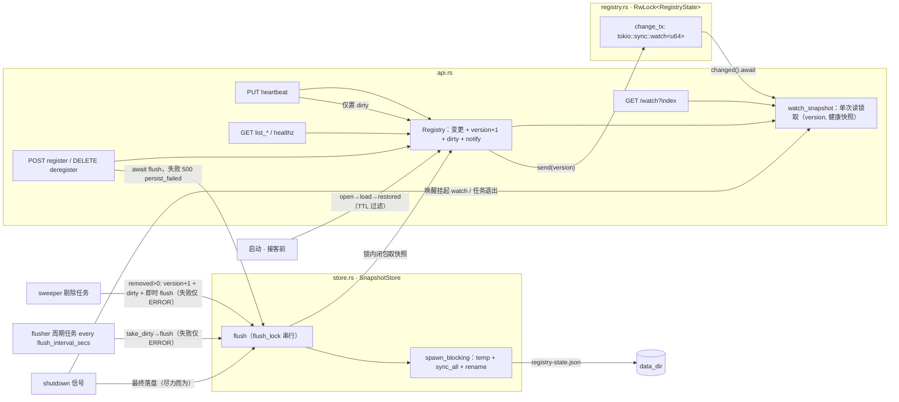

# 架构设计：velox-registry v0.2「状态持久化 + watch 推送」（registry 侧）

> feature slug: `registry-persistence-watch`
> 上游：`docs/specs/registry-persistence-watch/01-requirements.md`（FR-1…FR-11 / NFR-1…NFR-6 / AC-1…AC-14 / B-1…B-12 / Q1…Q9，冻结版）
> 关口评审：`docs/specs/registry-persistence-watch/01-requirements-review.md`（GATE1 PASS，QA-1…QA-6 已在本文第 9 节逐条定案）
> 范围红线：仅改 `velox-registry/` 及文档；`velox-mesh` / `velox-config` / `velox-demo` 零改动；watch 仅 registry 侧 HTTP+JSON 长轮询；单机落盘，无分布式一致性。

## 1. 需求引用（FR/AC 编号映射）

| FR | 本文档落位 |
|----|-----------|
| FR-1 结构变更即时写穿落盘（全量快照、绝对时间戳） | §4.2 `SnapshotStore`、§4.3 Registry 挂接、§5 文件格式 |
| FR-2 心跳：内存即时 + 脏标记周期刷盘 | §4.3 `dirty` 标记、§4.4 刷盘任务、§5（写入时机） |
| FR-3 重启恢复、`instance_id` 不变、接客前完成 | §4.4 装配时序（main.rs 步骤 3 在 bind 之前） |
| FR-4 恢复按绝对时间 TTL 判定、超时不恢复 | §4.3 `Registry::restored`、§5 恢复流程 |
| FR-5 `[persistence]` 配置节 | §4.5 config.rs |
| FR-6 恢复失败降级：损坏跳过不阻断 | §4.2 `LoadOutcome::Corrupted`、§5 |
| FR-7 落盘失败：内存优先 + ERROR；结构变更 5xx | §4.6 error.rs（500 `persist_failed`）、§4.3 挂接点 |
| FR-8 watch 端点（长轮询 + 全局版本号） | §4.3 版本号、§4.7 api.rs watch handler |
| FR-9 变更触发范围 | §4.3 版本递增规则表 |
| FR-10 timeout 校验 | §4.7 参数校验、§4.6 `invalid_parameter` |
| FR-11 v0.1 兼容 | §4.6（AppError 保持 Registry 变体语义）、§4.7（既有路由不动）、§6.3 回归测试 |

| AC | 覆盖手段（§6 测试策略） |
|----|------------------------|
| AC-1/AC-2 重启恢复 + 同 id 心跳 | `tests/persistence.rs::restart_recovers_instances` |
| AC-3 刷盘周期 + 心跳不等待落盘 | `tests/persistence.rs::heartbeat_flush_is_periodic` + 设计保证（§4.3 心跳路径无 flush await） |
| AC-4 超 TTL 不恢复 | `Registry::restored` 单测 + 集成 |
| AC-5 默认值/关闭/非法值 | `tests/config.rs` + `tests/persistence.rs::disabled_persists_nothing` |
| AC-6 损坏跳过 | `tests/persistence.rs::corrupted_snapshot_skipped` |
| AC-7 落盘失败内存优先 | `tests/persistence.rs::readonly_dir_register_semantics`（只读目录注入） |
| AC-8 watch 唤醒 ≤1s / 旧 index 立即返回 | `tests/watch.rs` |
| AC-9 关停唤醒挂起 watch | `tests/watch.rs::shutdown_wakes_watchers` |
| AC-10 剔除触发 / 查询不触发 | `tests/watch.rs` |
| AC-11 timeout 非法 400 / 默认 30 | `tests/watch.rs` + 参数解析单测 |
| AC-12 v0.1 回归 + mesh 零改动 | 既有 `api.rs` 单测保持 + `tests/compat.rs` + demo 手工 e2e |
| AC-13 性能 ≤2× 基线 | 可选压测脚本（§6.4，非 CI 门槛） |
| AC-14 原子写 | 代码审查点 + tmp 残留文件测试 + demo kill -9 注入（§6.4） |

## 2. 现状分析（相关模块与既有模式）

### 2.1 velox-registry v0.1（develop @ dff2006）

| 文件 | 现状 | 与本 feature 的关系 |
|------|------|--------------------|
| `src/registry.rs` | `RwLock<HashMap<String, HashMap<Uuid, Instance>>>`；`Instance.last_heartbeat: Instant`；register/heartbeat/deregister/sweep_expired/list_* 全部锁内纯内存 | 本期改造核心：状态加版本号、挂接落盘与变更广播 |
| `src/api.rs` | 6 条 v0.1 路由；handler 薄（协议转换）；`tower::ServiceExt::oneshot` 单测 | 新增 watch 路由；v0.1 路由与断言不动 |
| `src/config.rs` | TOML + env 覆盖（`VELOX_REGISTRY__<SECTION>__<FIELD>`）+ `serde(default)`；无集中 validate（env 解析失败即 fail fast） | 新增 `[persistence]` 节；引入集中 `validate()`（参照 velox-config） |
| `src/error.rs` | `AppError(RegistryError)` → 404 `service_not_found`/`instance_not_found`，统一 `{"code","message"}` | 扩展变体：落盘失败、非法参数 |
| `src/main.rs` | 装配：config → tracing → Registry → shutdown watch 通道 → sweeper（select 优雅退出）→ bind → serve | 插入启动恢复、刷盘任务、关停最终落盘 |
| `tests/` | **不存在**（NFR-6 要求新建） | 新建集成测试目录 |

### 2.2 可复用的 velox-config 既有模式（`velox-config/src/store.rs`）

- **并发纪律**（QA-4 采纳）：`std::sync::RwLock` 锁内纯内存；`tokio::sync::Mutex`（flush_lock）串行化落盘；**快照必须在 flush_lock 锁内读取**，保证并发写不把文件回退到旧快照；真实文件写入走 `spawn_blocking`。
- **恢复时序**（FR-3 采纳）：启动期一次性同步 IO，发生在 HTTP 接客之前；损坏文件整文件跳过 + WARN，不阻断启动。
- **写穿失败语义**（FR-7/Q3 采纳）：内存已更新但落盘失败返回 Err（由 HTTP 层映射 5xx）。
- **QA-1 修正**：velox-config 现状为 `std::fs::write` 直接覆盖，**没有** temp+rename 原子写。本期复用的是上述「并发纪律 / 恢复时序 / 损坏跳过」模式；**原子写（NFR-5）为本期新增**，不在 velox-config 中补（范围外），仅 registry 实现。

### 2.3 依赖盘点（NFR-6：预期零新增）

- 长轮询挂起：`tokio::sync::watch`（已在用，main.rs shutdown / mesh discovery 同款）；`tokio::time::timeout/sleep_until`。
- 原子写：`std::fs` temp + `rename`（无新依赖）。
- 序列化：serde/serde_json；UUID：uuid（`serde` feature 已开）。
- 结论：**无需新增任何 crate，全部取自 `[workspace.dependencies]`**。

## 3. 方案总览

推荐方案一句话：**「全量快照单文件 + 写穿/脏刷双通道落盘 + 锁内版本号 + tokio watch 长轮询」**——持久化与变更感知共用同一把领域锁保证一致性，落盘沿用 velox-config 串行纪律并新增原子替换。

### 3.1 数据流



### 3.2 关键不变量

1. **版本号与状态原子可读**：`version` 与实例表同处一把 `RwLock`（`RegistryState`），watch 一次读锁同时取得 `(version, 快照)`，杜绝「版本新、快照旧」错配（B-11）。
2. **文件不回退**（QA-4）：所有落盘经 `SnapshotStore::flush` 串行（tokio Mutex），快照在该锁内读取；内存修改先于落盘被写锁串行化提交，后执行的 flush 读到的状态永不早于先执行的 flush。
3. **锁内无 IO、无 await**（NFR-1）：领域锁临界区只做内存操作；落盘 IO 全部在锁外 `spawn_blocking`。
4. **注册成功 ⇒ 已落盘**（Q3/QA-6）：register/deregister 在响应前 await flush，失败返回 500；心跳永不因落盘报错。

## 4. 模块与接口设计

### 4.1 模块划分（全部在 `velox-registry/src/`）

| 模块 | 职责 | 改动性质 |
|------|------|---------|
| `registry.rs` | 领域模型：实例表 + **版本号** + **脏标记** + **变更广播通道**；快照 DTO 转换（Instant↔epoch）；恢复 TTL 过滤 | 修改 |
| `store.rs`（新建） | 快照文件 IO：原子写、启动恢复读取、flush 串行化；**持有文件格式 DTO**（`RegistrySnapshot`/`PersistedInstance`） | 新建 |
| `api.rs` | 路由；watch 长轮询 handler；`AppState`（registry + 可选 store + shutdown rx） | 修改 |
| `config.rs` | `[persistence]` 配置节 + env 覆盖 + 集中 validate | 修改 |
| `error.rs` | `AppError` 扩展（persist/invalid_param），保持既有映射 | 修改 |
| `main.rs` | 装配：恢复 → sweeper（含剔除后 flush）→ flusher → bind → serve → 关停最终落盘 | 修改 |

> 不新建 `watch.rs`：变更通道仅是 Registry 的一个字段 + api 里的一个 handler，无独立状态，拆模块无收益。

### 4.2 `store.rs`（新建）——快照文件 IO

```rust
/// 文件格式 DTO（本模块持有文件契约；format_version 预留演进，解析不识别即按损坏跳过）
#[derive(Serialize, Deserialize)]
pub struct RegistrySnapshot {
    pub format_version: u32,                       // 恒为 1
    pub saved_at_epoch: u64,                       // 信息性字段，恢复逻辑不依赖
    pub services: BTreeMap<String, Vec<PersistedInstance>>,   // 服务名排序；实例按 (address, port, id) 排序，落盘字节稳定
}
#[derive(Serialize, Deserialize)]
pub struct PersistedInstance {
    pub id: Uuid,
    pub address: String,
    pub port: u16,
    pub metadata: HashMap<String, String>,
    pub last_heartbeat_epoch: u64,                 // 绝对时间戳（FR-1）
}

pub enum LoadOutcome {
    Restored(RegistrySnapshot),   // 合法快照
    Corrupted(String),            // JSON 非法 / 字段缺失 / format_version != 1（FR-6：整文件跳过）
    Missing,                      // 首次启动或 enabled=false（INFO 即可）
}

pub struct SnapshotStore { data_dir: PathBuf, flush_lock: tokio::sync::Mutex<()> }

impl SnapshotStore {
    /// create_dir_all（失败 → Err 含路径，B-3 fail fast）；尽力清理残留 `registry-state.json.tmp`
    pub fn open(data_dir: impl Into<PathBuf>) -> anyhow::Result<Self>;

    /// 同步读取，仅启动期调用（不在请求路径）
    pub fn load(&self) -> LoadOutcome;

    /// 串行化落盘。`snapshot_of` 在 flush_lock **锁内**调用（纯内存闭包，QA-4 时序纪律），
    /// 之后 spawn_blocking 执行：写 `{file}.tmp` → `sync_all()` → `rename` 为 `{file}`（NFR-5 原子替换）
    pub async fn flush<F>(&self, snapshot_of: F) -> Result<(), StoreError>
    where F: FnOnce() -> RegistrySnapshot;
}

pub enum StoreError { Io(std::io::Error), Json(serde_json::Error) }   // thiserror
```

要点定案：
- **单文件** `{data_dir}/registry-state.json`（Q6 默认方案采纳，与 velox-config `data_dir = "./data"` 约定共目录不冲突——文件名不同；B-10 限制「两个 registry 实例」不得共目录，写文档约束，不加代码防御）。
- **原子写 = temp + sync_all + rename**：temp 用固定名 `registry-state.json.tmp`（flush_lock 已串行化单进程写入，固定名避免 tmp 堆积；启动 open 时清理崩溃残留）。`sync_all()` 为超出需求最低线的加固：kill -9 场景 rename 已足够（AC-14），sync_all 额外覆盖掉电丢页缓存，代价为每 5s 一次 fsync，可忽略。
- **损坏判定**（FR-6）：读文件失败、JSON 解析失败、必填字段缺失（serde 默认行为即报错）、`format_version != 1` —— 统一返回 `Corrupted(reason)`，调用方 WARN 后按空注册表启动；**不做部分恢复**。
- 快照克隆（约数百 KB @ 1000 实例）在读锁内完成（与 velox-config `.cloned()` 同款），写入本身在锁外阻塞线程池。

### 4.3 `registry.rs`（修改）——领域模型

```rust
struct RegistryState {
    version: u64,                                              // 全局变更版本号，从 0 起（FR-8：不持久化，重启归零）
    services: HashMap<String, HashMap<Uuid, Instance>>,        // v0.1 原样
}
struct Instance {
    address: String, port: u16,
    metadata: HashMap<String, String>,
    last_heartbeat: Instant,                                   // 内存保持 Instant（运行期 TTL 语义与 v0.1 逐字节一致）
}

pub struct RestoreStats { services: usize, instances: usize, dropped_expired: usize }

pub struct Registry {
    state: RwLock<RegistryState>,
    ttl: Duration,
    dirty: AtomicBool,                                         // true = 内存新于文件（FR-2）
    change_tx: tokio::sync::watch::Sender<u64>,                // watch::channel(0)；send 失败（无接收者）忽略
}

impl Registry {
    pub fn new(ttl: Duration) -> Self;
    /// 启动恢复：now_epoch 下按 `now_epoch - last_heartbeat_epoch > ttl_secs` 丢弃超时实例（FR-4），
    /// 空/缺失服务条目不建；恢复不置 dirty（文件本已匹配内存）。仅恢复期同步调用。
    pub fn restored(ttl: Duration, snapshot: RegistrySnapshot, now_epoch: u64) -> (Self, RestoreStats);

    pub fn register(&self, service: &str, address: String, port: u16,
                    metadata: HashMap<String, String>) -> InstanceView;          // +version/dirty/notify
    pub fn heartbeat(&self, service: &str, id: Uuid) -> Result<(), RegistryError>; // 置 dirty；仅「复活」时 +version/notify
    pub fn deregister(&self, service: &str, id: Uuid) -> Result<(), RegistryError>; // +version/dirty/notify
    pub fn sweep_expired(&self) -> usize;                                        // removed>0 时整体 +version×1 / dirty / notify

    // v0.1 查询接口签名与语义不变（FR-11）
    pub fn list_services(&self) -> Vec<String>;
    pub fn list_instances(&self, service: &str, only_healthy: bool) -> Result<Vec<InstanceView>, RegistryError>;

    // watch 支撑
    pub fn version(&self) -> u64;
    pub fn subscribe(&self) -> tokio::sync::watch::Receiver<u64>;
    /// 单次读锁同时取 (version, 各服务健康实例列表)；服务名 BTreeMap 排序，实例按 (address, port) 排序，
    /// 无健康实例的服务不出现在 map 中
    pub fn watch_snapshot(&self) -> (u64, BTreeMap<String, Vec<InstanceView>>);
    /// 持久化全量快照（含未健康未剔除实例；恢复期由 FR-4 二次过滤）
    pub fn snapshot(&self) -> RegistrySnapshot;      // 内含 Instant→epoch 换算 + saved_at_epoch=now
    /// 原子取走脏标记；true 则调用方执行 flush（FR-2）
    pub fn take_dirty(&self) -> bool;
}
```

**版本号递增规则**（FR-9 + QA-2 + QA-3 定案，均在写锁内完成、与状态变更原子）：

| 事件 | version | 说明 |
|------|---------|------|
| 注册成功 | +1 | |
| 主动注销 | +1 | |
| sweep 一批移除 k≥1 个实例 | +1 | **批次整体 +1**（QA-2 定案；watch 本就全量快照 + 通道合并唤醒，客户端只关心「变了」，无需按实例计数） |
| 心跳使 unhealthy→healthy（「复活」） | +1 | QA-3 定案：写锁内一次 `elapsed > ttl` 判断，迟到心跳翻回健康时唤醒 watch，避免快照内容变化但客户端等满 timeout |
| 心跳（健康内续约） | 不 +1 | 内容无变化；仅置 dirty |
| 健康 healthy→unhealthy 翻转（TTL 到点、sweep 前） | 不 +1 | FR-9.4 定案：无离散事件可挂接；收敛延迟上限 = timeout_secs（超时响应本就携带当前快照），文档明示为已知取舍 |
| 查询（list/healthz/watch 自身） | 不 +1 | FR-9 |

**时间换算**（放在 registry.rs，DTO 只携带 u64）：

```rust
fn now_epoch() -> u64 { SystemTime::now().duration_since(UNIX_EPOCH).unwrap_or_default().as_secs() }
// 快照：now_epoch().saturating_sub(instant.elapsed().as_secs())
// 恢复：age = now_epoch.saturating_sub(epoch)；先按 age > ttl 丢弃（FR-4）；
//       存活者 last_heartbeat = Instant::now().checked_sub(age)
//         .unwrap_or_else(|| Instant::now())   // age 超过进程运行时长的钳位兜底：
//         此时实例已通过 TTL 过滤，钳位只影响下次到期判定的秒级偏差，下次心跳即复位。
//       ⚠️ 实现必须用 checked_sub，禁止直接 `Instant::now() - Duration`（age 大时 panic）。
```

时钟回拨（B-9）为已知限制，不做专门防御，README 记录。

### 4.4 `main.rs`（修改）——装配时序（FR-3/NFR-2/B-8）

```
 1. Config::load(args)                      // validate 在 load 内完成，fail fast（AC-5）
 2. tracing init（现状不动）
 3. 持久化初始化（接客之前，一次性同步 IO）：
      enabled=true  → SnapshotStore::open(data_dir)          // 目录不可建 → 启动失败含路径（B-3）
                    → store.load()                            // Corrupted → WARN（含路径+原因）按空表启动（FR-6）
                    → Registry::restored(...)                 // FR-4 TTL 过滤
                    → INFO：enabled/data_dir/flush_interval/恢复服务数/实例数/丢弃数（NFR-4）
      enabled=false → Registry::new(...)，store=None        // 与 v0.1 完全一致（FR-5）
 4. 建 shutdown watch 通道（现状）
 5. sweeper 任务（现状 select 退出）+ 追加：removed>0 →
      version/notify/dirty 已在 sweep_expired 内 → 即时 store.flush（失败仅 ERROR，后台任务不外发，FR-7）
 6. flusher 任务（仅 enabled）：interval(flush_interval_secs)，select 退出；
      每 tick：registry.take_dirty() → store.flush（失败仅 ERROR 日志，不重试退避——下个周期自然重试）
 7. bind TcpListener（恢复完成后才接客，FR-3）
 8. axum::serve(...).with_graceful_shutdown(shutdown_signal)   // shutdown_tx.send(true) → 挂起 watch 全部唤醒（AC-9）
 9. serve 返回后：await sweeper/flusher 退出；最终落盘一次
      （B-8 尽力而为：store.flush，失败仅日志；与 flusher 最后一 tick 经 flush_lock 串行，幂等无害）
```

### 4.5 `config.rs`（修改）——`[persistence]` 配置节

```rust
#[derive(Debug, Clone, Deserialize)]
pub struct PersistenceConfig {
    pub enabled: bool,             // Default: true   （Q1 定案：默认开启）
    pub data_dir: String,          // Default: "./data"（Q6 定案）
    pub flush_interval_secs: u64,  // Default: 5      （FR-2）
}
```

- env 覆盖：`VELOX_REGISTRY__PERSISTENCE__ENABLED`（仅接受 `true`/`false`，错误含实际值）、`...__DATA_DIR`、`...__FLUSH_INTERVAL_SECS`。
- `bool` 的 `serde(default)` 只会给 `false`，故 `PersistenceConfig` 手写 `Default`（enabled=true）。
- 引入集中 `Config::validate()`（参照 velox-config，load 末尾调用），规则（均为 fail fast，错误含配置项名与实际值，AC-5）：
  1. `persistence.flush_interval_secs == 0` → 拒绝（FR-5）；
  2. `persistence.flush_interval_secs >= registry.heartbeat_ttl_secs` → **拒绝**（QA-5 定案选「校验」而非部署约束：保证 FR-2「健康实例恢复后不被误判」成为确定性不变量——落盘时间戳最大陈旧度 = flush_interval，必须 < ttl 才有 `恢复后健康实例必存活` 的硬保证；默认 5 < 30 满足）；
  3. `persistence.data_dir` 为空 → 拒绝。
- 同步更新 `config/velox-registry.toml`（带注释的 `[persistence]` 节）与 README 配置表（NFR-6）。

### 4.6 `error.rs`（修改）——错误变体（QA-6 定案）

```rust
pub enum AppError {
    Registry(RegistryError),   // 既有：404 service_not_found / instance_not_found，映射不变（FR-11）
    Persist(String),           // 500 + {"code":"persist_failed","message":"registry state persist failed"}
                               // message 不含内部路径/IO 细节；细节由调用点 error! 日志外显（FR-7/NFR-4）
    InvalidParam(String),      // 400 + {"code":"invalid_parameter","message":"timeout_secs=0（要求 1..=300）"}
}
```

映射表：

| 变体 | 状态码 | code | 触发点 |
|------|--------|------|--------|
| `Registry(InstanceNotFound)` | 404 | `instance_not_found` | 心跳/注销（v0.1 不变） |
| `Registry(ServiceNotFound)` | 404 | `service_not_found` | 列表/心跳/注销（v0.1 不变） |
| `Persist` | 500 | `persist_failed` | register/deregister 的 await flush 失败（Q3/QA-6） |
| `InvalidParam` | 400 | `invalid_parameter` | watch 参数校验（FR-10） |

落盘失败时的 ERROR 日志在 **api handler / sweeper / flusher / 关停路径各自记录**（`error!(error = %e, path = …, "persist failed")`），错误细节不进 HTTP 响应。

### 4.7 `api.rs`（修改）——watch 端点与 AppState

```rust
pub struct AppState {
    pub registry: Arc<Registry>,
    pub store: Option<Arc<SnapshotStore>>,          // enabled=false 时 None
    pub shutdown: tokio::sync::watch::Receiver<bool>, // 复用 main 的关停广播
}
pub fn router(state: Arc<AppState>) -> Router;      // 内部签名变化，外部 HTTP API 不变

// 新增路由（追加，不动既有 6 条）：
// GET /api/v1/registry/watch?index={u64}&timeout_secs={u64}
#[derive(Deserialize)] struct WatchQuery { index: Option<u64>, timeout_secs: Option<u64> }
```

watch handler 定案逻辑（FR-8/Q4/Q5/B-7）：

1. 校验：`timeout_secs` 缺省 30（常量 `WATCH_TIMEOUT_DEFAULT_SECS=30`）；`0` 或 `>300`（`WATCH_TIMEOUT_MAX_SECS=300`）→ `AppError::InvalidParam`（400，AC-11）。`index` 缺省 0（等价「从未见过」，因 0 ≤ 任何版本，走立即返回分支）。
2. 先 `subscribe()` 再 `watch_snapshot()`（订阅先于读，杜绝「读后变、通道漏通知」窗口）。
3. `index != 当前 version` → **立即返回**当前 `(version, services)`（覆盖 index 过旧与 B-7 index 过大两种情况，后者以响应内新 index 纠正客户端）。
4. `index == version` → `select!` 三路等待：
   - `rx.changed()`：`borrow_and_update()` 后新 version != index → 返回最新 `(version, services)`（长轮询唤醒，通道即时 notify，满足 AC-8 的 1s 内）；若版本未越过 index（理论不发生，防御性 continue）。
   - `shutdown.changed()`：优雅关停 → 立即返回当前快照（200），连接随服务关闭（AC-9「唤醒/断开」）。**必须**唤醒而非等超时：axum graceful shutdown 会等待在途连接完成，不唤醒则关停被挂起请求拖到 timeout_secs。
   - `sleep_until(deadline)`：超时 → 返回当前 `(version, services)`，HTTP 200（FR-8）。
5. 响应体：`{"index": u64, "services": { "<svc>": [ InstanceView... ] }}`，仅健康实例，复用 `InstanceView` 序列化（与列表端点同构，消费方零学习成本）；无健康实例的服务不出现在 map。
6. 无服务端订阅会话（B-6）：每次请求独立，断开即弃，客户端重携原 index 重入即可。

**心跳/注册/注销挂接**：`register`/`deregister` handler 在领域变更后 `state.persist_after_change().await?`（`None → Ok(())`；`Some → store.flush(|| registry.snapshot())`，失败 → 记 ERROR + `AppError::Persist`）。`heartbeat` handler 不 flush（registry.heartbeat 内部仅置 dirty），故心跳永不因落盘失败报错（FR-2/Q3）。

### 4.8 并发模型小结（NFR-1/QA-4/B-11）

| 锁 | 保护对象 | 纪律 |
|----|---------|------|
| `std::sync::RwLock<RegistryState>` | version + 实例表 | 临界区纯内存（读快照的克隆也在锁内，数百 KB 量级可接受）；无 IO、无 await |
| `tokio::sync::watch::Sender<u64>` | 变更广播 | send 非阻塞，写锁内调用安全；无接收者时错误忽略 |
| `AtomicBool` | 脏标记 | 仅 take（swap false）与 set，无竞争窗口问题（多余一次 flush 无害） |
| `tokio::sync::Mutex<()>`（SnapshotStore.flush_lock） | 落盘串行 | **锁内**读快照闭包 → 锁外 spawn_blocking 写文件；结构写穿、sweep flush、周期 flush、关停 flush 四路共用 |

死锁评估：四把锁/通道互不嵌套（领域锁内不发 flush、flush_lock 内不取领域写锁——闭包只取读锁），无环。

## 5. 数据模型与迁移

### 5.1 落盘文件（`{data_dir}/registry-state.json`）

```json
{
  "format_version": 1,
  "saved_at_epoch": 1737000000,
  "services": {
    "svc-a": [
      {
        "id": "0f8e…",
        "address": "172.17.0.2",
        "port": 9000,
        "metadata": { "version": "0.1.0" },
        "last_heartbeat_epoch": 1736999995
      }
    ]
  }
}
```

写入时机汇总（FR-1/FR-2/Q2 定案）：

| 路径 | 时机 | 失败语义 |
|------|------|---------|
| register / deregister | 响应前 await flush（写穿） | 500 `persist_failed`（Q3） |
| sweep 移除>0 | sweeper 任务即时 flush | ERROR 日志（后台） |
| heartbeat | 仅置 dirty，由 flusher 每 `flush_interval_secs` 合并刷盘 | ERROR 日志（FR-2：崩溃丢最近一个刷盘周期的心跳新鲜度，不丢实例存在性；`flush_interval < ttl` 已由配置校验硬保证） |
| 优雅关停 | 最终 flush 一次（尽力而为） | 日志（B-8） |
| `enabled=false` | 全部不发生 | —（v0.1 等价） |

### 5.2 恢复流程（FR-3/FR-4/FR-6，全部在接客前）

```
open（建目录 fail fast / 清 tmp） → load
  ├─ Missing            → 空表启动（INFO）
  ├─ Corrupted(reason)  → 空表启动（WARN：文件路径 + 原因）
  └─ Restored(snapshot) → 逐实例：age = now_epoch - last_heartbeat_epoch
                            age > ttl → 丢弃（WARN + dropped_expired 计数，FR-4/Q9）
                          → 构造 Registry（restored），返回 RestoreStats → INFO（NFR-4）
```

### 5.3 迁移与兼容

- v0.1 → v0.2：无存量落盘数据，首启 `Missing → 空表`，无迁移动作；`enabled=false` 可完全回到 v0.1 行为（逃生门）。
- v0.2 → v0.1 回滚：旧二进制忽略 data 目录（无害增量，Q1 风险已记录）。
- 格式演进：`format_version` 预留；不识别 → 按损坏跳过；文件格式不对外承诺兼容（范围外 §6.8），无需升 API 版本。

## 6. 测试策略建议（供 DA/TA 参考）

### 6.1 单元测试（模块内 `#[cfg(test)]`）

- `registry.rs`：版本递增规则全表（§4.3）、sweep 批次 +1、复活心跳 +1、查询不 +1；`restored` 的 TTL 过滤（构造固定 epoch）；Instant↔epoch 换算往返与 `checked_sub` 钳位；dirty 取走语义。
- `store.rs`：save/load 往返；损坏 JSON / 缺字段 / `format_version=99` → `Corrupted`；残留 `.tmp` 清理；并发 flush 文件不回退（多任务竞争 flush 断言最终文件含最后状态，QA-4）。
- `config.rs`：三分支（默认 / `flush_interval_secs=0` 拒绝 / `flush >= ttl` 拒绝）、env 覆盖含 ENABLED 非法值。
- `api.rs`：既有 v0.1 单测**原样保留**（AC-12 兼容断言）；timeout 参数解析（缺省 30，AC-11 默认值断言走这里，集成测试不等 30s）。

### 6.2 集成测试（新建 `velox-registry/tests/`，oneshot/router 级，不起真端口）

| 文件 | 覆盖 |
|------|------|
| `tests/persistence.rs` | 重启往返（写→drop→同 store 重 open→字段一致，AC-1）；恢复后同 id 心跳 200（AC-2）；超 TTL 丢弃 + 计数（AC-4）；损坏文件跳过 + healthz 200（AC-6）；`enabled=false` 不产生文件（AC-5）；只读目录注册 → 500 `persist_failed` 且内存可查、进程不退（AC-7）；周期刷盘 mtimer 更新 + 心跳响应不等刷盘（AC-3） |
| `tests/watch.rs` | index 落后立即返回（AC-8b）；挂起中被注册唤醒 <1s 且 index+1 含新实例（AC-8a）；超时返回当前快照 200；timeout=0/301 → 400 `invalid_parameter`（AC-11）；deregister 唤醒且快照不含该实例（AC-10a）；纯查询后 index 不变（AC-10b）；shutdown 通道 send(true) → 挂起请求立即完成（AC-9）；B-7 index 过大立即返回并纠正 |
| `tests/compat.rs` | v0.1 六端点全签名回归（含 404 code、`?healthy=true`、`{"ok":true}`）；模拟 mesh 拉取序列（list services → instances?healthy=true）在持久化开启下照常工作（AC-12） |

### 6.3 构建/测试命令（CI 门槛）

```bash
scripts/test.sh                 # 完整门槛：fmt + clippy(-D warnings) + build + test（全绿方可合入）
scripts/test.sh --lint          # 静态检查
cargo test -p velox-registry    # 本 crate 全部单测 + 集成测试
```

### 6.4 手工/脚本级验收（非 CI 门槛）

- AC-1/AC-12/AC-14 e2e：demo 环境（provider + registry）跑通后 `kill -9` registry 再重启：provider 心跳无缝续上、mesh 不改代码继续拉取；写盘中途 kill 注入（循环 kill + 校验文件 JSON 合法），验证 rename 原子性。
- AC-13 压测：1000 实例 × 5s 心跳脚本，对比开/关持久化的注册/心跳/查询 P99 ≤ 2×（可复用 demo 脚本，验收阶段执行）。

## 7. 备选方案与取舍

| 决策点 | 备选 | 不选理由 |
|--------|------|---------|
| 内存时间表示 | B1：内存只存 epoch（u64，单时间源） | 运行期 TTL 从单调 `Instant` 改为墙钟，进程内 NTP 跳变影响健康判定，偏离 v0.1 语义；`Instant::now() - Duration` 恢复路径还有 panic 陷阱。选 A（Instant + 边界换算）：运行期语义与 v0.1 完全一致，墙钟依赖被限制在恢复边界（B-9 已接受） |
| 落盘形态 | B2：每服务一个文件（仿 velox-config namespace） | sweep 批次跨文件、恢复需目录扫描与合并、≤100 服务无收益；velox-config 的多文件源于「namespace 即文件名」的写入模型，registry 是单一全量状态 |
|  | B3：追加式 WAL + 压缩 | 需要段轮转/压缩/重放协议，规模假设（千实例、数百 KB 快照）下全量重写每 5s 一次的 IO 成本可忽略，复杂度不成比例 |
|  | B4：SQLite/sled 嵌入式存储 | 新增依赖（违反 NFR-6 零新增预期）、运维面扩大，收益为零 |
| 心跳落盘 | B5：逐次写穿 | 1000 实例 × 每 5s = ≥200 次全量写/秒，IO 不可接受（FR-2 已论证）；仅在 ≤100 实例保守场景可辩护，不做默认 |
| watch 机制 | B6：SSE / WebSocket / gRPC stream | FR-8 明确排除（push 留待 v0.3+，architecture.md §3.3） |
|  | B7：短轮询 + ETag/If-None-Match | 无法满足 AC-8「变更后 1s 内返回」的唤醒语义，把负担转嫁给客户端高频轮询 |
| 版本号存储 | B8：`AtomicU64` 置于锁外 | (version, 状态) 读取不再原子，需额外顺序协调；置入 `RegistryState` 一把锁内天然解决（B-11） |
|  | B9：持久化版本号 | FR-8 明确重启归零，避免「客户端 index > 服务端」语义混乱 |
| watch 粒度 | B10：per-service 端点 | Q4 定案：mesh 类消费方本就全量订阅；真需求出现再加（端点形状已预留，追加路由即可） |
| flush 快照获取 | B11：flush_lock 外克隆快照再传入 | 慢 flush 可携旧快照覆盖新文件（velox-config store.rs 注释已论证）；选闭包在锁内读取（QA-4） |
| 持久化失败语义 | B12：返回 200 + 告警头 | 破坏「注册成功 ⇒ 已落盘」强语义，provider 退避重试自愈路径失效；Q3 定案 5xx |

## 8. 风险与工作量评估

| # | 风险 | 等级 | 缓解 |
|---|------|------|------|
| R1 | 挂起 watch 连接拖住 axum graceful shutdown（等待在途连接完成） | 高→已消解 | handler `select!` 挂 shutdown 通道，关停即唤醒（AC-9 集成测试覆盖） |
| R2 | Instant↔epoch 换算的 `checked_sub` 恐慌/钳位偏差 | 中 | §4.3 已给安全实现定案；单测覆盖极端 epoch；钳位偏差有界且下次心跳复位 |
| R3 | 时钟回拨（B-9）导致恢复判定偏差 | 低 | 单机低概率运维事件，文档明示，不防御（范围共识） |
| R4 | 读锁内克隆快照的延迟 @1000 实例 | 低 | 数百 KB 克隆为微秒~毫秒级；NFR-3 有 2× 预算，AC-13 压测验证 |
| R5 | 双 registry 共享 data_dir 互踩（B-10） | 低 | 代码不防御，部署约束写入 README（单实例独占） |
| R6 | `flush >= ttl` 配置破坏恢复正确性 | 已消解 | config validate 硬拒绝（§4.5 规则 2） |
| R7 | 长轮询经过反向代理被空闲超时切断 | 低 | 默认 30s 低于常见 60s 代理空闲阈值；文档提示 |
| R8 | 多路 flush（写穿/周期/关停）竞态写文件 | 已消解 | flush_lock 串行 + 锁内读快照（不变量 2），并发测试覆盖 |

**工作量**：**M**。估算：store.rs 新建 ~200 行、registry.rs +~150、api.rs +~90、config.rs +~45、error.rs +~25、main.rs +~55、集成测试 ~450 行、文档同步（README/config toml/subsystems.md/architecture.md §7 per Q8）。建议实施顺序：store.rs → registry.rs → config.rs → error.rs → api.rs → main.rs → tests → 文档。

## 9. 对待确认问题的处置

| 问题 | 处置 | 落位 |
|------|------|------|
| Q1 持久化默认开启 | **采纳默认**：`enabled = true`，关闭为排障逃生门 | §4.5 |
| Q2 心跳落盘策略 | **采纳默认**：脏标记 + 周期刷盘（默认 5s） | §4.3/§4.4/§5.1 |
| Q3 落盘失败 HTTP 语义 | **采纳默认并具体化**：register/deregister → 500 + `persist_failed`（QA-6）；sweep 后台仅日志；心跳永不报错 | §4.6/§4.7 |
| Q4 watch 端点形态 | **采纳默认**：全局单端点 `GET /api/v1/registry/watch`，响应 = index + 各服务健康实例列表 | §4.7 |
| Q5 watch 超时 | **采纳默认**：缺省 30s、上限 300s、非法 400 | §4.7 |
| Q6 目录与文件布局 | **采纳默认**：`./data` + 单文件 `registry-state.json` | §4.2/§5.1 |
| Q7 healthz 是否暴露状态 | **采纳默认**：不变（FR-11 优先），观测靠 NFR-4 启动/运行日志 | §4.4/§4.7 |
| Q8 architecture.md §7 与 subsystems.md 演进路线不一致 | **采纳默认**：以 subsystems.md 为准，交付时同步 architecture.md §7 v0.2 行（文档 PR，列入实施顺序） | §8 |
| Q9 恢复时超 TTL 实例 | **采纳默认**：直接丢弃 + WARN 计数 | §4.3/§5.2 |

**QA-1…QA-6 逐条吸收**：

| QA | 处置 |
|----|------|
| QA-1 「原子写系复用」措辞失实 | 已修正：§2.2 明确原子写为**本期新增**（temp+sync_all+rename），复用的仅是并发纪律/恢复时序/损坏跳过模式 |
| QA-2 版本号批量语义 | 定案：**单次变更批次 +1**（register/deregister/一次 sweep/复活心跳各 +1）；§4.3 规则表 + §6.1 单测覆盖；AC-8 断言前提为单实例注册 |
| QA-3 unhealthy→healthy 翻转 | 定案：**复活心跳触发 +1 并唤醒 watch**（写锁内一次比较，代价可忽略）；healthy→unhealthy 不触发，收敛延迟上限 timeout_secs 为已知取舍（§4.3 规则表） |
| QA-4 并发落盘时序 | 定案：沿用 velox-config 纪律并写成硬性设计要求——flush_lock 串行 + **锁内**读快照（不变量 2 / §4.8 / R8，含并发测试） |
| QA-5 含糊表述量化 | 「丢数据窗口」= 结构变更响应返回前完成落盘、心跳 ≤ flush_interval_secs（默认 5s）；「显著小于」→ config validate 硬校验 `flush_interval_secs < heartbeat_ttl_secs`；「亚秒级」恢复 → 千实例全量快照读+解析为毫秒级 IO（量级论证）；「写放大风暴」→ 每 `flush_interval_secs` 至多一次全量写，单次数百 KB |
| QA-6 落盘失败具体语义 | 定案：**500 + `persist_failed`**，响应 message 不含内部细节，ERROR 日志外显；纳入 error.rs 变体清单（§4.6） |
